class: center, middle
## Please pick up your **name card** from the front
  
## **office hours**: Thursdays, 1:00-2:00 pm 
## Basement, Room 003, **Linguistics Building**

---
## **Midterm: Morphological Analysis, Hebrew**
 

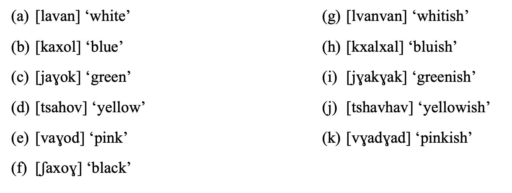

 
--

if **red** is [adom], what is **reddish**?  

--

(l) [ʃaxaɣxaɣ] 'blackish'

  

--

**reddish** is actually [admumi]  

--

### never be arrogant towards other people's languages

---
## **Meaning in Language**
 
.pull-left[
- so far this semester, we've focused on the form or structure of language  
- **Morphology**: study of the <u>structure</u> of words
  - morphemes, morphological processes, morphological trees  
- **Syntax**: study of the <u>structure</u> of sentences
  - parts of speech, constituents, phrase structure rules, syntax trees
]
.pull-right[
 

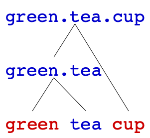
   
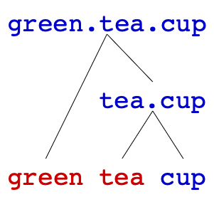

]

---
.pull-left[
## **Meaning in Language**
 
of course, language is **NOT** just structure – language has **meaning** – and we've mentioned meaning on several occasions:  
- **Morphology**
  - morphemes are the smallest linguistic unit with <u><i>meaning</i></u>
  - derivation changes a word's core <u><i>meaning</i></u>
  - order of affixation reflects a word's <u><i>meaning</i></u>  
- **Syntax**
  - parts of speech can be defined based on their <u><i>meaning</i></u>
  - ambiguous sentences like '<i>The girl saw the bear with the telescope</i>' show us that syntactic structures contribute to the <u><i>meaning</i></u> of sentences
]
.pull-right[
 

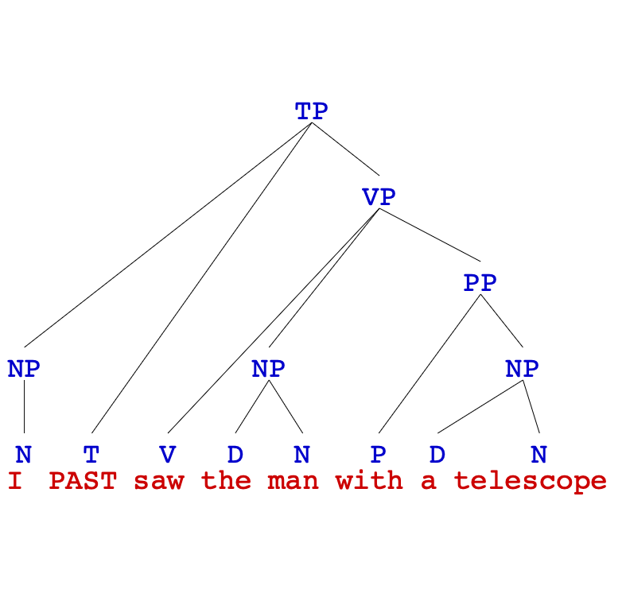
  
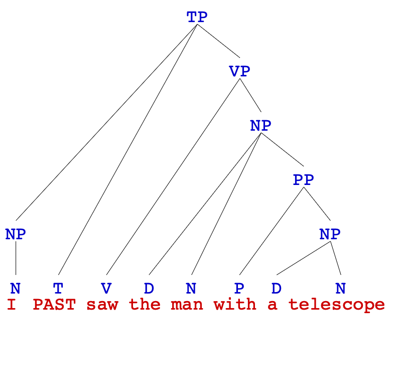

]

---
## **Meaning in Language**
 
in this and the next unit, we're going to focus on **meaning** more specifically and we can differentiate three **types** of linguistic meaning:  

**literal meaning** 
  - **Semantics** studies <u>*literal meaning*</u> in language   
  
<b>implied meaning</b> 
  - <b>Pragmatics</b> studies <u>*implied meaning*</u> in language   
  
<b>social meaning</b> 
  - <b>Sociolinguistics</b> and <b>Linguistic Anthropology</b> study <u>*social meaning*</u>

  
---
## **Literal Meaning and Implied Meaning**
 
.pull-left[
- as a system for communicating ideas, language must have **meaning**  
- but meaning in language goes **beyond** the **literal**  
  - imagine the following conversation:  
  **A**: <i>Do you want to go out tonight</i>? 
  **B**: <i>I have an exam in the morning</i>  
  - what has B literally said?  
  - what has B implied that they have not said explicitly?  
- as in this example, much of what we say has different levels of **literal** and **implied** meaning
]
.pull-right[
 

]

---
## **Social Meaning**
 
- language also has **social meaning**, since it's a tool for **social interaction**:  
  - we use **small talk** to establish and reinforce social bonds with others
  - the way we speak can indicate our attitude toward others (friendliness, solidarity, irritation…)  
- we actively **choose** to speak a particular way to convey a particular social identity  
  - good morning</i> to a professor 
  - 'sup</i> to a friend 
  - do we usually do it other way around?  
  - homosexual voice? [just an example, not sterotype]  
- we often unconsciously **accommodate to the speech** of people we like, adopting phrases and speech patterns from them without even noticing it  
  - have you noticed your speech changing since you came to college?
---
## **Social Meaning**
 
.pull-left[
language **varies** by region, community, and other social factors  
- so the way we speak often **conveys information** like where we're from, our age, gender, etc.  
- we often strongly **identify** with the language and dialect we grew up speaking  
- we can actively use language to **signal our membership** in certain communities  
  - A: <i>Did you eat my cake</i>? 
    B: <i>I <b>never</b> ate your cake</i>.
]
.pull-right[
 
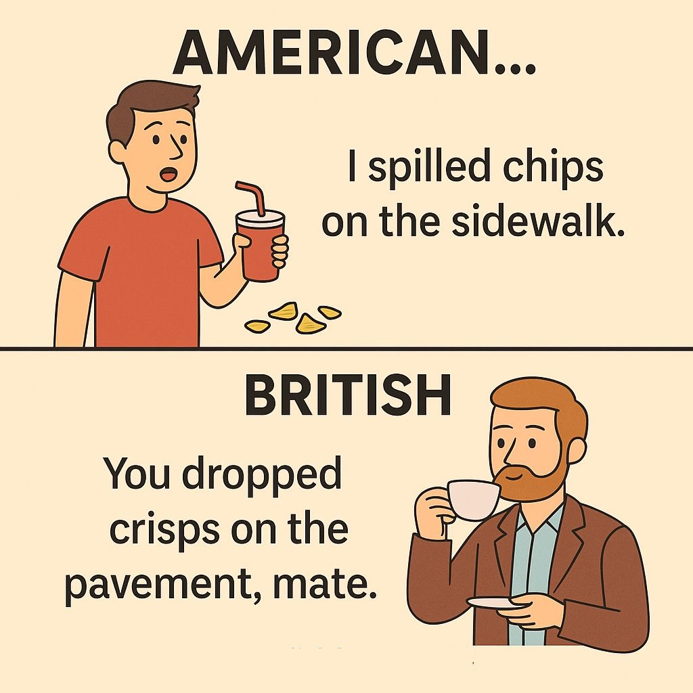
]
  
---
.pull-left[
## **Semantics**
 
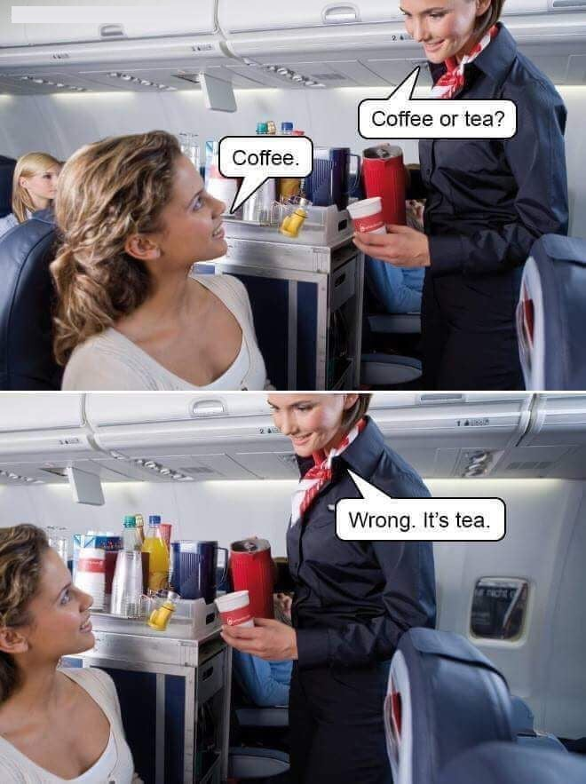
]
.pull-right[
 
- in this unit, we'll focus on **Semantics** – the literal meaning of language  
- we can identify two levels of semantics: **lexical semantics** and **compositional semantics**  
- **lexical semantics** – the meaning of words
  - lexicon refers to a speaker's mental vocabulary; words are known as lexical items, but lexical items can also include common multi-word expressions  
- **compositional semantics** – the meaning of sentences
  - we said <u><i>A girl saw a bear with a telescope.</i></u> has two different meanings, and these meanings depend on syntax
  - meaning of a sentence = meaning of words + meaning of structure
]

---
## **Lexical Meaning**
 
**lexical semantics** studies the **meaning of words** and lexical meaning is **conventional** and **arbitrary**  
- lexical meaning is **conventional**  
1. words mean what they mean because we agree as a speech community that's what they mean – that is, words are defined by **social convention**  
2. consider words with slang meanings like <i><u>sick</u></i> 'amazing, excellent'  
  - how did <i><u>sick</u></i> come to mean 'great'?   
  - someone starting using it with that meaning, and it caught on – the rest of the community agreed it can be used that way, too  
3. same thing with **technological terms** like <i><u>mouse</u></i>, <i><u>screen</u></i>, <i><u>tablet</u></i>, even <i><u>computer</u></i>:  
  - all of these words originally had other meanings, but when we invented new technology and needed a name for it, we agreed these words can have new meanings  

---
## **Lexical Meaning**
 
**lexical semantics** studies the **meaning of words** and lexical meaning is **conventional** and **arbitrary**  
- lexical meaning is **arbitrary**
  - there is no inherent connection between the sound of a word and its meaning  
- we know this because:
  - same **sounds** can have different **meanings** in different languages: 
  <b>Spanish</b> <i>taco</i> 'taco' vs. <b>Japanese</b> <i>tako</i> 'octopus' 
  <b>English</b> <i>eat</i> 'eat' vs. <b>Kazakh</b> <i>it</i> 'dog'  
  - same **meaning** can be conveyed with different **sounds** in different languages: 
  <b>English</b> <i>dog</i> vs. <b>Spanish</b> <i>perro</i>  
  - meaning and sound of words can **change over time**: 
  <i>nice</i> 'foolish' > 'kind', <i>knight</i> [knixt] > [najt]  
- main exception: **onomatopoeia** – words that mimic sounds
  - even **onomatopoeia** can be a bit arbitrary: cockadoodledoo, quiquiriquí, kokekokko, wowo
  
---
## **Sense and Reference**
 
.pull-left[
- so we know that words have meaning: **lexical semantics**  
- and we know that lexical meaning is **conventional** and **arbitrary**  
- but how do we specify what a word means?  
- think of the words **fruit** and **animal**:  
  - what image comes to mind when you think of a **fruit** or an **animal**?
  - how might you try to define these words?
]
.pull-right[

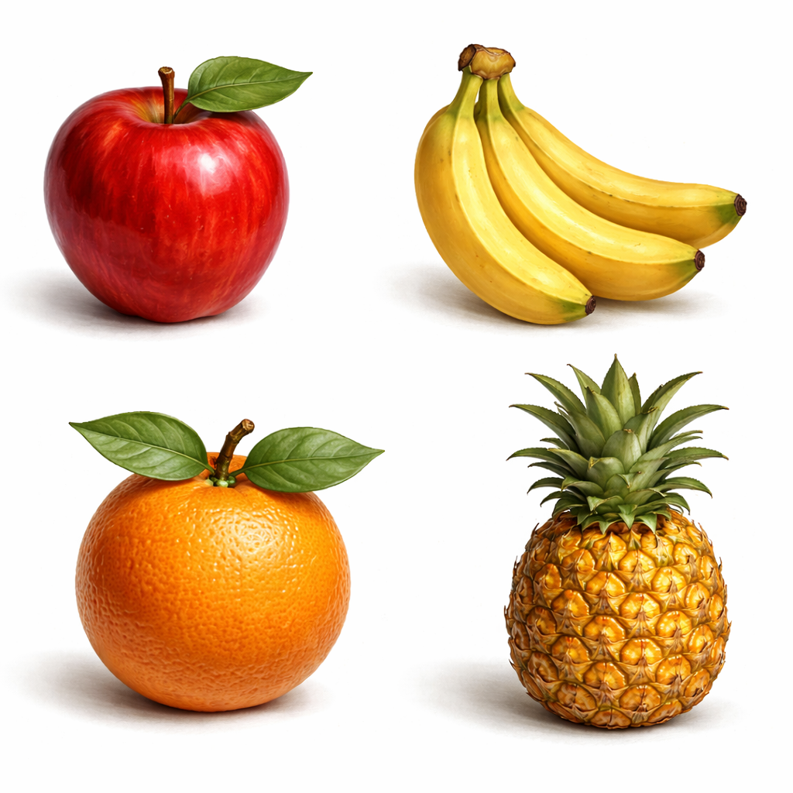

  

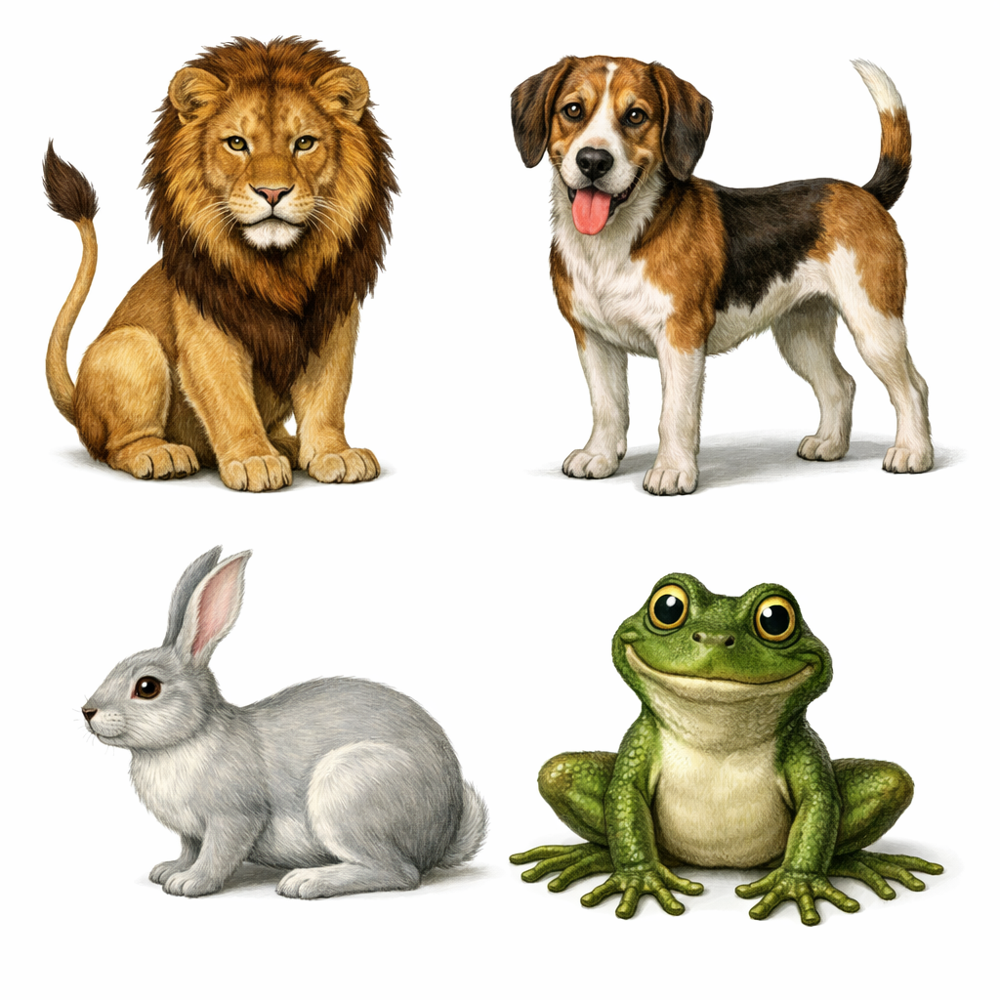

]
  
---
## **Sense and Reference**
 
**a test**: which group is **animal** and which group is **fruit**? how do you know?
    
.pull-left[

]
.pull-right[

]

---
## **Sense and Reference**
 
**a test**: how about these new thigs? **animals or fruit**? how do you know?
    

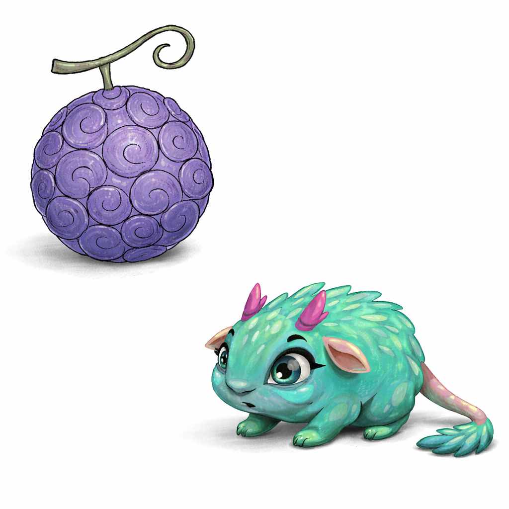

---
## **Sense and Reference**
 
.pull-left[

  

]
.pull-right[
there are two ways of thinking about a word's meaning:  
**sense** and **reference**  
- the **sense** of a word is:
  - the mental concept of a word's meaning
  - a description of this mental concept: dictionary definition  
- for instance, the sense of fruit might be:
  - a seed-bearing structure in flowering plants
]

---
## **Sense and Reference**
 
.pull-left[

  

]
.pull-right[
there are two ways of thinking about a word's meaning:  
**sense** and **reference**  
- the **reference** of a word is:
  - the set of things in the world that the word refers to
  - each thing the word refers to is a **referent** of the word  
- the reference of the word fruit would include:
  - the apple I had for breakfast
  - the bananas they have at Cafe West
  - the oranges they sell at Costco...
]

---
## **Sense and Reference**
 
.pull-left[

  

]
.pull-right[
- defining words by **reference** helps us understand how we can
categorise new items we come across:
  - by comparing them to the referents we already know  
- it's also more in line with how we **learn** words:
  - we don't learn what an animal is by learning that it's a
"<u><i>multicellular eukaryotic organism [in] Animalia</i></u>" (Wikipedia)  
  - we learn what an animal is by learning that a **puppy** is an animal and a **kitty** is an animal and a **froggy** is an animal...  
  - we learn what a fruit is by observing what our caregivers call fruit
]

---
## **Sense and Reference**
 
.pull-left[

  

]
.pull-right[
in this class, we'll define words by **reference**, which is the **set** of things in the world (referents) that the word refers to  
- once we define a word as a **set** or collection of things, we can also **compare** the sets of things that different words refer to  

1. some words refer to **entirely different** sets of things
2. sometimes there is overlap between **two sets** of referents  

is there any reference overlap in each pair below?
  - dog vs. animal
  - dog vs. canine
  - dog vs. husky

]

---
.pull-left[
## **Semantic Relations**
 
- **synonym:** words that have the same reference / refer to the same set of things in the world  
  - <b>drinks</b> and <b>beverages</b>  
- **hypernym:** words whose reference is a **superset** of another words reference  
  - <b>student</b> is a hypernym to <b>linguistics student</b>  
- **hyponym:** words whose reference is a **subset** of another words reference  
  - <b>dog</b> is a hyponym to <b>mammal</b>  
- **antonym:** words that have opposite meanings
]
.pull-right[
 

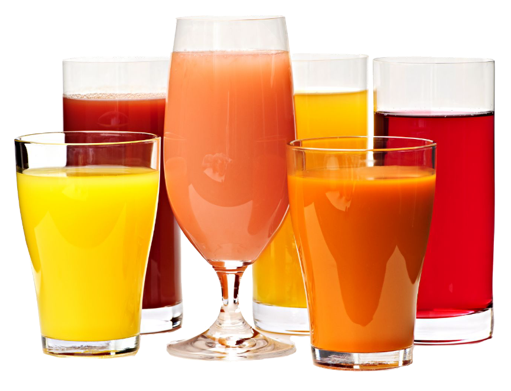

 
<i>[[drink]]</i> = <i>[[beverages]]</i>
  
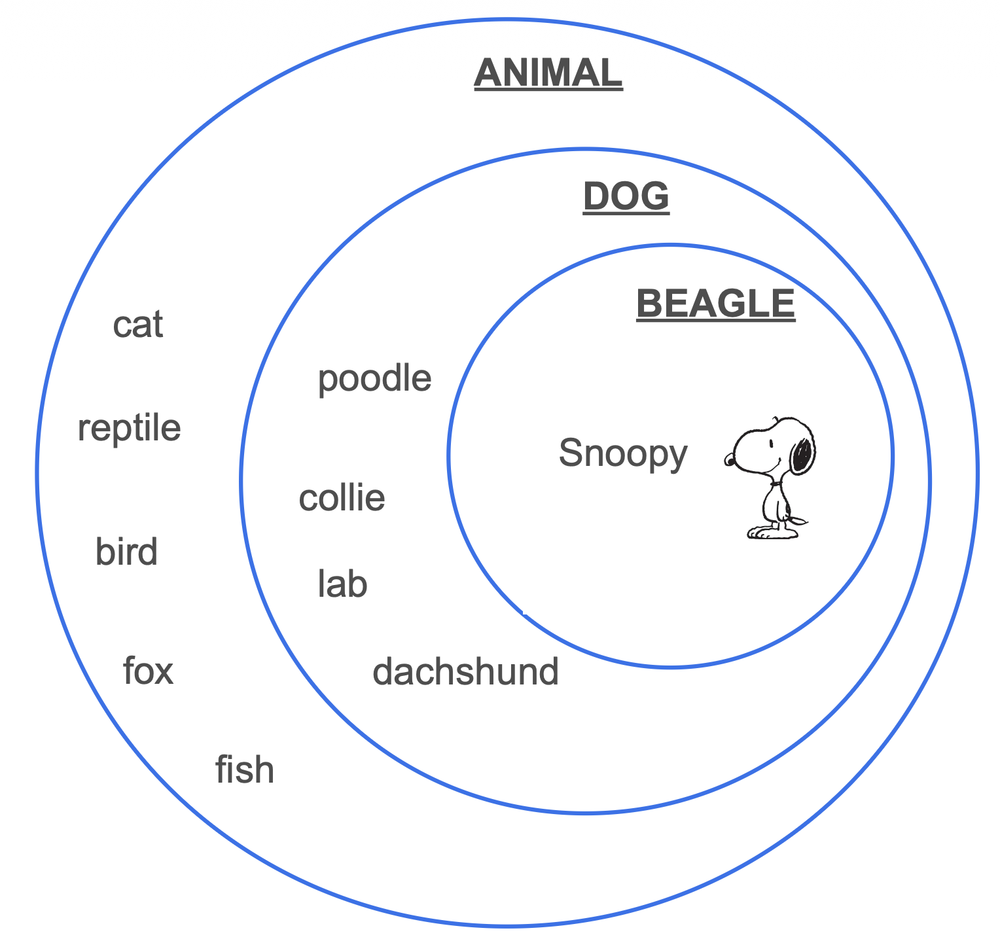

]

---
## **Semantic Relations: Antonyms**
 
.pull-left[
**antonym:** words that have opposite meanings, and it turns out to be difficult to define in terms of reference  
- **complementary pairs:** items that can't be in both categories
  - <b>alive</b> vs. <b>dead</b>  
  
- **gradable pairs:** opposite ends of a scale
  - <b>young</b> vs. <b>old</b>  
  
- **reverses:** opposite directions
  - <b>up</b> vs. <b>down</b>  
  
- **converses:** same action, different perspective
  - <b>buy</b> vs. <b>sell</b>  
]
.pull-right[
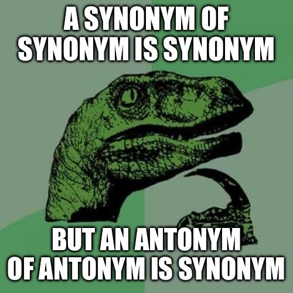
]

---
## **Exercise I: Semantic Relations**
 
- are the following word pairs **synonyms**, **antonyms**, or a **hypernym-hyponym pair**? 
- if the last, which is the hypernym and which is the hyponym?  
.pull-left[
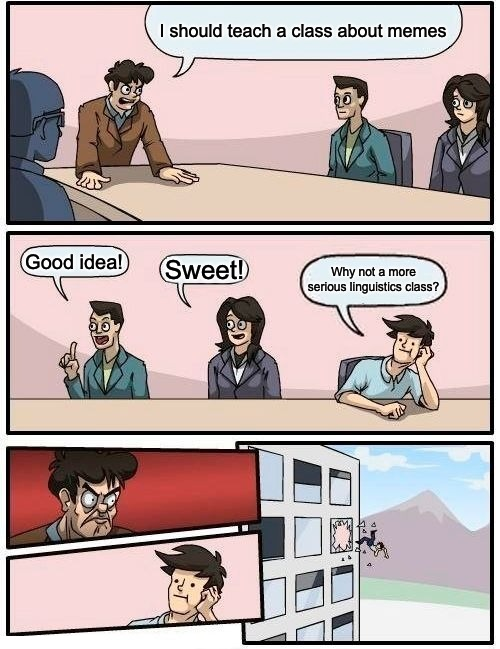
]
.pull-right[
1. bird – avian  
2. bird – sparrow  
3. bird – animal  
4. synonym - antonym  
5. hypernym - hyponym  
6. Rutgers - universities  
7. Linguistics - Mathematics  
8. **MORE**?
]

---
## **Compositional Semantics**
 
- so we've seen some ideas about **lexical semantics** – the meaning of words (or lexical items)  
- beyond words, phrases and sentence can also have meaning - **compositional semantics**  
- **COMPOSITIONALITY in semantics**:  
  - the meaning of a **complex** expression is due to
  1. the meaning of its parts (i.e., lexical meaning);
  2. how these parts are **combined** (i.e., syntactic structure)  
- compare these two sentences:
  (a) <i>It is snowing outside</i>.
  (b) <i>It is sunny outside</i>.  
- both sentences are formed by <i><u>it is ... outside</u></i> + a <i>weather word</i>
- yet they cannot be true at the same time, and which one is true depends on <i>snowing</i> and <i>sunny</i>

---
## **Truth Values**
  
.pull-left[
- part of a sentence's meaning is its **truth value**: is it <b>true</b> or <b>false</b>  
- What is the **truth value** of the following sentences?  
  1. Earth is a planet.  
  2. Fish are birds.  
  3. Mars is in the Solar System.  
  4. Cats are animals.
]
.pull-right[
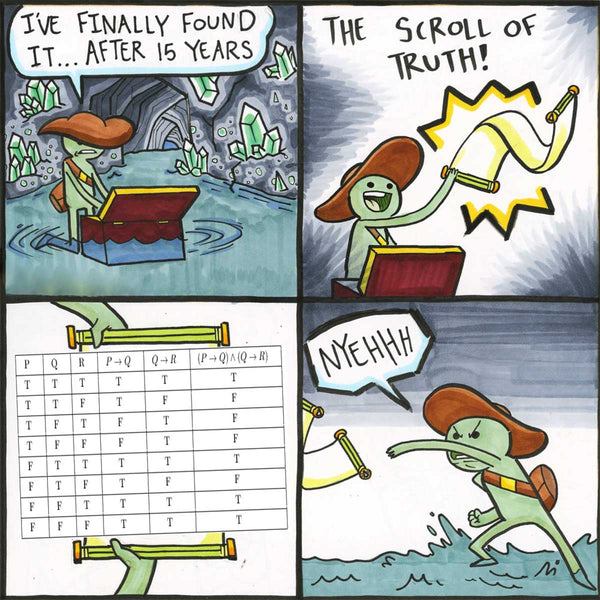
]

---
## **Complex Truth Values**
 

- some sentences make multiple propositions, each of which has its own truth value:
- the truth value of a sentence <b>depends on</b> the truth value of its propositions
- all of the propositions in a sentence must be <b>true</b> for the entire sentence to be <b>true</b>  

.pull-left[
- <i>Earth is a rocky planet</i>.  
  - <u>proposition 1</u>: Earth is a planet. <b>true</b>
  - <u>proposition 2</u>: Earth is rocky. <b>true</b>  
  - sentence truth value: <b>true</b>  
- <i>Merlin speaks Kazakh and Greek</i>.  
  - <u>proposition 1</u>: Merlin speaks Kazakh. <b>true</b>
  - <u>proposition 2</u>: Merlin speaks Greek. <b>false</b>  
  - sentence truth value: <b>false</b>
]
.pull-right[
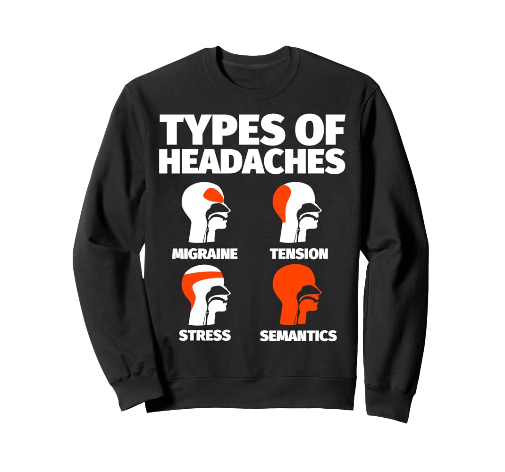
]

---
## **Complex Truth Values**
 
- some sentences make multiple propositions, each of which has its own truth value:
- the truth value of a sentence **depends on** the truth value of its propositions
- all of the propositions in a sentence must be <b>true</b> for the entire sentence to be <b>true</b>  

.pull-left[
- <i>Earth is a rocky planet</i>.  
  - <u>proposition 1</u>: Earth is a planet. <b>true</b>
  - <u>proposition 2</u>: Earth is rocky. <b>true</b>  
  - sentence truth value: <b>true</b>  
- <i>Merlin speaks Kazakh and Greek</i>.  
  - <u>proposition 1</u>: Merlin speaks Kazakh. <b>true</b>
  - <u>proposition 2</u>: Merlin speaks Greek. <b>false</b>  
  - sentence truth value: <b>false</b>
]
.pull-right[

]

---
## **Complex Truth Values**
 
.pull-left[
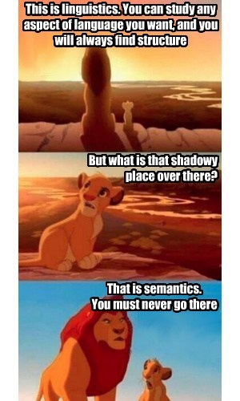
]
.pull-right[
- a sentence might also give rise to other, **unspoken propositions** –
  often related through synonyms, hypernyms, and hyponyms  
- the sentence <i><u>I have a dog.</u><i> gives rise to other propositions:  
  - I have a pet.  
  - My pet is a canine.  
  - My pet is an animal.  
- all of these propositions must also be <b>true</b> for the sentence to be <b>true</b>:  
  - If <u><i>my pet is an animal</i></u> is false, then <u><i>I have a dog</i></u> cannot be true.
]
.pull-right[

]

---
class: center, middle
**Assignment IV** will be published this Wednesday (**Oct 21**) 
and is due next Friday **Oct 30** at **11:59 pm**  
<b>continue reading</b>: the chapter **Semantics I: Compositionality**  from Victoria Fromkin et al.'s <i>An Introduction to Language</i>  
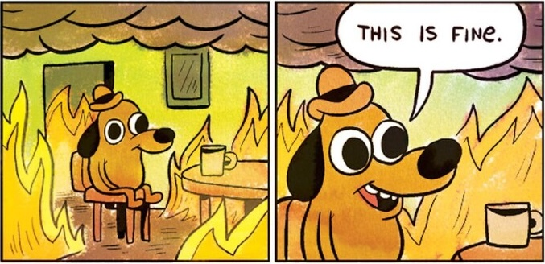
  
Slides created via the R package [**xaringan**](https://github.com/yihui/xaringan).
