class: center, middle
## Please pick up your **name card** from the front
  
## **office hours**: Mondays, 2:00-3:00 pm 
## Basement, Room 003, **Linguistics Building**

---
## **Previously on 201**
 
- defining the meaning of words **by sense** and **by reference**:
  - a word's **sense** is the **mental concept** of the word's meaning or a dictionary definition of the word's meaning
  - a word's **reference** is the set of entities (referents) that the word **refers to**  
- consider the word <i><u>university</u></i>
  - **sense**: an institution of higher education
  - **reference**: Rutgers, NYU, CUNY, Harvard, MIT, Penn, Stanford, Johns Hopkins...  

- **Semantics** is the study of **literal** meaning in language
  - lexical semantics (words) and compositional semantics (sentences)  

- lexical meaning is **conventional** and **arbitrary**
  - under this, we can have different relations: synonym, antonynm, hypernym, hyponym  

- compositional meaning includes **truth values** of the sentence
  - sentences can have multiple propositions with different **truth values**

---
class:middle, center

Entailment

---
class: middle, center

# **ENTAILMENT**   

### a proposition ***p*** entails another proposition ***q*** <b>if</b>, <b>whenever</b> ***p*** is <b>true</b>, ***q*** must also be <b>true</b>  

### more formally: ***p*** entails ***q*** <b>iff whenever</b> ***p*** is <b>true</b>, ***q*** is <b>true</b>  

<b>iff</b>: if and only if  
"<b>whenever</b>": it means you cannot find any possible world, 
where **q** is <b>false</b> while **p** is <b>true</b>

---
## **Entailment**
 
.pull-left[
.pull-left[]
.pull-right[]
.pull-left[]
.pull-right[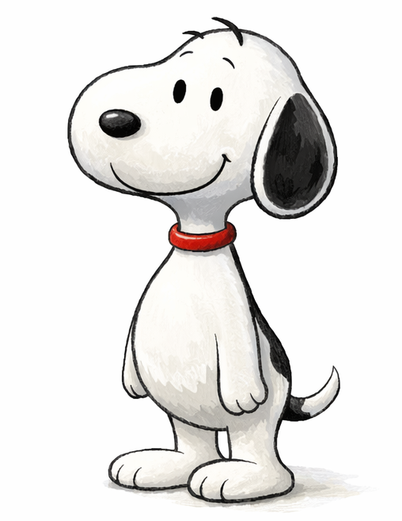]
]
.pull-right[
the relationship between the propositions in a sentence is called **entailment**  
- a proposition ***p*** entails another proposition ***q*** <b>if</b>, <b>whenever</b> ***p*** is <b>true</b>, ***q*** must also be <b>true</b>  

let's say we have two propositions  
<b><i>p:</i></b> <i><u>Snoopy is a beagle.</u></i> 
<b><i>q:</i></b> <i><u>Snoopy is a dog.</u></i>  
proposition <b><i>p</i></b> **entails** proposition <b><i>q</i></b>  
because if we say "<i><u>Snoopy is a beagle.</u></i>" is <b>true</b>, 
Snoopy must be a dog, since beagles are dogs, 
then "<i><u>Snoopy is a dog.</u></i>" is <b>true</b>  
But, <b><i>q</i></b> does NOT **entail** <b><i>p</i></b>, why?
]

---
## **Possible Worlds**
 
- one way to think about entailment is to imagine the **possible worlds** (alternative realities) in which a sentence would be true  
- consider the sentence <i>Merlin has a dog</i>.  
- There are many possible worlds in which <i>Merlin has a dog</i> would be <b>true</b>
  
.pull-left[
.pull-left[

<b>World 1</b>

]
.pull-right[

<b>World 2</b>

]
]
.pull-right[
.pull-left[

<b>World 3</b>

]
.pull-right[

<b>World 4</b>

]
]
  

  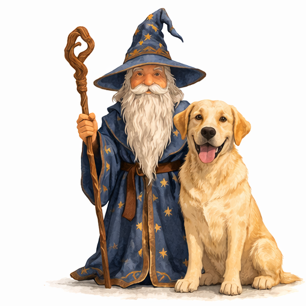
  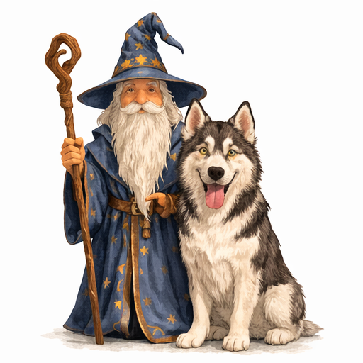
  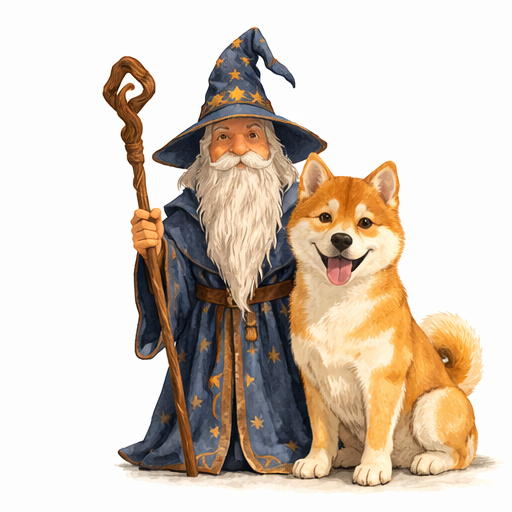
  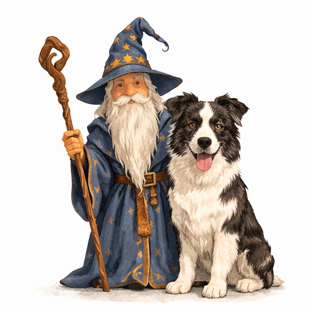

---
.pull-left[
## **Possible Worlds**
 
There are also many possible worlds in which
<i>Merlin has a dog</i> would be <b>false</b>
  
.pull-left[

]
.pull-right[
<b>World 5</b>  
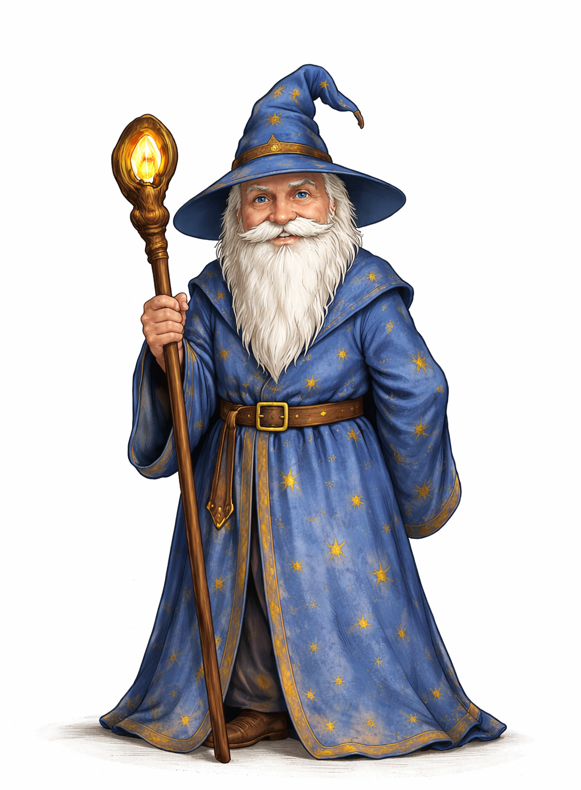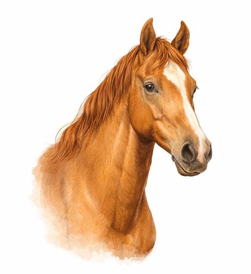
]
  
.pull-left[
<b>World 6</b>  
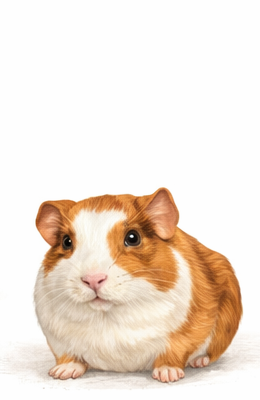
]
.pull-right[

]
]
.pull-right[
.pull-left[<b>World 7</b>  
]
.pull-right[]
  
.pull-left[]
.pull-right[<b>World 8</b>  
]
  
.pull-left[<b>World 9</b>  
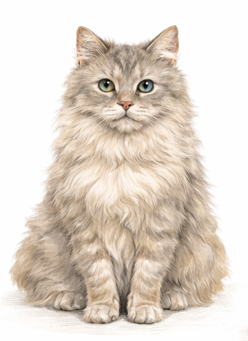]
.pull-right[]
]

---
.pull-left[
## **Possible Worlds**
knowing the **meaning** of a sentence involves knowing in
which <u>possible worlds</u> the sentence would be <b>true</b>
  
.pull-left[
<b>World 5</b>  

]
.pull-right[
<b>World 6</b>  

]
  
.pull-left[
<b>World 8</b>  

]
.pull-right[
<b>World 9</b>  

]
]

.pull-right[
  

.pull-left[<b>World 1</b>  
]
.pull-right[]
  
.pull-left[]
.pull-right[<b>World 2</b>  
]

]

---
## **Possible Worlds**
 
.pull-left[
now consider the following sentences:  
- can you think of a possible world in which only one of these sentences is <b>true</b>?
- can you think of a possible world in which two or more of these sentences are <b>true</b>?  

(a) Merlin has a fluffy dog.  
(b) Merlin has a dog.  
(c) Merlin has a fluffy dog and a cat.  
]
.pull-right[
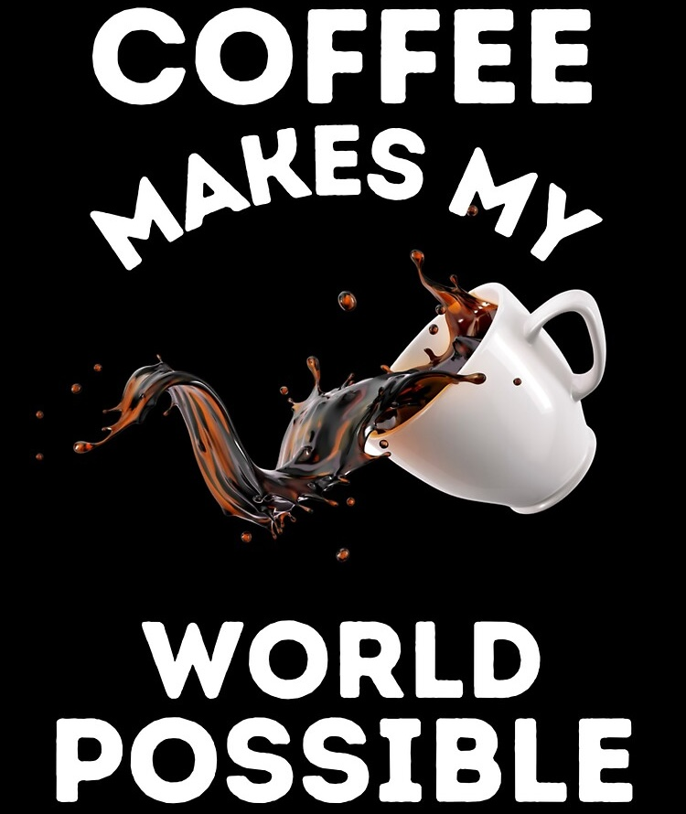
]

---
## **Entailment and Possible Words**
 
.pull-left[
- recall our definition of **entailment**  
**entailment**: a proposition ***p*** entails another proposition ***q*** <b>if</b>, <b>whenever</b> ***p*** is <b>true</b>, ***q*** must also be <b>true</b>  
**in other words**: ***p*** entails ***q*** when there is <b>NO</b> possible world in which ***p*** is <b>true</b> and ***q*** is <b>false</b>   

(a) Merlin has a fluffy dog.  
(b) Merlin has a dog.  
(c) Merlin has a fluffy dog and a cat.
]
.pull-right[
  
- (a) **entails** (b) because (a) cannot be <b>true</b> while (b)
is <b>false</b>:  
  - there is <b>NO</b> possible world in which 
  <i><u>Merlin has a fluffy dog but not a dog</u></i>  
- (b) does <b>NOT</b> **entail** (a) because (b) can be <b>true</b>
while (a) is <b>false</b>:  
  - there is a possible world, in which  
  <i><u>Merlin could have a short-haired dog</u></i>  
- (c) **entails** both (a) and (b) because (c) cannot be <b>true</b> while (a) or (b) is <b>false</b>
]

---
.pull-left[
## **Entailment**
 
consider the following sentences:  
(a) Alicia drank coffee at midnight.  
(b) Alicia drank coffee.  
(c) Alicia drank coffee at midnight in the living room.  
]
.pull-right[
  
**entailment**: a proposition ***p*** entails another proposition ***q*** <b>if</b>, <b>whenever</b> ***p*** is <b>true</b>, ***q*** must also be <b>true</b>  
**in other words**: ***p*** entails ***q*** when there is <b>NO</b> possible world in which ***p*** is <b>true</b> and ***q*** is <b>false</b>
]
.pull-left[
- does (a) **entail** (b)?  
- does (a) **entail** (c)?  
- does (b) **entail** (c)?  
- does (c) **entail** (a)?
]
.pull-right[

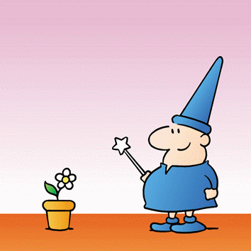

]

---
.pull-left[
## **Entailment**
 
consider the following sentences:  
(a) Alicia drank coffee at midnight.  
(b) Alicia drank coffee.  
(c) Alicia drank coffee at midnight in the living room.  
]
.pull-right[
  
**entailment**: a proposition ***p*** entails another proposition ***q*** <b>if</b>, <b>whenever</b> ***p*** is <b>true</b>, ***q*** must also be <b>true</b>  
**in other words**: ***p*** entails ***q*** when there is <b>NO</b> possible world in which ***p*** is <b>true</b> and ***q*** is <b>false</b>   
]

- does (a) **entail** (b)? <i>yes: if Alicia drank coffee at midnight is true, it must be true that Alicia drank coffee</i>  
- does (a) **entail** (c)? <i>no: Suppose Alicia drank coffee at midnight in the kitchen. (a) will be true while (b) is false</i>  
- does (b) **entail** (c)? <i>no: Suppose Alicia drank coffee in the morning. (b) will be true while (c) is false</i>  
- does (c) **entail** (a)? <i>yes: If Alicia drank coffee at midnight in the living room is true, it must be true that
Alicia drank coffee at midnight</i>

---
## **Logical Entailment**  
.pull-left[
- **p** *entails* **q** for logical reasons, **regardless** of world knowledge or lexical meaning   
**p**: <b>The cat sat on the mat.</b>  
**q**: <b>There is a cat/mat.</b>   
**p**: <b>(a dog): I heard the can opener.</b>  
**q**: <b>(Therefore for the dog), FOOD EXISTS!.</b>   
- We got the entailment relation between **p** and **q** by logical inferences
]
.pull-right[
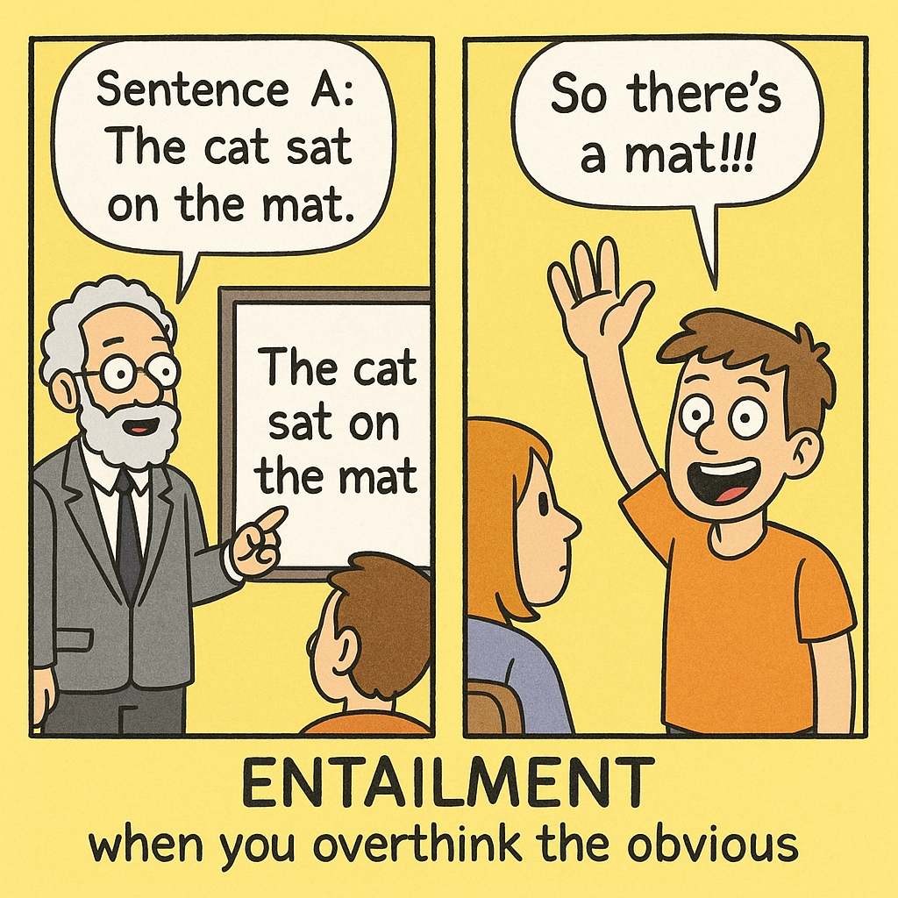
]

---
## **World-specific Entailment**  
.pull-left[
- **p** *entails* **q** due to world knowledge or lexical meaning  
**p**: <b>Charles III is the King of the United Kingdom.</b>  
**q**: <b>Queen Elizabeth II was Charles's mother.</b>   
**p**: <b>Merlin is from Scotland. </b>  
**q**: <b>Merlin is from UK.</b>   
- We got the entailment relation between **p** and **q** by making reference to how the world works, or to knowledge of lexical meaning
]
.pull-right[
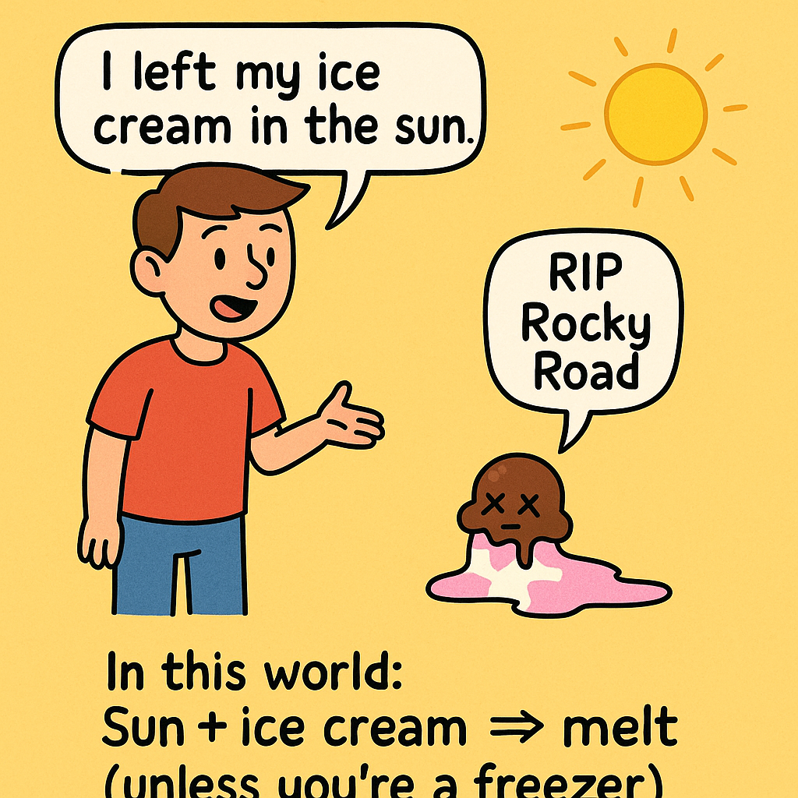
]

---
## **Mutual Entailment**  
.pull-left[
- **p** *entails* **q** <b>AND</b> **q** *entails* **p** as well.  
**p**: <b>Merlin is a sorcerer.</b>  
**q**: <b>Merlin is a wizard.</b>   
**p**: <b>Merlin is immortal </b>  
**q**: <b>Merlin is not capable of dying.</b>   
]
.pull-right[
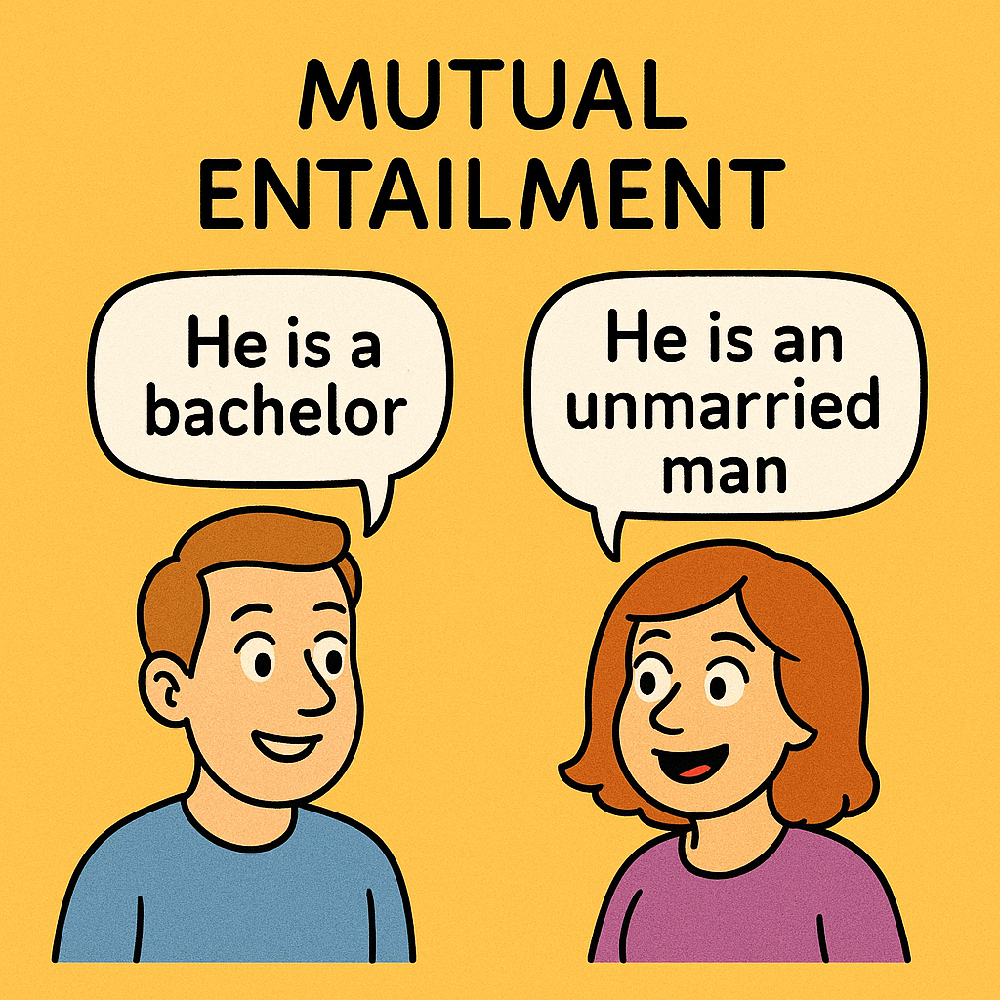
]

---
.pull-left[
### **Exercise I: Entailment**
]
.pull.right[
**entailment**: Sentence **p** entails sentence **q** <b>iff</b> 
**q** is true whenever **p** is true.
]
 

For each pair of sentences, which one <b>entails</b> the other one?  
.pull-left[
- **p**. Charles III is the King of the United Kingdom. 
**q**. Queen Elizabeth II was Charles's mother.  
- **p**. I am tired. 
**q**. I am very very very very very very tired.  
- **p**. Bob live above a restaurant on Ocean Avenue. 
**q**. Bob and Linda lives above a restaurant on Ocean Avenue.  
- **p**. The kids trick-or-treated on Halloween. 
**q**. The kids trick-or-treated in scary costumes on Halloween.
]
.pull-right[

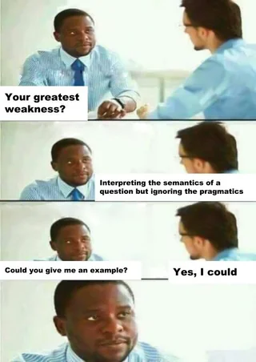

]

---
.pull-left[
### **Exercise II: Entailment**
]
.pull.right[
**entailment**: Sentence **p** entails sentence **q** <b>iff</b> 
**q** is true whenever **p** is true.
]
  
work in <b>GROUP</b>, think of three sentences that are entailed by each of these sentences:  
.pull-left[
  
- **a**.  
The spotted lanternfly is an insect that has spread invasively to New Jersey and can cause damage to forests and fruit crops.  
- **b**.  
The starship Enterprise explored strange new worlds, sought out new life and new civilizations, and boldly went where no one had gone before.  
]
.pull-right[
  
- **c**.  
Controversially, DeLa chose to eliminate herself from the competition after winning the lip-sync battle, which allowed Trixie, Kennedy, and Shangela to all stay in the competition.  
- **d**.  
Mario defeated Bowser, but then all he found in the dungeon was Toad, who told him that the princess was in another castle.
]

---
.pull-left[
### **Exercise III: Entailment Chain**
]
.pull.right[
**entailment**: Sentence **p** entails sentence **q** <b>iff</b> 
**q** is true whenever **p** is true.
]
  

.pull-left[
consider the following sentences:  
- (a) Merlin drank coffee.  
- (b) Merlin drank coffee in the library.  
- (c) Merlin drank coffee at midnight in the library.  

1. does a **entail** b?
2. does b **entail** c?
3. does c **entail** b?
4. does b **entail** a?  

what is the **difference** among these three sentences?
]

.pull-right[
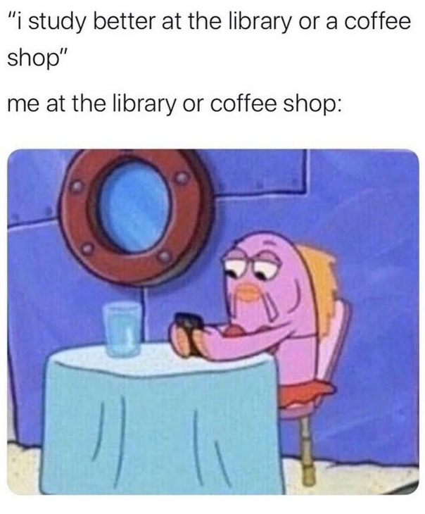
]

---
.pull-left[
### **Exercise III: Entailment Chain**
]
.pull.right[
**entailment**: Sentence **p** entails sentence **q** <b>iff</b> 
**q** is true whenever **p** is true.
]
  

.pull-left[
consider the following sentences:  
- (a) Merlin drank coffee.  
- (b) Merlin drank coffee in the library.  
- (c) Merlin drank coffee at midnight in the library.  

1. does a **entail** b?
2. does b **entail** c?
3. does c **entail** b?
4. does b **entail** a?  

5. does c **entail** a?
]

--

.pull-right[
   
<h3><b>TRANSITIVITY</b></h3>  
a property where a **relation** transfers across elements  
for instance, **if** A=B and B=C, **then** A=C  
generally it refers to a "**passing over**" of a relationship, action, or property across elements
]

---
## **Entailment Notes I**
 
- importantly, not all entailment relations can be identified so easily from the **syntactic structure** of the sentences and/or the **particular words** that they contain   

.pull-left[
- consider three pairs of sentences below:  
(a). <i>Arthur <b>managed to</b> leave on time</i>. 
(b). <i>Arthur left on time</i>.  
(c). <i>Arthur <b>tried to</b> leave on time</i>. 
(d). <i>Arthur left on time</i>.  
(e). <i>Arthur <b>attempted to</b> leave on time</i>. 
(f). <i>Arthur left on time</i>.  

1. does (a) **entail** (b)? 
2. does (c) **entail** (d)? 
3. does (e) **entail** (f)? 
]

--

.pull-right[

<h3>
in fact, <u>syntactic structure is a poor indicator of entailment</u>
  
after all, entailment is a <b>semantic relation</b>, not a syntactic one
</h3

]

---
## **Entailment Notes II: 'Weird' Case - Tautology**
 
- there are sentences that are **ALWAYS** true and they are **true** in every possible world (**tautology**)  
  - (a) <i>A dog is a dog</i>.  
  - (b) <i>I will either save the world or I will not save the world</i>.  

- given our definition of entailment, such sentences are **entailed by all other sentences**  
  - (c) <i>Merlin is a musical actor</i>.  
  
- (a) and (b) are **always** true, so whenever (c) is true, they will be true:
  - if Merlin **IS** actually a musical actor in a possible world, then "<i>A dog is a dog</i>." is **true**  

- we call this: entailment holds **vacuously**
  - why we call it "vacuously"?
    
---
class:middle, center

Presupposition

---
class: middle, center

# **PRESUPPOSITION**   
### A **SPECIAL** TYPE OF ENTAILMENT   

___

### for two propositions <b>p</b> and <b>q</b>:  
###<b>p</b> presupposes <b>q</b> iff **both** <b>p</b> and the <b>negation</b> of <b>p</b> **entail** <b>q</b>

---
## **Presupposition: a Special Type of Entailment**
 
- consider the following two pairs of sentences:  

(a). <i>My brother Jeong Kwan lives in Korea</i>.&nbsp;&nbsp;&nbsp;&nbsp;&nbsp;&nbsp;&nbsp;&nbsp;&nbsp;&nbsp;&nbsp;&nbsp;&nbsp;&nbsp;(c). <i>My brother Jeong Kwan <b>does not</b> live in Korea</i>.  

(b). <i>I have a brother</i>.&nbsp;&nbsp;&nbsp;&nbsp;&nbsp;&nbsp;&nbsp;&nbsp;&nbsp;&nbsp;&nbsp;&nbsp;&nbsp;&nbsp;&nbsp;&nbsp;&nbsp;&nbsp;&nbsp;&nbsp;&nbsp;&nbsp;&nbsp;&nbsp;&nbsp;&nbsp;&nbsp;&nbsp;&nbsp;&nbsp;&nbsp;&nbsp;&nbsp;&nbsp;&nbsp;&nbsp;&nbsp;&nbsp;&nbsp;&nbsp;&nbsp;&nbsp;&nbsp;&nbsp;&nbsp;&nbsp;&nbsp;&nbsp;
(b). <i>I have a brother</i>.  

.pull-left[

does (a) entail (b)?

]

.pull-right[

does (c) entail (b)?

]  

--

- this entailment **survives negation** so it is also a **presupposition**  

--

- "if it is a <b>presupposition</b> relation, it must be an <b>entailment</b> relation as well"
- "if it is an <b>entailment</b> relation, it is <b>NOT necessarily</b> a <b>presuppostion</b> relation"  

--

we also say that a <b>presuppostion</b> is the <u>belief or background (tacit) assumption</u> whose truth is taken for
granted in a sentence or discourse

---
## **Presupposition: a Special Type of Entailment**
 
- **FOR INSTANCE**:  

.pull-left[
(a). <i>Merlin drank coffee in the library</i>.  
(b). <i>Merlin drank coffee</i>.
]
.pull-right[
(c). <i>Merlin DID NOT drink coffee in the library</i>.  
(b). <i>Merlin drank coffee</i>.
]  

--

.pull-left[

(a) entails  (b)

]
.pull-right[

(c) does NOT entail  (b)

]
  
- therefore, (a) is NOT a **presupposition** of (b)  

--

- note here: we are deciding the presupposition relation between **proposition (a) and (b)**
- however, given our definition of presupposition, we have to refer to another proposition, **c**, which is the **negation of b,** to determine presupposition relation

---
.pull-left[
### **Exercise IV: Presupposition**
]
.pull-right[
**presupposition**: for two propositions <b>p</b> and <b>q</b>, <b>p</b> presupposes <b>p</b> iff **both** <b>p</b> and the <b>negation</b> of <b>p</b> **entail** <b>q</b>.
]
  
.pull-left[
do following pairs of sentence fall under **presupposition** relation?  
(1) 
**p**: <b>The cat sat on the mat.</b>  
**q**: <b>There is a cat/mat.</b>   
(2) 
**p**: <b>(a dog): I heard the can opener.</b>  
**q**: <b>(Therefore for the dog), FOOD EXISTS!.</b>   
(3) 
**p**: <b>The king of the United States is bald.</b>  
**q**: <b>There is a king of the United States.</b>   
(4) 
**p**: <b>Arthur is driving a blue car.</b>  
**q**: <b>Arthur is driving a car.</b>
]
.pull-right[
**entailment**: Sentence **p** entails sentence **q** <b>iff</b> 
**q** is true whenever **p** is true.
   

]

---
class:middle, center
## we will come back to **presupposition** again in **Pragmatics**   
## in that section, we will introduce different types of presupposition

---
class: center, middle
**Assignment IV** will be published today (**Oct 21**) 
and it is due **Oct 30** at **11:59 pm**  
<b>continue reading</b>: the chapter **Semantics I: Compositionality**  from Victoria Fromkin et al.'s <i>An Introduction to Language</i>  

  
Slides created via the R package [**xaringan**](https://github.com/yihui/xaringan).
