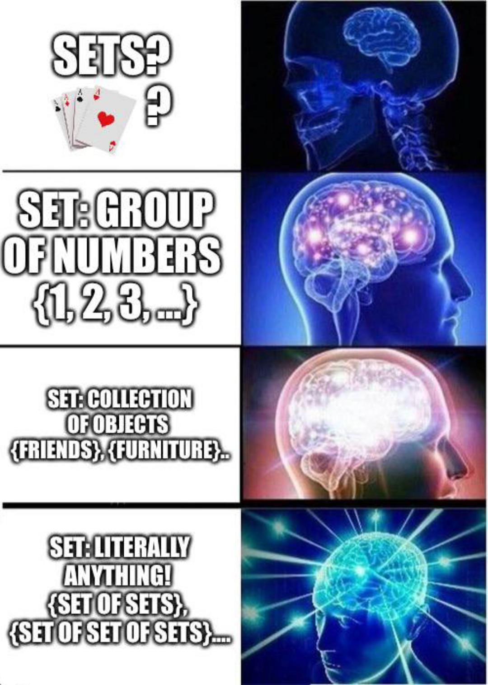
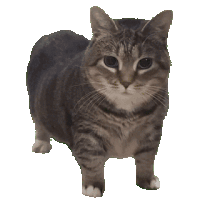
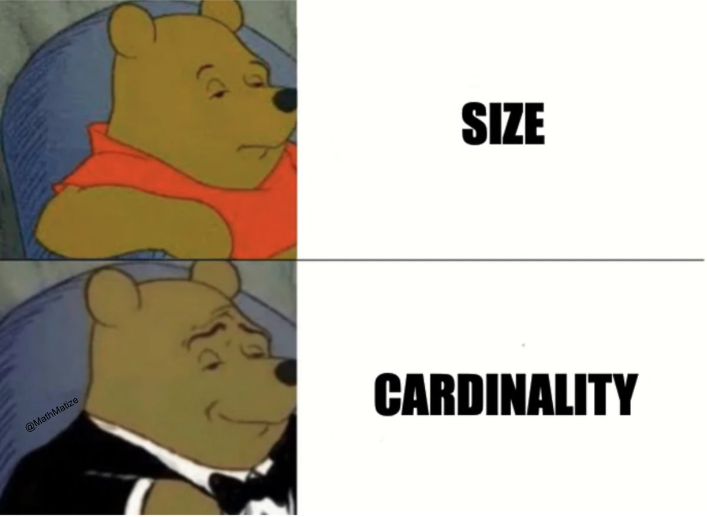
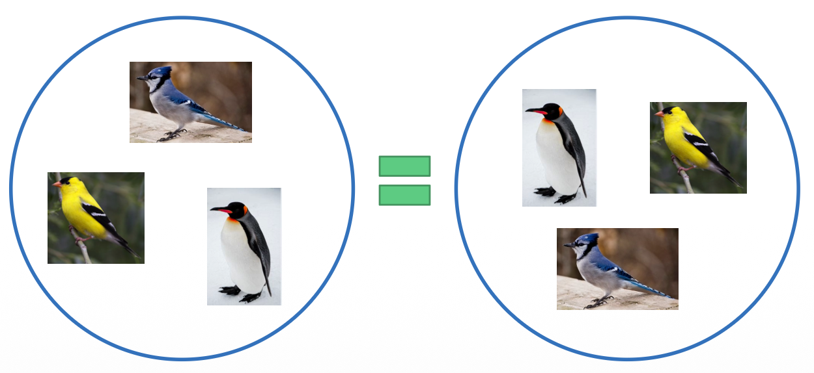

## **Previously on 201**
 
**tools** to figure out meanings in Semantics:  

### for two propositions <b>p</b> and <b>q</b>:  

### <b>entailment</b>: a proposition <b>p</b> entails another proposition <b>q</b> iff, whenever <b>p</b> is <b>true</b>, <b>q</b> must also be <b>true</b>  

### <b>presupposition</b>: a proposition <b>p</b> presupposes aother proposition <b>q</b> iff both <b>p</b> and the <b>negation</b> of <b>p</b> <b>entail</b> <b>q</b>  

--

<h3><b>Set Theory</b></h3>

---
class:middle, center

Set Theory: Basic Concepts

---
## **Set theory: Sets and Elements**
 
.pull-left[
a **set** is an abstract <u>collection of items</u>:  
- {Mon, Tue, Wed, Thu, Fri, Sat, Sun} is the set of days of the week  

the individual items in a set are called **member**s or **element**s:  
- *Thursday* is a **member** or **element** of the set of days of the week  

The symbols <b>∈</b> and <b>∉</b> are used to specify whether an element is a member of a given set:  
  - *Mon* <b>∈</b> {Mon, Tue, Wed, Thu, Fri, Sat, Sun}
  - *Oct* <b>∉</b> {Mon, Tue, Wed, Thu, Fri, Sat, Sun}
]
.pull-right[

]

---
## **Set theory: Sets and Elements**
 
- as in other branches of mathematics, we can use variables to stand in for values:
.pull-left[
***A*** = {Mon, Tue, Wed, Thu, Fri, Sat, Sun}
]
.pull-right[
defines variable ***A*** as the set of days
]
  

- by convention, we use **capital letters (*A*, *B*, *C*...)** for sets and <b>lowercase letters (<i>x</i>, <i>y</i>, <i>z</i>...)</b> for elements  

- we can first assign various elements to variables and then define sets based on them:
.pull-left[
.pull-left[

<i><b>a</b></i> = Rutgers

]
.pull-right[

<i><b>b</b></i> = Stanford

]
]
.pull-right[
.pull-left[

<i><b>c</b></i> = MIT

]
.pull-right[

<i><b>d</b></i> = Fudan

]
]
  
.pull-left[
  - ***U*** = {Rutgers, Stanford, MIT, Fudan}
]
.pull-right[
  - [[**U**niversities]]
]
.pull-left[
  - ***B*** = {Rutgers, Fudan}
]
.pull-right[
  - [[the **B**est Universities]]
]   
- we can also define sets in terms of their <b>natural language meaning</b>
.pull-left[
  - ***D*** = [[days of the week]]
]
.pull-right[
  - [[Monday]] ∈ **D**
]  

- we put [[ ]] around natural language expressions to show we're talking about their meaning, not their structure, morphology, or sounds

---
## **Set theory: Properties of Sets**
 
.pull-left[
- **order** of elements does **NOT** matter:
  - {a, e, i, o, u} = {u, o, i, e, a}  
- <b>repeating</b> does <b>NOT</b> matter
  - an element is either **in** the set **or not**, it can't be in it twice:
  - {a, e, i, o, u} = {a, a, a, e, i, o, o, o, o, u, u}  
- sets can be <b>finite</b> or <b>infinite</b>:
  - <b>finite</b>: set of days of the week = {Mon, Tue, Wed, Thu, Fri, Sat, Sun}
  - <b>infinite</b>: set of positive integers = {1, 2, 3…}  
- members do <b>NOT</b> have to be <b>relevant</b> to each other
  - although in **Semantics**, they usually are:
  - {u, 3, Wed, blue} is a legitimate set
]
.pull-right[
in **mathematics**:
- a <b>SET</b> must  be **well-defined**
- meaning we know how to decide <b>membership</b> clearly
- {2, 4, 6, 8, 10,...} (the set of even numbers)  

yet in **semantics**:
- a **list** is also considered a <b>SET</b>  
- {legitmate, 3x=5, OIIAI-cat.GIF, *never-gonna-give-you-up.MP4*}
  

]

---
class: center, middle, video-slide

<video id="vid"
  src="https://merlinudinov.github.io/spring2026ling201/pic/1026/never_web.mp4"
  type="video/mp4"
  autoplay
  muted
  controls     <!-- ✅ adds play/pause + volume/unmute -->
  playsinline>
</video>

---
## **Set theory: Specifying a Set**
 
- <b>list notation</b>: we can specify a set by listing its **members** between curly brackets  
  - <b>C</b>(olours) = {red, orange, yellow, green, blue, violet}
  - <b>F</b>(lowers) = {tulip, rose, violet, carnation, peony, daisy}  
- <b>venn diagram notation</b>: we can specify a set by placing its **members** in a circle
  

<!-- Left circle -->

<!-- Right circle -->

<!-- Labels C and F -->

<b>C</b>

<b>F</b>

<!-- Left words -->

yellow

green

blue

orange

red

<!-- Intersection -->

violet

<!-- Right words -->

tulip

rose

carnation

peony

daisy

- Venn diagrams are especially useful for illustrating where sets overlap (what members they have in common):
  - violet ∈ C and violet ∈ F
  

---
## **Set theory: Specifying a Set**
 
- sometimes we can't list all the members (we don't know them, there are too many)
- can anyone of us list **ALL** the stars in the universe?
  - Sun, Polaris, Proxima Centauri, Betelgeuse, Rigel...  
- we can use **predicate notation** to define such a set:  

set of all starts: <b><i>S</i></b> = { &nbsp;&nbsp;&nbsp x &nbsp;&nbsp;&nbsp | &nbsp;&nbsp;&nbsp <u>x is a star</u> }

<svg width="1200" height="180" viewBox="0 0 1200 180">
  <!-- little braces -->
  <text x="565" y="235" font-size="25" fill="#CC0033" transform="rotate(270 455 120)">{</text>
  <text x="640" y="195" font-size="25" fill="#CC0033" transform="rotate(270 530 120)">{</text>
  <text x="870" y="35" font-size="25" fill="#CC0033" transform="rotate(270 760 120)">{</text>

  <!-- lines -->
  <line x1="563" y1="20" x2="413" y2="120" stroke="#CC0033" stroke-width="3"/>
  <line x1="598" y1="20" x2="598" y2="120" stroke="#CC0033" stroke-width="3"/>
  <line x1="668" y1="20" x2="818" y2="120" stroke="#CC0033" stroke-width="3"/>

  <!-- labels -->
  <text x="300" y="140" font-size="20">variable standing in</text>
  <text x="300" y="166" font-size="20">for the set's members</text>
  <text x="550" y="153" font-size="20">"such that"</text>
  <text x="700" y="140" font-size="20">condition elements have to</text>
  <text x="700" y="166" font-size="20">fulfill in order to be members</text>
</svg>

  
- we read this out loud as: <i><u>S equals the set of elements x, such that x is a star</u></i> 
- this is more or less the same as saying **the set of all stars** or the <b>set of all referent</b> of the word "star"

---
## **Words and Sets**
 
- now that we know how to define a set, we can use it to define the meaning of a word  
- recall that we're trying to define words in terms of their **reference**
  - the **set** of things they refer to  
- we can define the reference of a word by:  

<h3><b>list notation</b>: [[bird]] = {goose, duck, sparrow, eagle…}</h3>  
<h3><b>predicate notation</b>: [[bird]] = { x | x is a bird }</h3>

  
- remember that we put natural language expressions like words in [[ ]]
  - this shows we're talking about the meaning of the word, not its structure

---
class:middle, center

Set Relations

---
## **Sets**
 
.pull-left[
- the reference of words can **overlap** in various ways  
- in order to **compare** two sets, we need **set relations   
  - equality (identity)  
  - subset   
  - proper subset
]

[[animal]]

[[dog]]

pigeon

octopus

raccoon

cat

sugarglider

boarder collie

husky

shiba

labrador

golden retriever

---
## **Set Theory: Cardinality**
 
.pull-left[
  

]
.pull-right[
- **cardinality** refers to the number of elements in a set (think cardinal numbers)  
- we use vertical bars **|A|** to indicate cardinality
  - **|A|** is pronounced: cardinality of A, not absolute value of A)
  - suppose C = { red, orange, yellow, green, blue, violet }, what is |C|?   
- a set with only one element (cardinality = 1) is called a **singleton set**:
  - {red}, {Wednesday}, {3}, {Snoopy}  
- a set with no elements (cardinality = 0) is called the **null set** or the **empty set**:
  - an empty set is written as {} or Ø
  - but not as {Ø} （**why not?**）
]

---
## **Set Relations: Equality/Identity**
 
- equality/identity symbol: *A* **=** *B* (not equal/identical symbol: *A* **≠** *B*)  
- two sets are equal or identical if they have **exactly the same elements**:  
  - { a, e, i, o, u } = { i, e, a, u, o }
  - { x | x is a bird } = { x | x is a winged, feathered animal that lays eggs }  
- **formally**: *A* = *B* **iff** for every x: x ∈ *A* iff x ∈ *B*  

---
## **Set Relations: Subset**
 
.pull-left[
- subset symbol: *A* **⊆** *B* (not a subset symbol: *A* **⊈** *B*)
  - *A* is a subset of *B* if **every element of** *A* is **also** an element of *B*:
  - { a, o, u } ⊆ { a, e, i, o, u }  
- **formally**: *A* ⊆ *B* **iff** for every x: if x ∈ *A* then x ∈ *B*
  - if A contains <b>anything</b> that's <b>NOT</b> in *B*, it's <b>NOT</b> a subset of *B*:
  - { a, o, y } ⊈ { a, e, i, o, u }  
- <b>note</b>: if *A* and *B* are identical (*A* = *B*)
  - *A* is technically still a **subset** of *B*, because every element in *A* is also in *B*:
  - { a, e, i, o, u } ⊆ { a, e, i, o, u }
]

[[vowel]]

[[back_vowel]]

i

e

a

o

u

---
## **Set Relations: Proper Subset**
 
.pull-left[
- proper subset symbol: *A* **⊂** *B* (not a proper subset symbol: *A* **⊄** *B*)
  - *A* is a **proper subset** of *B* if *A* is a <b>subset</b> of *B* <b>and</b> they are <b>NOT</b> identical (*A* ≠ *B*)  
  - { a, o, u } ⊂ { a, e, i, o, u}
  - { a, e, i, o, u } ⊄ { a, e, i, o, u}  
- **formally**: *A* ⊂ *B* **iff** *A* ⊆ *B* <b>and</b> *A* ≠ *B*  
- in natural language, we **typically** use subsets (⊆) rather than proper subsets (⊂) because they're more flexible
]

[[vowel]]

[[back_vowel]]

i

e

a

o

u

---
## **Exercise I: Set Relation**
 
.pull-left[
are the following statements **true** or **false**?  
1. B ⊂ A 
  - <b>true</b>, all elements in B are also in A  
2. B = C 
  - <b>true</b>, order does not matter  
3. B ⊆ C 
  <b>true</b>- , if B = C, B is also a subset of C  
4. B ⊂ C 
  <b>false</b>- , to be a proper subset, there must be elements in C but not in B  
5. B ⊆ D
  <b>false</b>- , there are elements in B that are not in D
]
.pull-right[
    
A = {Mary, Peter, Ivan, Josefina, Antonio}  
B = {Peter, Ivan, Antonio}  
C = {Antonio, Peter, Ivan}  
D = {Peter, Mary, Ivan, Josefina}
]

---
## **Exercise I: Set Relation**
 
.pull-left[
are the following statements **true** or **false**?  
1. B ⊂ A 
  - **true**, all elements in B are also in A  
2. B = C 
  - **true**, order does not matter  
3. B ⊆ C 
  - **true**, if B = C, B is also a subset of C  
4. B ⊂ C 
  - **false**, to be a proper subset, there must be elements in C but not in B  
5. B ⊆ D
  - **false**, there are elements in B that are not in D
]
.pull-right[
    
A = {Mary, Peter, Ivan, Josefina, Antonio}  
B = {Peter, Ivan, Antonio}  
C = {Antonio, Peter, Ivan}  
D = {Peter, Mary, Ivan, Josefina}
]

---
class:middle, center

Set Relations in Natural Languages

---
## **Set Relations in Natural Language**
 
- now that we know how to talk about **set relations** (equality, subset), we can return to our discussion of **synonyms**, **hyponyms**, and **hypernyms**  

  - are the following pairs of words <b>synonyms</b> or <b>hypernyms/hyponyms</b>?
  - what is the set relation between them?
  - how would you write that out using **set theory** notation (=, ⊆/⊇)   

.pull-left[

cats vs. felines

]
.pull-right[

[[cats]] = [[felines]]

]
  
.pull-left[

drink vs. beverage  
squirrel vs. mammal  
sparrow vs. bird  
soft drink vs. soda  
beverage vs. juice

]

--

.pull-right[

[[drink]] <b>=</b> [[beverage]]  
[[squirrel]] <b>⊆</b> [[mammal]]  
[[sparrow]] <b>⊆</b> [[bird]]  
[[soft drink]] <b>=</b> [[soda]]  
[[beverage]] <b>⊇</b> [[juice]]  

]

---
## **Principle of Semantic Compositionality**
 
- recall that we can talk about two levels of semantic meaning:
  - **lexical semantics**: the meaning of words
  - **compositional semantics**: the meaning of sentences  
- we can do the same with set theory  
- **Principle of Semantic Compositionality** states that the meaning of <b>sentences</b> derives from the meaning of their <b>words</b> plus the meaning of their <b>structures</b>
  - we have known how to represent <b>words</b> using set theory
  - and we need to find a way to use set theory to show a sentence's <b>structures</b>  
  
- we will only look at **declarative** sentences, and ignore <b>interrogative</b> and <b>imprative</b> sentences for now
  - since a declarative sentence is what we considered a **PROPOSITION** (or a statement)
  - a proposistion can be either **true** or **false**  
.pull-left[
(a) <i>Snoopy is a dog</i>. 
]
.pull-right[

(b) <i>Birds are animals</i>.

]
  
---
## **Declarative Sentences and Claims**
 
.pull-left[
  

]
.pull-right[
**declarative** sentences typically state propositions in **two** steps  
- first, they introduce some <b>topic</b> in the subject of the sentence
  
.pull-left[
(a) <i><u>Snoopy</u> is a dog</i>. 
]
.pull-right[

(b) <i><u>Birds</u> are animals</i>.

]  

  - then, they make some <b>comment</b> about that <b>topic</b> in the predicate:
  
.pull-left[
(a) <i>Snoopy <u>is a dog</u></i>. 
]
.pull-right[

(b) <i>Birds <u>are animals</u></i>.

]  

so to translate into a sentence into set theory, we need to figure out how to <b>identify a sentence's <b>topic</b> and <b>comment</b> and then state it in set theory</b>
]

---
## **Compositional Semantics: Name is NOUN**
 

<h3><b><i>Snoopy is a dog</i>.</b></h3>

  

- what is the <b>subject</b> (<b>topic</b>)of this sentence?  
- what is the <b>predicate</b> (<b>comment</b>) of this sentence?  
- what is the <b>predicate</b> saying about the <b>topic</b>?  
- is there anything in this sentence that could be represented as **a set** or **an element**?

---
## **Compositional Semantics: Name is NOUN**
 

<h3><b><i>Snoopy is a dog</i>.</b></h3>

  

in a sentence with the structure **Name is NOUN** like <i><u>Snoopy is a dog</u></i>  
- the <b>subject</b>  is a **proper noun** – that is, an **element**, not a set  
- the <b>predicate</b>: 
  - introduces some noun referring to a **set**: [[dog]] = set of all dogs 
  - makes a claim about the **relationship** between the subject and this set: Snoopy is a **member** of the **set** of all dogs  

--

<h3><b>[[Snoopy]] ∈ [[dog]]</b></h3>

  

- in general, sentences of the structure <u>Name is NOUN</u> can be written as **[[name]] ∈ [[NOUN]]**

---
## **Compositional Semantics: Name is ADJ**
 

<h3><b><i>Snoopy is happy</i>.</b></h3>

  

- this sentence has the form **NAME is ADJ**  
- we can use set theory to define adjectives, too: 
  - <i><u>happy</u></i> refers to the **set** of all happy things in the world, so **[[happy]]** = { x | x is happy }  
- the sentence <i><u>Snoopy is happy</u></i>:
  - mentions an individual (**element**) Snoopy and a set [[happy]]
  - makes the claim (**comment**) that Snoopy is a member of [[happy]]  

--

<h3><b>[[Snoopy]] ∈ [[happy]]</b></h3>

  

- sentences of the form <u>Name is ADJ</u> can be encoded in set theory as: **[[name]] ∈ [[ADJ]]**
  
---
## **Compositional Semantics: Name VERBs**
 

<h3><b><i>Snoopy runs</i>.</b></h3>

  
- the sentence has the form Name VERBs – the **predicate** is a verb  
- suppose we define the verb run as referring to the **set** of all things in the world that run: 
  **[[run]]** = {x | x runs} 
- then the sentence above
  - introduces an **element** Snoopy, introduces a **set** [[run]]
  - again makes the **claim** that the element is a member of the set  
  
--

<h3><b>[[Snoopy]] ∈ [[run]]</b></h3>

  

- sentences of the type <u>NAME VERBs</u> can be encoded: **[[name]] ∈ [[VERB]]**
- all three sentence types (**NAME** is NOUN/is ADJ/ VERBs) above can be encoded in the same way
  
---
## **Compo Semantics: Commoun Noun Subjects**
 

<h3><b><i>Cats are mammals</i>.</b></h3>

  
- now the subject doesn't refer to an **individual**, it refers to a **set** of things: **[[cat]]**  
- yet the <b>predicate</b> is the same as above sentences, which
  - introduces another **set**: [[mammal]] 
  - makes a <b>claim</b> about the **relationship** between the <b>subject</b> [[cat]] and [[mammal]]  
- can we say <b>[[cat]] ∈ [[mammal]]</b>?
  - **all** members of [[cat]] are **also** members of [[mammal]]  

--

<h3><b>[[cat]] ⊆ [[mammal]]</b></h3>

  

- sentences of the type <u>Nouns are Nouns</u> can be encoded: **[[NOUN]] ⊆ [[NOUN]]**

---
## **Compo Semantics: Commoun Noun Subjects**
 
.pull-left[

<h3><b><i>Cats are fuzzy</i>.</b></h3>

]
.pull-right[

<h3><b><i>Cats meow</i>.</b></h3>

]
  
.pull-left[
- <i><u>cats are fuzzy.</u></i> has the form **NOUNs are ADJ**  
  - [[fuzzy]] = **set** of all fuzzy things = {x | x is fuzzy}
]
.pull-right[
- <i><u>cats meow.</u></i> has the form **NOUNs VERB**  
  - [[meow]] = **set** of all things that meow = {x | x meows}
]  

--

.pull-left[

<h3><b>[[cat]] ⊆ [[fuzzy]]</b></h3>

]
.pull-right[

<h3><b>[[cat]] ⊆ [[meow]]</b></h3>

]  

--

note that we use <b>subset (⊆)</b> rather than <b>proper subset (⊂)</b>, because it works even when the sets in the subject and predicate are <b>synonyms</b> 
  
.pull-left[

<h3><b>[[beverage]] ⊆ [[drink]]</b></h3>

]
.pull-right[

<h3><b>??? [[beverage]] ⊂ [[drink]]</b></h3>

]

- so using subsets gives us more **flexibility** and helps us deal with ambiguity in language

---
## **Compositional Semantics: Truth Values**
 
- as we've seen, declarative sentences state some proposition, which can be encoded in set theory  
- but just because you **state a proposition**, that does **NOT** mean it's **true**
  - you can make a **false** claim   
- You can lie, you can be wrong, or you can say things without knowing if they're true  
- so when we think of <u>what a sentence means</u>, we need to **separate** these two concepts:  
  - what is **its proposition**? (and how do we **encode** that proposition in set theory?)
  - is the proposition **true** or **false**? (that is, what is its **truth value**?)  
- defining sentences in set theory and determining whether they're true are two **separate** processes
<table style="width:100%; border-collapse: collapse;">
  <tr>
    <td style="width:40%;">(a) <i>Snoopy is a cat</i></td>
    <td style="width:40%;">[[Snoopy]] ∈ [[cat]]</td>
    <td style="width:20%; padding-right: 20px;"><b>FALSE</b></td>
  </tr>

  <tr>
    <td>(b) <i>Cats bark.</i></td>
    <td>[[cat]] ⊆ [[bark]]</td>
    <td style=" padding-right: 20px;"><b>FALSE</b></td>
  </tr>

  <tr>
    <td>(c) <i>Dogs are mammals.</i></td>
    <td>[[cat]] ⊆ [[mammal]]</td>
    <td style="padding-right: 20px;"><b>TRUE</b></td>
  </tr>
</table>

---
class: center, middle
**Assignment IV** is due this Friday (**Oct 30**) at **11:59 pm**  
**Assignment V** will be published this Wednesday (**Oct 28**) and 
it is due next Friday (**Nov 06**) at **11:59 pm**  
<b>continue reading</b>: the chapter **Semantics I: Compositionality**  from Victoria Fromkin et al.'s <i>An Introduction to Language</i>  

  
Slides created via the R package [**xaringan**](https://github.com/yihui/xaringan).
