class: center, middle
## Please pick up your **name card** from the front
  
## **office hours**: Mondays, 2:00-3:00 pm 
## Basement, Room 003, **Linguistics Building**

---
## **Previously on 201: Set Theory**
 
.pull-left[
1. in a set, **order** of items <b>does not</b> matter
  - {a, b, c} = {a, c, b} = {b, a, c} = {b, c, a} = {c, a, b} = {c, b, a} 
  
2. **repetitions** of items <b>do not</b> matter
  - {a, b, c} = {a, a, a, b, c} = {a, b, b, c, c}
  
3. an <b>item</b> in a set is called the **MEMEBER** of that set
  - and we use symbol **∈** to describe membership relation   
  - a **∈** {a, b, c}
  - a **is in** / <b>belongs to</b> / <b>is an element of</b> the set {a, b, c}
]
.pull-right[

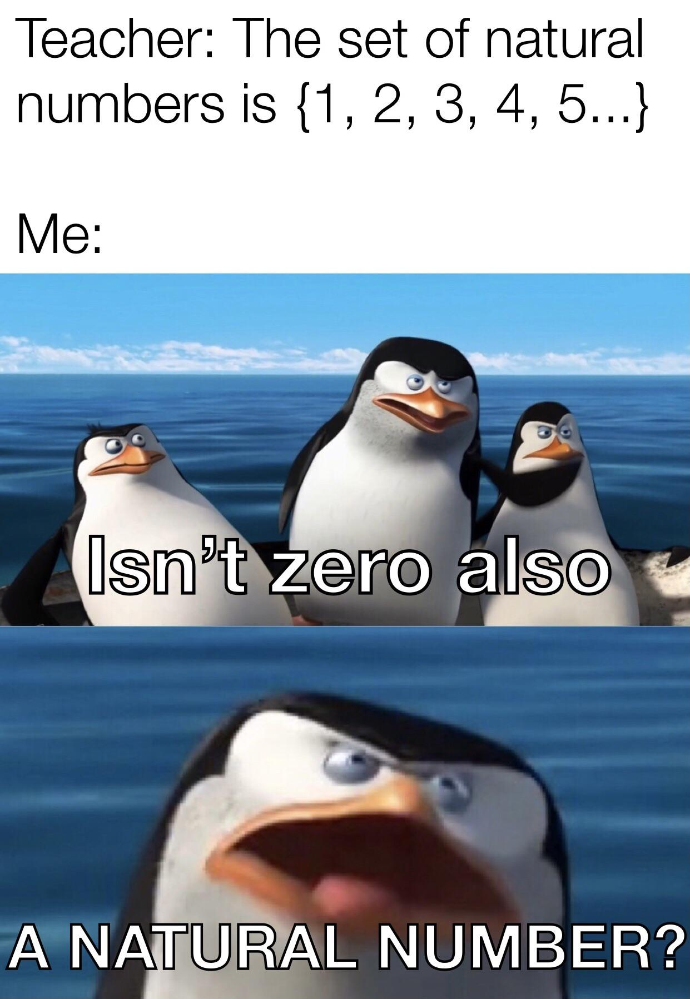

]

### **∈ ∉**

---
## **Previously on 201: Set Theory**
.pull-left[
### **list notation**
 
the **list notation** specifies a set by listing its members  between {curly brackets}  
  - The set *T* is characters in ***Tom and Jerry***
  - *T* = {Tom, Jerry, Tuffy, Spike, Tyke, Butch, Quacker, Cuckoo...}
  

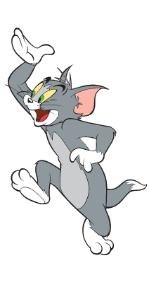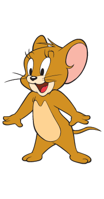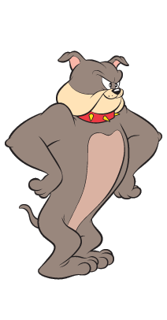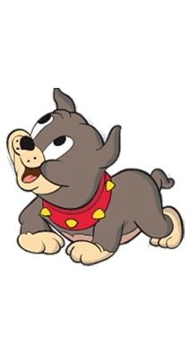

 

### **venn diagram notation**
]

.pull-right[
### **predicate notation**
 
The **predicate notation** specifies a set by describing member's property  
- *S* = { x **|** x is a sorcerer }
- "*S* equals the set of elements <b>*x*</b>, such that **every** <b>*x*</b> is a sorcerer"
- normal words: "the set of all sorcerers"
- **|** stands for "*<u>such that</u>*" 
  

  

]

---
## **Previously on 201: Set Relations**
 
.pull-left[
### **cardinality**: the number of elements in a set
 
- if A = {a, b, c}

  then the **cardinality** of the set A, **|A|** = 3
  
  also, **|A|** = **| {a, b, c} |**  
- <b>singleton set</b>: a set with cardinality = 1
- <b>null set</b> <b>empty set</b>: a set with cardinality = 0
  - {} = **Ø** "empty set"
]

.pull-right[
### **subset (⊆)**
*A* is a subset of *B* if **every** element of *A* is **also** an element of *B*

.pull-left[

{a, b} **⊆** {a, b, c}

]
.pull-right[

{a, b} **⊆** {a, b}

]  

- a ⊆ {a, b, c} is <b>WRONG</b>, why? 

<h3><b>proper subset (⊂)</b></h3>
<i>A</i> is a proper subset of <i>B</i> if <i>A</i> is a <b>subset</b> of <i>B</i> and they are not <b>identical</b> 

.pull-left[

{a, b} <b>⊂</b> {a, b, c}

]
.pull-right[

{a, b, c} <b>⊄</b>  {a, b}

] 

### <b>identity (=)</b>
- two sets are identical/equal if they have <b>exactly the same elements</b>
  - {a, b} <b>=</b> {b, a}
]

---
## **Previously on 201: Set Relations in Languages**
  
.pull-left[

<h3><b><i>Snoopy runs</i>.</b></h3>

]
.pull-right[

<h3><b><i>Cats run</i>.</b></h3>

]
    
.pull-left[
- <i><u>Snoopy runs</u></i>. has the form **Name VERBS**  
  - [[Snoopy]] = **element** Snoopy = s    
  

<h3><b>[[Snoppy]] ∈ [[run]]</b></h3>

]
.pull-right[
- <i><u>cats run</u></i>. has the form **NOUNs VERB**  
  - [[cat]] = **set** of all cats = { x | x is a cat }    

<h3><b>[[cat]] ⊆ [[run]]</b></h3>

]

---
## **Compositional Semantics: NPs**
 
- suppose I wanted to use an **NP** like <u><i>yellow birds</i></u>
  

<h3><b><i>What kind of birds do you like</i>?</b></h3>
<h3><b><i>Yellow birds</i>!</b></h3>

  

- by using this **NP**, we are not making a <b>claim</b>  
- we did not say "<u><i>birds are yellow</i></u>"  
- we are just trying to refer to **all elements** that are **simultaneously** in both [[bird]] and [[yellow]]  
- to define this in set theory, we need **set operations**

---
## **Set Operations**
 
- **set operations** are ways of taking <b>existing sets</b> and creating a <b>new set</b> out of them 
  this is analogous to how **addition** and **subtraction** take <b>two</b> numbers and make a <b>third</b> number  
- four set operations: **union (∪)**, <b>intersection (∩)</b>, <b>difference (–)</b>, <b>complement (')</b>    

.pull-left[
imagine a **universe ** <b>U</b>, in that universe, there are five elements divided into two **sets**  
  - let A = { x ∈ U | x is an animal } = { rabbit, chicken, frog }  
  - let B = { x ∈ U | x is green } = { tree, frog, pepper }  
  - notice that **frog** is in both A and B
]
.pull-right[
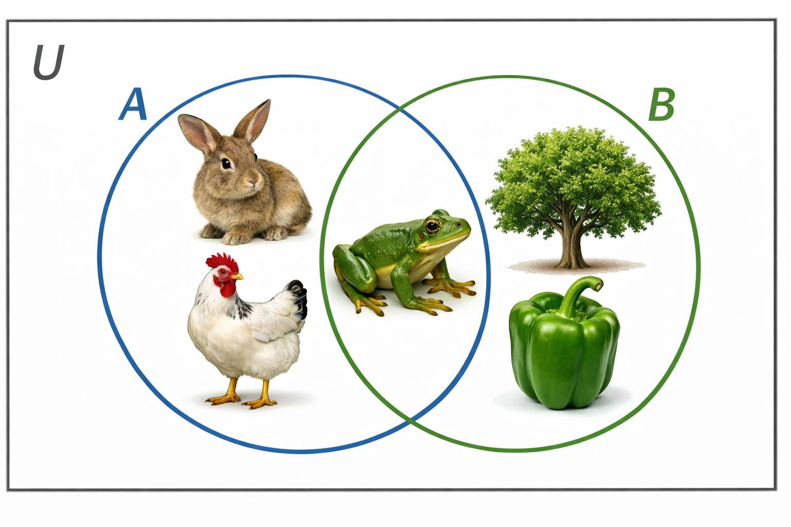
]

---
## **Set Operations: Union**
 
**union** of A and B produces a new set, which contains all **elements** that **belong to A or B** (or both).
  - A **∪** B = { rabbit, chicken, frog, tree, pepper }
    

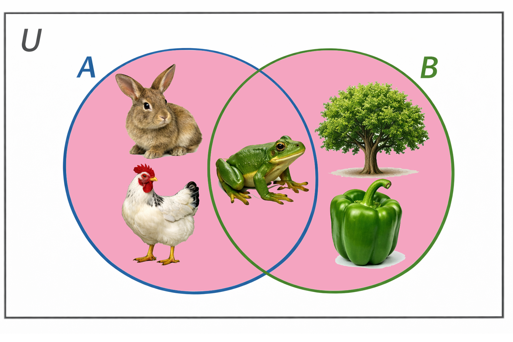

---
## **Set Operations: Intersection**
 
<b>intersection</b> of A and B produces a new set that contains all elements that **belong to both A and B**
  - A <b>∩</b> B = { frog }
  - <b>intersection</b> is the part that **overlaps** between two sets in a Venn diagram
   

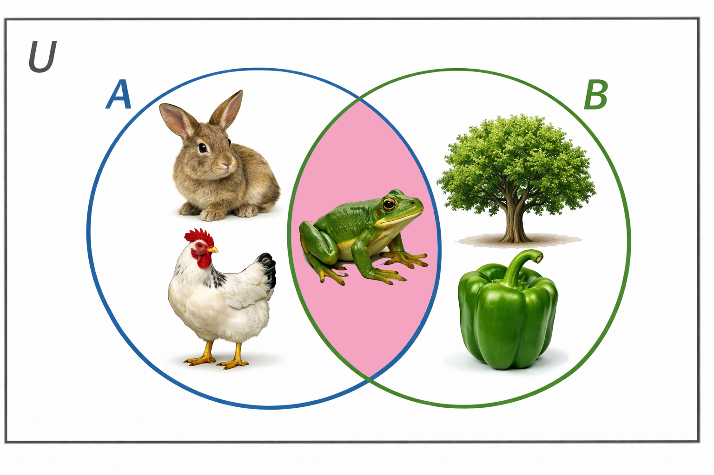

---
## **Set Operations: Difference**
 
<b>difference (–)</b> of A and B produces a new set, which contains all elements that **belong to A but not B**
  - A <b>–</b> B = { rabbit, chicken }
  - **note** that A <b>–</b> B **≠** B <b>–</b> A
    
.pull-left[

A <b>–</b> B  
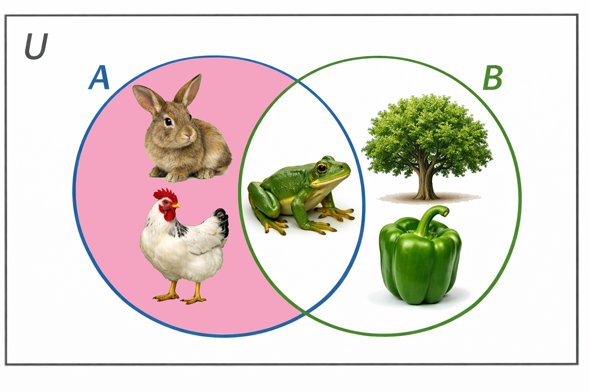

]
.pull-right[

B <b>–</b> A  
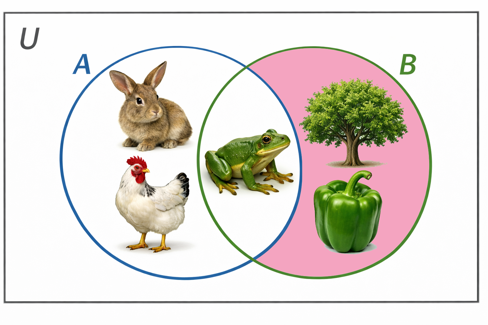

]

---
## **Set Operations: Complement**
 
<b>complement</b> of A produces a new set, which contains all elements **in the specified universe (U) that are not in A**
  - A<b>'</b> = { tree, pepper }
  - the symbol of <b>complement</b>  is tiny, so be careful
   

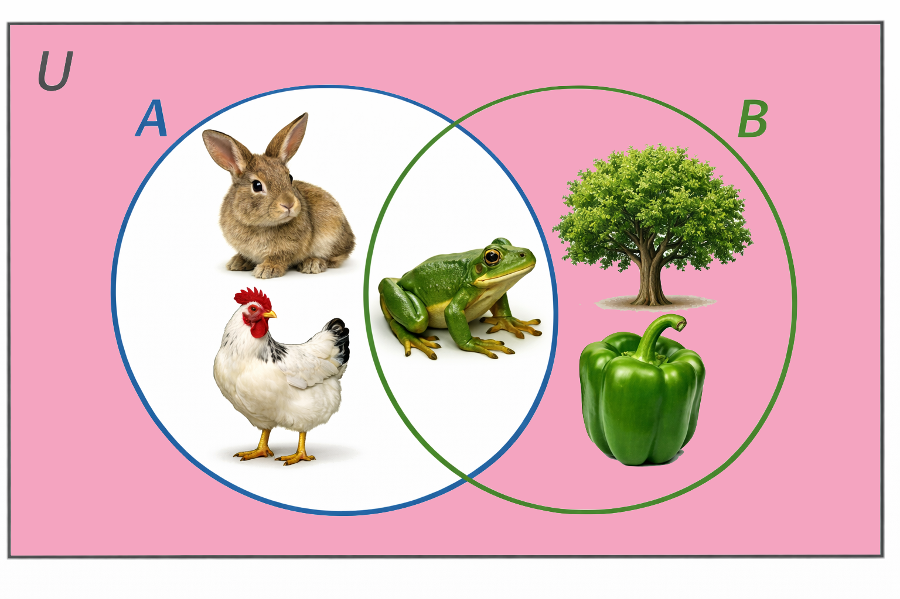

---
## **Set Operations: Summary**
 
<table style="width:100%; border-collapse: collapse;">
  <tr>
    <td style="width:25%; padding: 20px;"><b>union (∪)</b></td>
    <td style="width:50%; padding: 20px;">
      
<i>A ∪ B = { x ∈ U | x ∈ A or x ∈ B }</i>

      
(elements in A or B or <i>both</i>)

    </td>
    <td style="width:20%; padding: 20px; text-align:center;">
      
    </td>
  </tr>

  <tr>
    <td style="padding: 20px;"><b>intersection (∩)</b></td>
    <td style="padding: 20px;">
      
<i>A ∩ B = { x ∈ U | x ∈ A and x ∈ B }</i>

      
(elements in both A and B)

    </td>
    <td style="padding: 20px; text-align:center;">
      
    </td>
  </tr>

  <tr>
    <td style="padding: 20px;"><b>difference (–)</b></td>
    <td style="padding: 20px;">
      
<i>A − B = { x ∈ U | x ∈ A and x ∉ B }</i>

      
(elements in A but not B)

    </td>
    <td style="padding: 20px; text-align:center;">
      
    </td>
  </tr>

  <tr>
    <td style="padding: 20px;"><b>complement (')</b></td>
    <td style="padding: 20px;">
      
<i>A' = { x ∈ U | x ∉ A }</i>

      
(elements in U but not A)

    </td>
    <td style="padding: 20px; text-align:center;">
      
    </td>
  </tr>

</table>

---
## **Exercise I: Set Operations**
 
.pull-left[
**calculate** the following formulas, and **name** the set operation(s) involved  
1. A ∪ B 
  - <b>union</b>: {apple, pear, plum, orange}  
2. A – B 
  - <b>difference</b>: {apple, plum}  
3. B ∩ C 
  - <b>intersection</b>: {orange}  
4. B ∩ D 
  - <b>intersection</b>: Ø or {}  
5. C′ 
  - <b>complement</b>: {apple, pear}
]
.pull-right[  
A = { apple, pear, plum }  
B = { orange, pear }  
C = { plum, apricot, orange, nectarine }  
D = { nectarine, apple }  
**universe** of fruit 
U = { apple, pear, plum, orange, apricot, nectarine }  
<ol start="6">
  <li>(A ∩ B)′</li>
</ol>
  - <b>intersection</b>: A ∩ B = {pear}  
  - <b>complement</b>: (A ∩ B)'= ({pear})' = {apple, plum, orange, apricot, nectarine}
]

---
## **Exercise I: Set Operations**
 
.pull-left[
**calculate** the following formulas, and **name** the set operation(s) involved  
1. A ∪ B 
  - **union**: {apple, pear, plum, orange}  
2. A – B 
  - <b>difference</b>: {apple, plum}  
3. B ∩ C 
  - <b>intersection</b>: {orange}  
4. B ∩ D 
  - <b>intersection</b>: Ø or {}  
5. C′ 
  - <b>complement</b>: {apple, pear}
]
.pull-right[  
A = { apple, pear, plum }  
B = { orange, pear }  
C = { plum, apricot, orange, nectarine }  
D = { nectarine, apple }  
**universe** of fruit 
U = { apple, pear, plum, orange, apricot, nectarine }   
<ol start="6">
  <li>(A ∩ B)′</li>
</ol>
  - <b>intersection</b>: A ∩ B = {pear}   
  - <b>complement</b>: (A ∩ B)'= ({pear})' = {apple, plum, orange, apricot, nectarine}
]

---
## **Set Operations in Natural Languages**
 
.pull-left[
- returning to our **NP** <b>yellow birds</b>:  
  - [[yellow birds]] refers to **all elements** that are in both [[yellow]] and [[bird]]
  - simultaneously in two sets  
- what **set operation** do we use to specify elements that are **simultaneously** in two sets?  
  - intersection (∩): A **∩** B = all elements that are in both A and B at the same time
  - [[yellow]] **∩** [[bird]] = all elements that are in both [[yellow]] and [[bird]] = [[yellow bird]]  
- any **NP** of type <u>ADJ NOUN</u> can be specified in set theory via **intersection**: [[ADJ]] **∩** [[NOUN]]
]
.pull-right[
 

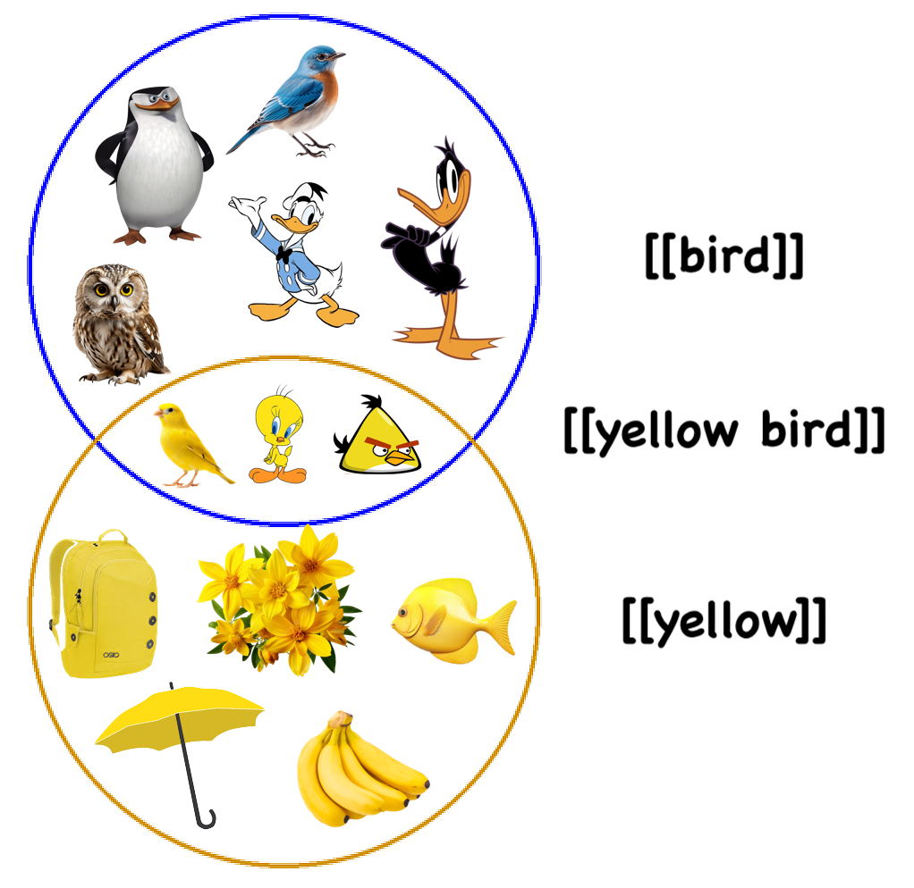

]
---
## **Set Operations in Natural Languages**
 
.pull-left[
- this **NP** <b>yellow birds</b> is further usable in structures we've already seen  

.pull-left[
<i>Tweety is a bird</i>.
]
.pull-right[
[[Tweety]] **∈** [[bird]]
]
<i>Tweety is a yellow bird</i>. 

[[Tweety]] **∈** [[yellow]] **∩** [[bird]]

 

.pull-left[
<i>Birds are pretty</i>.]
.pull-right[
[[bird]] **⊆** [[pretty]]
]
<i>Yellow birds are pretty</i>. 

[[yellow]] **∩** [[bird]] **⊆** [[pretty]]

 

- again, this demonstrates the **Principle of Semantic Compositionality**  
- more complicated sentences usually need more composing and more set relations

]
.pull-right[

 
- note that set operators (∪, ∩, −, ′) **take precedence over** set relation symbols (∈, ⊆, =)
- compare this to arithmetic operators (+, –, ×, ÷) and (in)equality symbols (=, <, >) in algebra
]

---
## **Set Theory in Semantics So Far**
 
.pull-left[

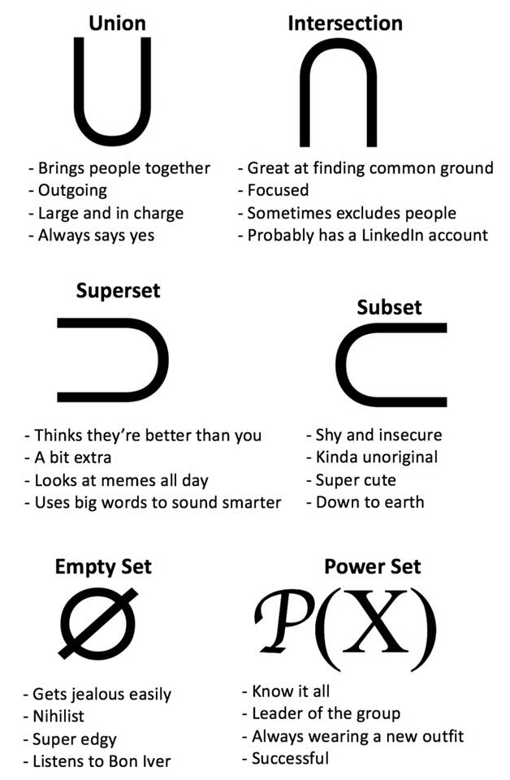

]
.pull-right[
- we can define words by **reference** – the set of things they refer to  
- we can use set theory to precisely define the reference of a **natural language expression**  
  - **sets** are **collections** of elements  
  - **set relations** can capture the relationship **between words** 
  <u><i>Cats are mammals</u></i>.(hypo/hypernyms) 
  <u><i>Snoopy is happy</u></i>.(declarative sentences)  
  - **set operations** can capture the reference of **NP**s like ADJ NOUN  
- at last, we use**cardinality** to define **quantifiers**
]

---
class:middle, center

Quantifiers

---
## **Semantics of Determiners**
 
.pull-left[
 
  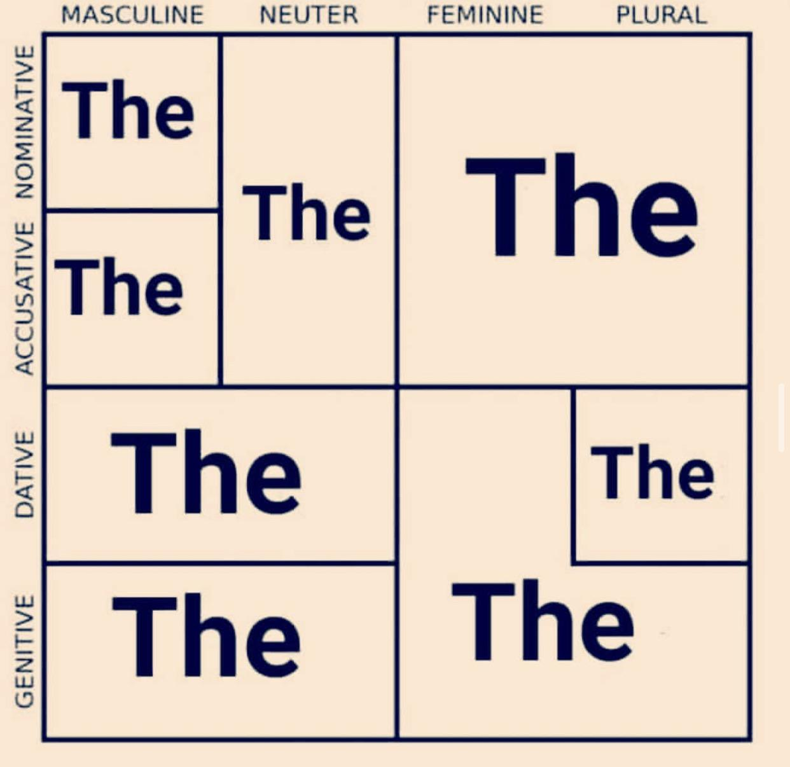
]
.pull-right[
- we previously defined **determiner** as a part of speech and it consists of  
  <small>
  - <b>articles</b> – <i>the</i>, <i>a</i>
  - <b>demonstratives</b> – <i>this</i>, <i>that</i>, <i>these</i>, <i>those</i>
  - q<b>uantifiers</b> – <i>every</i>, <i>some</i>, <i>many</i>, <i>most</i>, <i>no</i>
  - <b>possessive pronouns</b> – <i>my</i>, <i>your</i>, <i>her</i>, <i>his</i>, <i>their</i>, <i>our</i>
  - some <b>question words</b> – <i>which</i>, <i>what</i>  </small>  
- determiners serve to **specify** which member of a set we're **referring to** in the world  
  <small>
  - <i><b>my</b> dog</i> – a **member** of [[dog]] that belongs to me
  - <i><b>this</b> dog</i> – a **member** of [[dog]] that is near me
  - <i><b>every</b> dog</i> – the **entire set** of [[dog]]
  - <i><b>the</b> dog</i> – a **member** of [[dog]] that is relevant to our current conversation
  - <i><b>a</b> dog</i> – an unspecified **member** of [[dog]]
  </small>
]

---
## **Semantics of Quantifiers**
 
.pull-left[
- **quantifiers** (including numerals) are specific type of **determiners** that describes how many **members** of a set we're talking about  

.pull-left[
1. <b>every</b> cat  
2. <b>some</b> cats  
3. <b>three</b> cats  
4. <b>many</b> cats  
5. <b>most</b> cats  
6. <b>no</b> cats
]
.pull-right[

]
]

.pull-right[

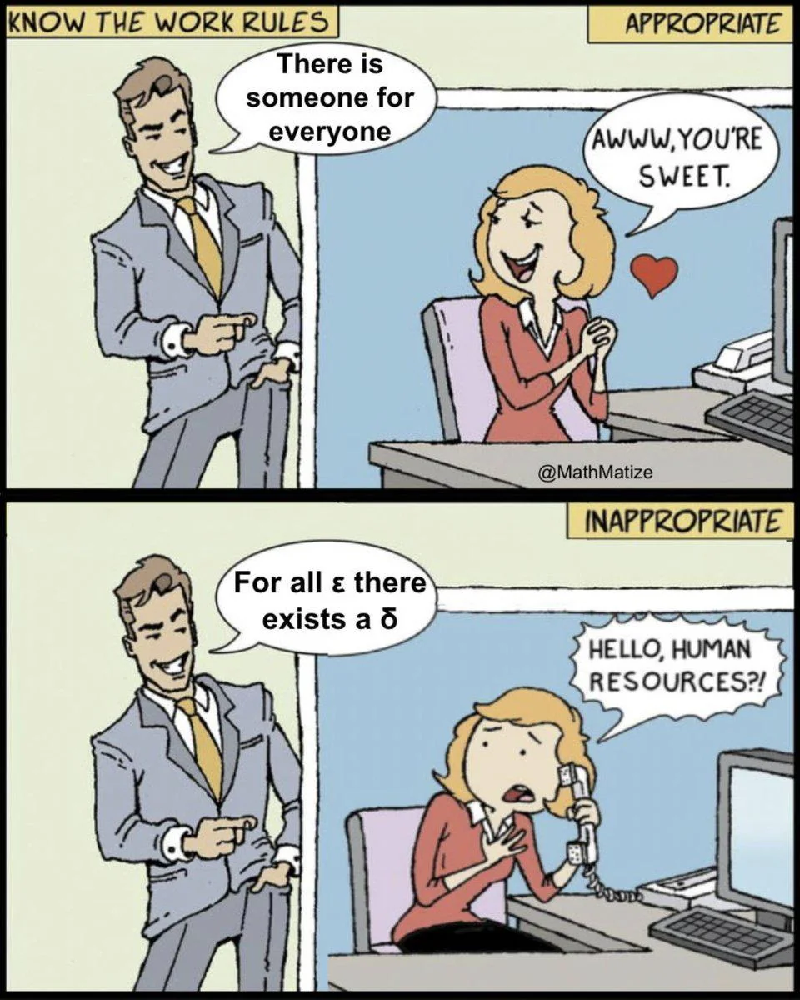

]

---
## **Semantics of Quantifiers**
 
.pull-left[
- **quantifiers** (including numerals) are specific type of **determiners** that describes how many **members** of a set we're talking about  

.pull-left[
1. <b>every</b> cat  
2. <b>some</b> cats  
3. <b>three</b> cats  
4. <b>many</b> cats  
5. <b>most</b> cats  
6. <b>no</b> cats
]
.pull-right[
all  
more than zero  
exactly three  
a large number  
more than half  
zero
]
]

.pull-right[

]

---
## **Semantics of Quantifiers**
 
- **declarative sentences** like NOUNs are NOUNs, NOUNs are ADJ, or NOUN VERBs make some **claim** about the relationship between sets 
.pull-left[

<h3><b><i>Cats run</i>.</b></h3>
⬇
<h3><b>[[cat]] ⊆ [[run]]</b></h3>

]
.pull-right[

<h3><b><i>Snoopy runs</i>.</b></h3>
⬇
<h3><b>[[Snoppy]] ∈ [[run]]</b></h3>

]
  
- sentences with **quantifiers** like QUANT NOUN VERBs also make some **claim** about the relationship between sets – but now it involves some **quantity** 

<h3><b><i>Four cats are running</i>.</b></h3>

  - how many elements are <b>both</b> in [[cat]] and [[run]]?
  - the **cardinality** of the intersection of [[cat]] and [[run]] is <b>four</b>, in other words, there are <b>exactly four elements</b> that are both in [[cat]] and [[run]]

--

<h3><b>| [[cat]] ∩ [[run]] | = 4</b></h3>

  
  
---
## **Semantics of Quantifiers**
 

<table style="width: 100%; border-collapse: collapse; table-layout: fixed;">
  <colgroup>
    <col style="width: 20%;">
    <col style="width: 30%;">
    <col style="width: 25%;">
    <col style="width: 25%;">
  </colgroup>

  <tr>
    <td><b>quantifier</b></td>
    <td><b>example</b></td>
    <td colspan="2"><b>set theory expression</b> (| [[N]] ∩ [[VP]] | = ?)</td>
  </tr>
  <tr>
    <td style="color:white">-</td>
  </tr>
  <tr>
    <td style="color:white">-</td>
  </tr>

  <tr>
    <td><b>numeral</b> N VP</td>
    <td><i><b>Two</b> students run</i>.</td>
    <td>| [[N]] ∩ [[VP]] | = n</td>
    <td style="text-align:right">(n specificed by numeral)</td>
  </tr>
  <tr>
    <td style="color:white">-</td>
  </tr>

  <tr>
    <td><b>some</b> N VP</td>
    <td><i><b>Some</b> students run</i>.</td>
    <td style="color:white">| [[N]] ∩ [[VP]] | ≠ 0</td>
    <td style="text-align:right; color:white"><b>or</b> [[N]] ∩ [[VP]] ≠ Ø</td>
  </tr>
  <tr>
    <td style="color:white">-</td>
  </tr>
  
  <tr>
    <td><b>every</b> N VP</td>
    <td><i><b>Every</b> student runs</i>.</td>
    <td style="color:white">| [[N]] ∩ [[VP]] | = | [[N]] |</td>
    <td style="text-align:right; color:white"><b>or</b> [[N]] ⊆ [[VP]] = TRUE</td>
  </tr>
  <tr>
    <td style="color:white">-</td>
  </tr>
  
  <tr>
    <td><b>many</b> N VP</td>
    <td><i><b>Many</b> students run</i>.</td>
    <td style="color:white">| [[N]] ∩ [[VP]] | > n</td>
    <td style="text-align:right; color:white">(n is some large number)</td>
  </tr>
  <tr>
    <td style="color:white">-</td>
  </tr>
  
  <tr>
    <td><b>most</b> N VP</td>
    <td><i><b>Most</b> students run</i>.</td>
    <td colspan="2"; style="color:white">| [[N]] ∩ [[VP]] | >  ½ | [[N]] |</td>
  </tr>
  <tr>
    <td style="color:white">-</td>
  </tr>
  
  <tr>
    <td><b>no</b> N VP</td>
    <td><i><b>No</b> students run</i>.</td>
    <td style="color:white">| [[N]] ∩ [[VP]] | = 0</td>
    <td style="text-align:right; color:white"><b>or</b> [[N]] ∩ [[VP]] = Ø</td>
  </tr>

</table>

---
## **Semantics of Quantifiers**
 

<table style="width: 100%; border-collapse: collapse; table-layout: fixed;">
  <colgroup>
    <col style="width: 20%;">
    <col style="width: 30%;">
    <col style="width: 25%;">
    <col style="width: 25%;">
  </colgroup>

  <tr>
    <td><b>quantifier</b></td>
    <td><b>example</b></td>
    <td colspan="2"><b>set theory expression</b> (| [[N]] ∩ [[VP]] | = ?)</td>
  </tr>
  <tr>
    <td style="color:white">-</td>
  </tr>
  <tr>
    <td style="color:white">-</td>
  </tr>

  <tr>
    <td><b>numeral</b> N VP</td>
    <td><i><b>Two</b> students run</i>.</td>
    <td>| [[N]] ∩ [[VP]] | = n</td>
    <td style="text-align:right">(n specificed by numeral)</td>
  </tr>
  <tr>
    <td style="color:white">-</td>
  </tr>

  <tr>
    <td><b>some</b> N VP</td>
    <td><i><b>Some</b> students run</i>.</td>
    <td>| [[N]] ∩ [[VP]] | ≠ 0</td>
    <td style="text-align:right"><b>or</b> [[N]] ∩ [[VP]] ≠ Ø</td>
  </tr>
  <tr>
    <td style="color:white">-</td>
  </tr>
  
  <tr>
    <td><b>every</b> N VP</td>
    <td><i><b>Every</b> student runs</i>.</td>
    <td>| [[N]] ∩ [[VP]] | = | [[N]] |</td>
    <td style="text-align:right"><b>or</b> [[N]] ⊆ [[VP]] = TRUE</td>
  </tr>
  <tr>
    <td style="color:white">-</td>
  </tr>
  
  <tr>
    <td><b>many</b> N VP</td>
    <td><i><b>Many</b> students run</i>.</td>
    <td>| [[N]] ∩ [[VP]] | > n</td>
    <td style="text-align:right">(n is some large number)</td>
  </tr>
  <tr>
    <td style="color:white">-</td>
  </tr>
  
  <tr>
    <td><b>most</b> N VP</td>
    <td><i><b>Most</b> students run</i>.</td>
    <td colspan="2">| [[N]] ∩ [[VP]] | >  ½ | [[N]] |</td>
  </tr>
  <tr>
    <td style="color:white">-</td>
  </tr>
  
  <tr>
    <td><b>no</b> N VP</td>
    <td><i><b>No</b> students run</i>.</td>
    <td>| [[N]] ∩ [[VP]] | = 0</td>
    <td style="text-align:right"><b>or</b> [[N]] ∩ [[VP]] = Ø</td>
  </tr>

</table>

---
## **Limitations of Set Theory**
 
- so set theory is a useful way to be **precise** about the **semantic meaning** of language  
- yet, there are a few things that **cannot** be described in set theory  
- an example is **non-intersective** adjectives  
  - an adjective like yellow in yellow bird is called **intersective** because [[yellow bird]] can be described as the **intersection** between [[yellow]] and [[bird]]  
  - what about <u><i>biggest tree</i></u> or <u><i>matching shirts</i></u>?  
  - we need more information – for instance to know which tree is biggest, we need to know the size of all other trees we need to compare them  
- also, we have not yet differentiated pairs like <u><i>Cats run</i>.</u> and <u><i>Cats are running</i>.</u>  
- so **set theory** IS useful, but it **CANNOT** describe all aspects of semantics

---
## **Exercise II: Reference Defining**
 
**define the reference in terms of sets** 
.pull-left[
### 1. <b>[[sleep]]</b>
[[sleep]] = { x | x sleeps }</b>  

### 2. <b>[[Arthur]]</b>
[[Arthur]] = arthur</b>  

### 3. <b>[[happy]]</b>
[[happy]] = { x | x is happy }</b>  

### 4. **[[king]]**
[[king]] = { x | x is a king }</b>
]
.pull-right[

  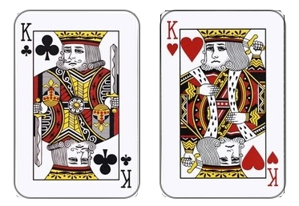
  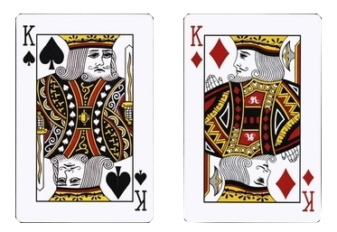

]

---
## **Exercise II: Reference Defining**
 
**define the reference in terms of sets** 
.pull-left[
### 1. <b>[[sleep]]</b>
[[sleep]] = { x | x sleeps }  

### 2. <b>[[Arthur]]</b>
[[Arthur]] = arthur   

### 3. <b>[[happy]]</b>
[[happy]] = { x | x is happy }  

### 4. **[[king]]**
[[king]] = { x | x is a king }
]
.pull-right[

  
  

]

---
## **Exercise III: Set Relation and Operation**
 
translate sentences into **set theory** expressions  
.pull-left[
1. Music is beautiful.  
2. Beautiful fish swim.  
3. Arthur is an ancient figure.   
4. Morgana and Merlin are good sorcerers.   
5. Dark magic is a horrible thing.  
6. Big old dogs are friendly.  
7. Every linguist is a mathematician.  
8. Most blue cats are elegant.
]
.pull-right[
   

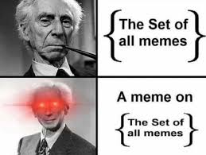

]

   
---
## **Exercise IV: Mario Universe**
### list notation and predicate notation  
define the following sets using both **list notation** and **predicate notation**  
.pull-left[
1. M, the set of characters with mustaches  
2. P, the set of characters who are/wear pink  
3. C, the set of characters with crowns  
4. G, the set of characters who are ghosts   

are any of the sets defined above **singletons**? which one(s)?
]
.pull-right[
<u>***U*** = universe of Mario Kart characters</u>  
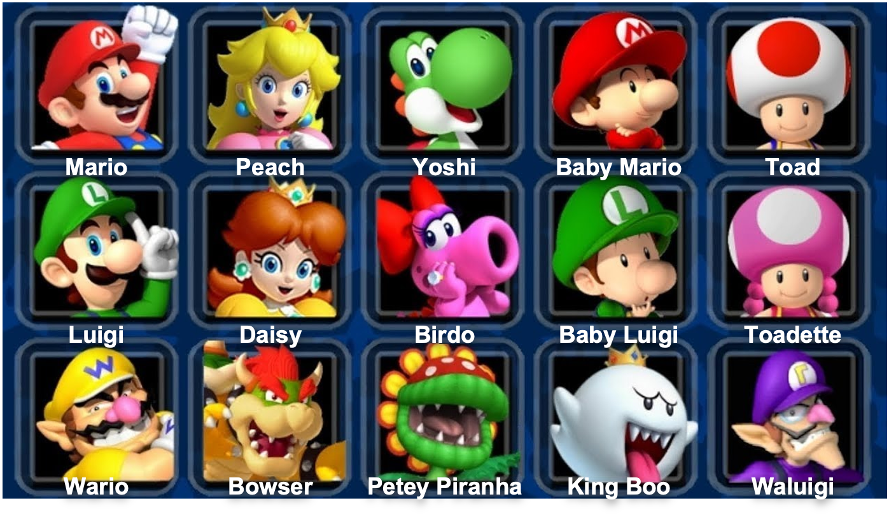
]

---
## **Exercise IV: Mario Universe**
### <b>A</b>  
**true** or **false**? why?  
.pull-left[
1. Mario ∈ M  
2. Peach ∉ C  
3. | C | = 3  
4. {Daisy, Birdo, Luigi} = {Luigi, Daisy, Birdo}  
5. | { x | x has a name that starts with 'W' } | = {Wario, Waluigi}
]
.pull-right[
<u>***U*** = universe of Mario Kart characters</u>  

]

---
## **Exercise IV: Mario Universe**
 
use the sets definedbelow, determine if each of these expressions is **true** or **false**  
.pull-left[
<small>
**M** = { x | x has a mustache} = {Mario, Luigi, Wario, Waluigi} 
**H** = { x | x has a hat} = {Mario, Luigi, Baby Mario, Baby Luigi, Wario, Waluigi} 
**N** = { x | x is a human} = {Mario, Luigi, Baby Mario, Baby Luigi, Peach, Daisy, Wario, Waluigi} 
**R** = { x | x is a princess} = {Peach, Daisy} 
**F** = { x | x is a female human} = {Peach, Daisy}</small>  

.pull-left[
1.M ⊂ H  
2.R ⊆ F  
3.H = N
]
.pull-right[
4.N ⊆ M  
5.R ⊄ N  
6.F ⊈ M  
]
]
.pull-right[
<u> ***U*** = universe of Mario Kart characters</u>
  

 
.pull-left[
<small>
A **=** B: equality/identity 
A **⊆** B: subset 
A **⊂** B: proper subset
</small>
]
.pull-right[
<small>
A **≠** B: not equal/identical 
A **⊈** B: not a subset 
A **⊄** B: not a proper subset
</small>
]
]

---
## **Exercise IV: Mario Universe**
 
.pull-left[
given sets on the right, **calculate** the following and **describe** the resulting set in words  

.pull-left[
01.C ∪ P  
02.H ∩ O  
03.H – M  
04.P ′  
05.C ∩ S
]
.pull-right[
06.| F ∪ S |  
07.| C ∩ P |  
08.O – H  
09.( C ∩ F ) ∪ M  
10.( F ∪ H )′
]

11.F ∩ S = S ∩ F (true or false?)  
12.F – S = S – F (true or false?) 

.pull-left[
<i>A **∪** B</i>: union 
<i>A **∩** B</i>: intersection
]
.pull-right[
<i>A **-** B</i>: difference 
<i>A**'**</i>: complement
]
]

.pull-right[
<u> ***U*** = universe of Mario Kart characters</u>
  

 
<small><small>
**M** = { x | x has a mustache} = {Mario, Luigi, Wario, Waluigi} 
**H** = { x | x has a hat} = {Mario, Luigi, Baby Mario, Baby Luigi, Wario, Waluigi} 
**C** = { x | x has a crown} = {Peach, Daisy, King Boo} 
**F** = { x | x has fangs} = {Bowser, Petey Piranha, King Boo} 
**P** = { x | x is/wears pink} = {Peach, Birdo, Toadette} 
**S** = { x | x has spots} = {Toad, Toadette, Petey Piranha} 
**O** = { x | x's name ends in "o" } = { Mario, Baby Mario, Wario, Birdo, King Boo }
</small></small>
]
---
## **Exercise V: Lion King Universe**
 
write out the **lexical meaning** of these words using **predicate notation**  
.pull-left[
1. lion				
  [[lion]] = L = { x | x is lion }   
2. warthog  
3. brown  
4. meerkat  
5. smile  
6. ferocious
]
.pull-right[
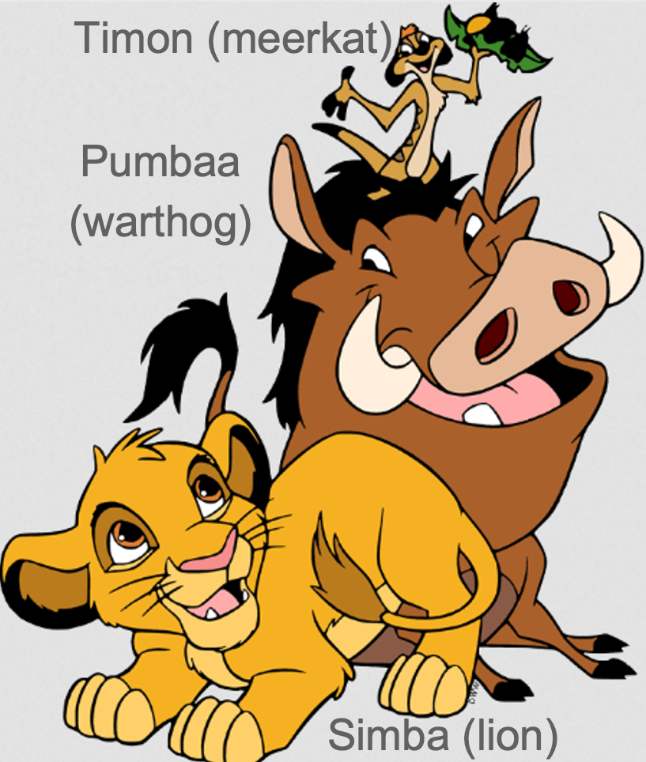
]

---
## **Exercise V: Lion King Universe**
 
write out the **compositional meaning** of these sentences using **set theory** and decide the **truth value**  
.pull-left[
1. Timon is a warthog.

  [[Timon]] ∈ [[warthog]]   			
2. Simba is brown.  
3. Meerkats are ferocious.  
4. Pumbaa smiles.  
5. Lions are not meerkats.  
]
.pull-right[

]

---
## **Exercise V: Lion King Universe**
 
write out the **compositional meaning** of these sentences using **set theory**   
.pull-left[
1. Simba is a cute lion.  
2. Lions are ferocious creatures.  
3. Pumbaa is smelly.  
4. Adult lions roar.  
5. Young lions are adorable animals.  
6. Pumbaa is not a sarcastic meerkat.  
7. Timon and Pumbaa are friendly.  
8. Lions and warthogs are ferocious.  
6-8 are **tricky**!
]
.pull-right[

]

---
## **Exercise VI: Stardew Valley Universe**
 
given the definitions to the right, **express** the meaning of the following sentences using **set theory**  
.pull-left[
1. Abigail is a villager.  
2. Mr. Qi does not live in Pelican Town.  
3. Every farmer grows crops.  
4. Some villagers raise chickens.  
5. Only one farmer lives in Pelican Town.  
6. Most villagers live in Pelican Town.  
7. Marnie and Shane both raise chickens.  
8. Neither Robin nor Abigail grow crops.
]
.pull-right[
[[Marnie]] = *m* 
[[Shane]] = *s* 
[[Mr. Qi]] = *q* 
[[Robin]] = *r* 
[[Abigail]] = *a*  
[[villager]] = { x | x is a villager } = *V* 
[[farmer]] = { x | x is a farmer } = *F* 
[[grow crops]] = { x | x grows crops } = *G* 
[[raise chickens]] = { x | x raises chickens } = *C* 
[[live in Pelican Town]] = { x | x lives in Pelican Town } = *P*
]

---
class: center, middle
**Assignment IV** is due this Friday (**Oct 30**) at **11:59 pm**  
**Assignment V** will be published today (**Oct 28**) and 
it is due next Friday (**Nov 06**) at **11:59 pm**  
<b>reading</b>: **Chapter 8: Pragmatics** of Griffiths & Cummins’ (2017) <i>An Introduction to English Semantics and Pragmatics</i>  

  
Slides created via the R package [**xaringan**](https://github.com/yihui/xaringan).
