class: center, middle
## Please pick up your **name card** from the front
  
## **office hours**: Mondays, 2:00-3:00 pm 
## Basement, Room 003, **Linguistics Building**

---
## **Previously on 201: Set Operations**
 
<table style="width:100%; border-collapse: collapse;">
  <tr>
    <td style="width:25%; padding: 20px;"><b>union (∪)</b></td>
    <td style="width:50%; padding: 20px;">
      
<i>A ∪ B = { x ∈ U | x ∈ A or x ∈ B }</i>

      
(elements in A or B or <i>both</i>)

    </td>
    <td style="width:20%; padding: 20px; text-align:center;">
      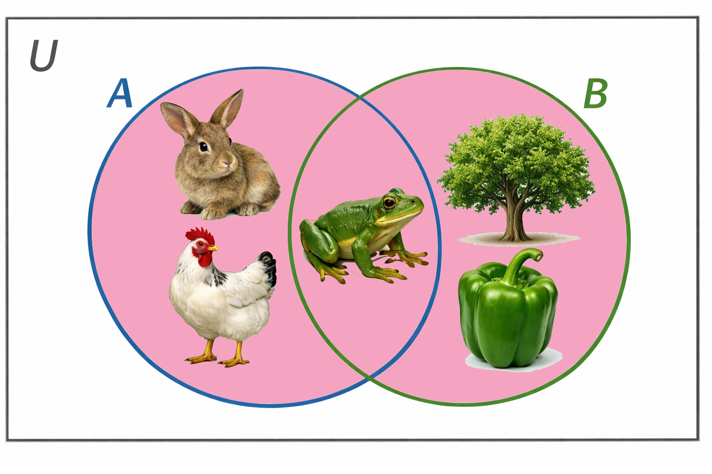
    </td>
  </tr>

  <tr>
    <td style="padding: 20px;"><b>intersection (∩)</b></td>
    <td style="padding: 20px;">
      
<i>A ∩ B = { x ∈ U | x ∈ A and x ∈ B }</i>

      
(elements in both A and B)

    </td>
    <td style="padding: 20px; text-align:center;">
      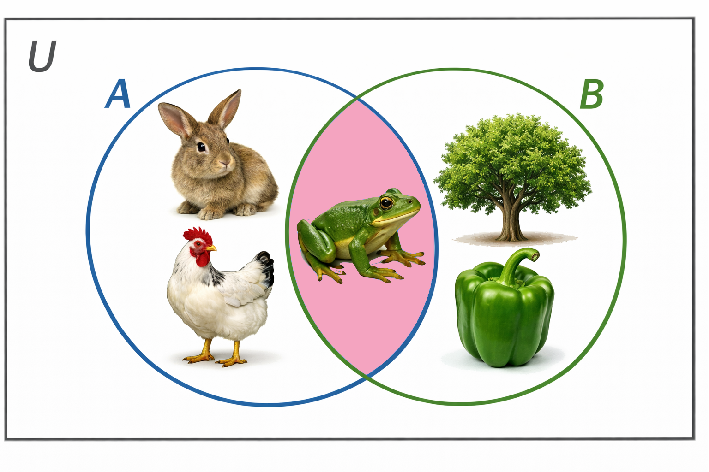
    </td>
  </tr>

  <tr>
    <td style="padding: 20px;"><b>difference (–)</b></td>
    <td style="padding: 20px;">
      
<i>A − B = { x ∈ U | x ∈ A and x ∉ B }</i>

      
(elements in A but not B)

    </td>
    <td style="padding: 20px; text-align:center;">
      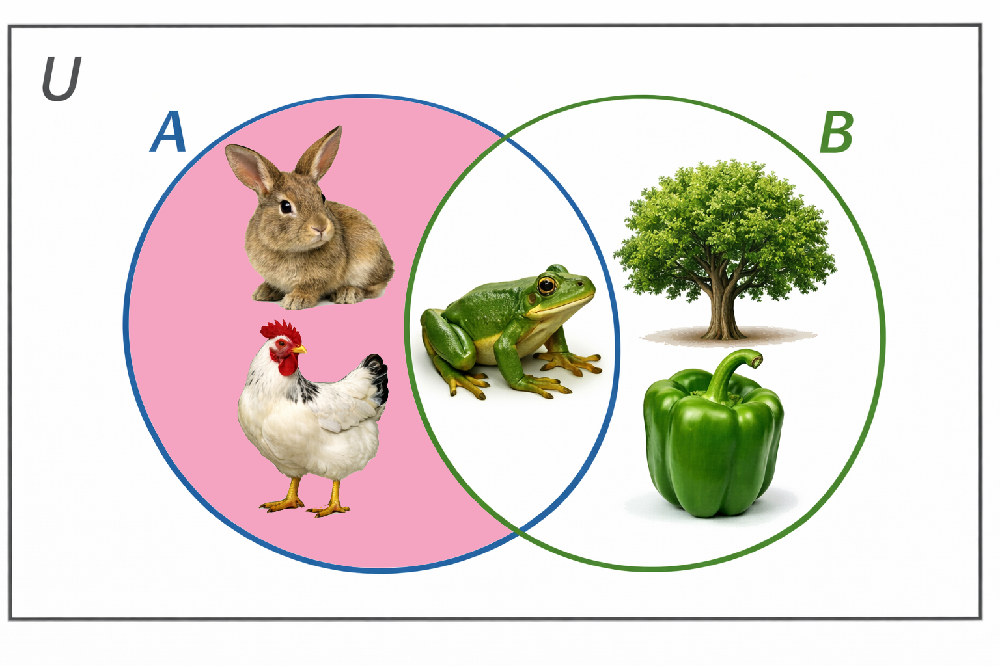
    </td>
  </tr>

  <tr>
    <td style="padding: 20px;"><b>complement (')</b></td>
    <td style="padding: 20px;">
      
<i>A' = { x ∈ U | x ∉ A }</i>

      
(elements in U but not A)

    </td>
    <td style="padding: 20px; text-align:center;">
      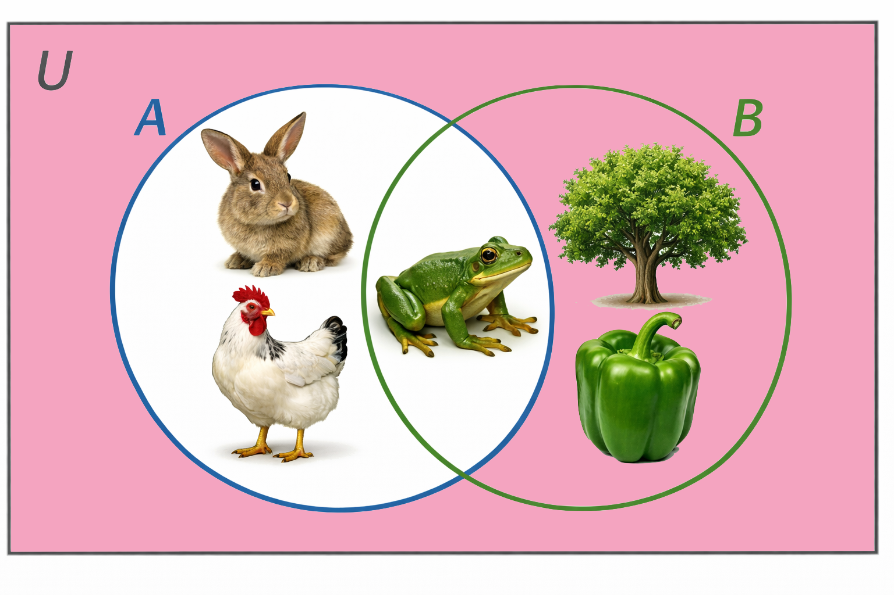
    </td>
  </tr>

</table>

---
## **Previously on 201: Set Theory in Languages**
  
.pull-left[

<b><i>Snoopy is a white dog</i>.</b>  
⬇  
<b>[[Snoopy]] ∈ [[white]] ∩ [[dog]]</b>      
<b><i>Yellow birds are pretty</i>.</b>  
⬇  
<b>[[yellow]] ∩ [[bird]] ⊆ [[pretty]]</b>

]
.pull-right[

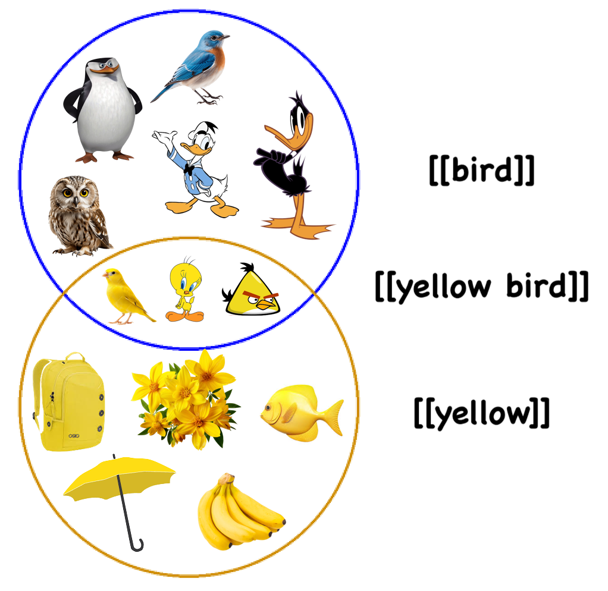

 
- note that set operators (∪, ∩, −, ′) **take precedence over** set relation symbols (∈, ⊆, =)
- compare this to arithmetic operators (+, –, ×, ÷) and (in)equality symbols (=, <, >) in algebra
]

---
## **Previously on 201: Quantifiers**
 
- sentences with **quantifiers** involve some quantity – **cardinality** of a set  

<h3><b><i>Four cats are running</i>.</b></h3>

- the **cardinality** of the intersection of [[cat]] and [[run]] is <b>four</b>
- in other words, there are <b>exactly four elements</b> that are both in [[cat]] and [[run]]

<h3><b>| [[cat]] ∩ [[run]] | = 4</b></h3>

 

<table style="width: 100%; border-collapse: collapse; table-layout: fixed;">
  <colgroup>
    <col style="width: 20%;">
    <col style="width: 30%;">
    <col style="width: 25%;">
    <col style="width: 25%;">
  </colgroup>

  <tr>
    <td><b>quantifier</b></td>
    <td><b>example</b></td>
    <td colspan="2"><b>set theory expression</b> (| [[N]] ∩ [[VP]] | = ?)</td>
  </tr>
  <tr>
    <td style="color:white">-</td>
  </tr>

  <tr>
    <td><b>numeral</b> N VP</td>
    <td><i><b>Two</b> students run</i>.</td>
    <td>| [[N]] ∩ [[VP]] | = n</td>
    <td style="text-align:right">(n specificed by numeral)</td>
  </tr>

  <tr>
    <td><b>some</b> N VP</td>
    <td><i><b>Some</b> students run</i>.</td>
    <td>| [[N]] ∩ [[VP]] | ≠ 0</td>
    <td style="text-align:right"><b>or</b> [[N]] ∩ [[VP]] ≠ Ø</td>
  </tr>
  
  <tr>
    <td><b>every</b> N VP</td>
    <td><i><b>Every</b> student runs</i>.</td>
    <td>| [[N]] ∩ [[VP]] | = | [[N]] |</td>
    <td style="text-align:right"><b>or</b> [[N]] ⊆ [[VP]] = TRUE</td>
  </tr>
  
  <tr>
    <td><b>many</b> N VP</td>
    <td><i><b>Many</b> students run</i>.</td>
    <td>| [[N]] ∩ [[VP]] | > n</td>
    <td style="text-align:right">(n is some large number)</td>
  </tr>
  
  <tr>
    <td><b>most</b> N VP</td>
    <td><i><b>Most</b> students run</i>.</td>
    <td colspan="2">| [[N]] ∩ [[VP]] | >  ½ | [[N]] |</td>
  </tr>
  
  <tr>
    <td><b>no</b> N VP</td>
    <td><i><b>No</b> students run</i>.</td>
    <td>| [[N]] ∩ [[VP]] | = 0</td>
    <td style="text-align:right"><b>or</b> [[N]] ∩ [[VP]] = Ø</td>
  </tr>

</table>

---
class:middle, center

Pragmatics

---
## **A Mysterious Note**
 
.pull-left[
- what information does this note provide?  
- what information is **missing** for fully understanding the note?    
- who is "me"? (who is writing?)  
- who is the implied "you"? (who is written to?)  
- where is "here"?   
- when is "tomorrow"? (when is the note written and when is the day after that?)
]
.pull-right[
  

]

---
## **Pragmatics**
 
.pull-left[
  

]
.pull-right[
- we have said that **Semantics** focuses on the literal meaning  
- yet when we actually talk, we do **NOT** speak in a vacuum  
- we also care about the **particular context**  
1. particular <b>time</b>
2. particular <b>venue</b>
3. particular <b>situation</b>
4. with particular <b>people</b> that we have a particular <b>relationship</b> with (or don't)
5. within an <b>ongoing</b> conversation (in a **discourse**, not individual sentences)
]

---
## **Pragmatics**
 
.pull-left[
- **Pragmatics**, focuses on **implied meaning** and is the study of **language in context**  
- in Pragmatics, we talk about **utterances** rather than <b>sentences</b>:  
  - a <b>sentence</b>: is language used in a vacuum <u>without reference to context</u>  
  - an **utterance** is language spoken <u>in a particular context</u> that informs meanings
]
.pull-right[

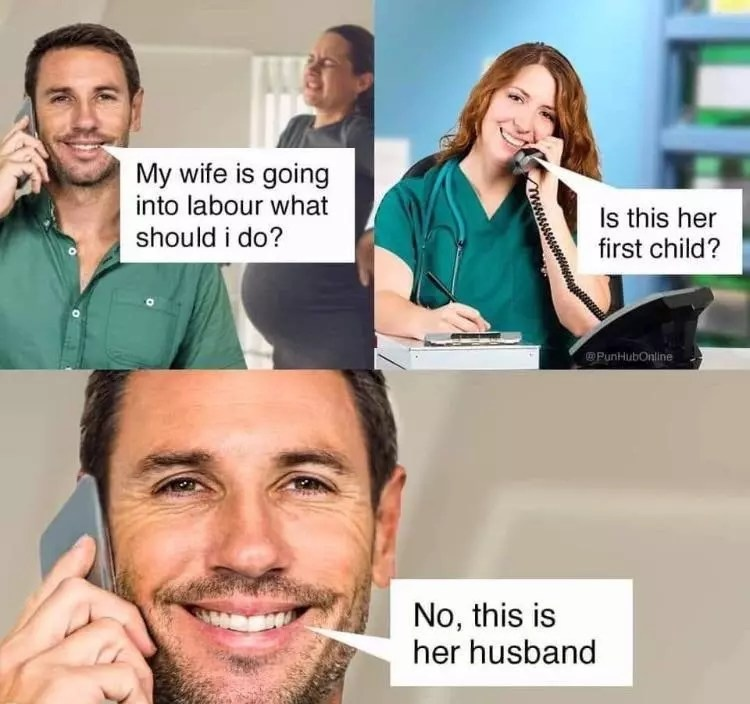

]
  

--

two types of <b>implied meaning</b> will be introduced

 
.pull-left[
<b>conversational implicatures</b>, implied meaning that arises when speakers follow (or ignore) the common rules of conversation
]
.pull-right[
  - <b>presuppositions</b> (revisit), the background information that is taken for granted when saying an utterance
]

---
### **Pragmatics: Speech Acts and Politeness Strategies**
 
Pragmatics studies many aspects of language **in context**, for instance
  
.pull-left[

<h3><b>speech act</b></h3>

  
- most language communicates an idea, asks a question, gives a command...  
- so we take an action simply by saying something, so the language that does something is called a **speech act**  
1. <b>a rookie</b>: <i>Roger that, sir!</i> 
2. <b>officiator</b>: <i>I now pronounce you married.</i> 
3. <b>King Arthur</b>: <i>For the love of Camelot!</i>

]
.pull-right[

<h3><b>politeness strategies</b></h3>

  
- <b>Kazakh</b>: two words for 'you', familiar <i><u>sen</u></i> and polite <i><u>siz</u></i>, part of knowing Kazakh is knowing **when** to use which pronoun  
- <b>Japanese</b>: a person named Kentaro Tanaka might be called <i><u>Ken-chan</u></i>, <i><u>Tanaka-san</u></i>, <i><u>Tanaka-sama</u></i>, <i><u>Tanaka-sensei</u></i>, etc. depending on their relationship to the speaker  
- **English**: <i><u>'Sup!</u></i> is used mostly in casual situation
]

---
## **Pragmatics vs. Semantics**
 
.pull-left[

<b>Arthur: Do you want to go out tonight?</b> 
<b>Merlin: I have an exam tomorrow.</b>

  
- **Semantics** studies <b>literal meaning</b>
  - meanings that can be defined with <u>truth values</u> or calculated with <u>set theory</u> expressions
  - literal meaning: Merlin has an exam  
- **Pragmatics** studies <b>implied meaning</b>
  - meanings that rely on **context** for interpretation
  - implied meaning: Merlin can't or doesn't want to go out
]
.pull-right[

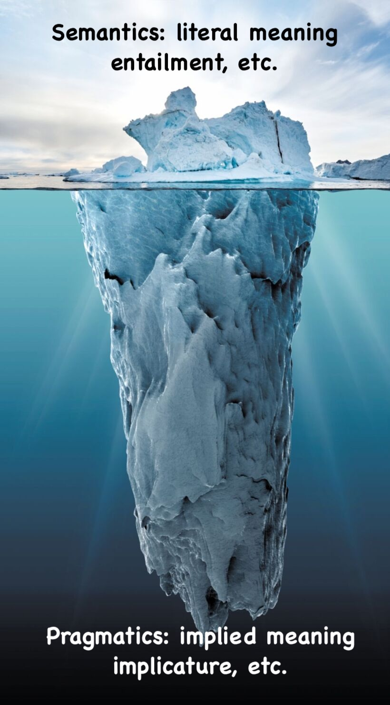

]

---
## **Pragmatics vs. Semantics**
 
in semantics, we discussed **relations** between sentences and we saw that some sentences can <b>entails</b> or <b>presuppose</b> other sentences  

.pull-left[

P <b>entails</b> Q iff: whenever P is <b>TRUE</b>, Q is also <b>TRUE</b>

  

P <b>presupposes</b> Q iff: both P and the negation of P <b>entail</b> Q

]

--

.pull-right[

<b>entailment</b> is only about the relationships between the <b>literal</b> meanings of sentences

  

but <b>presupposition</b> could further be about <b>common sense</b> and general <b>world knowledge</b>

]    

--
.pull-left[

(a) <i>Lancelot opened his umbrella</i>. 
(b) <i>it was raining outside</i>.

]

--

.pull-right[
if we only consider the <b>literal meaning</b>, (a) does **NOT** entai (b), even though common sense might tell us that (a) is likely due to (b)
]

---
class:middle, center

Implicature

---
## **A New Inference**
 

<h3><b>- Arthur: Is it raining outside?</b></h3>
<h3><b>- Merlin: (well,) Lancelot opened his umbrella.</b></h3>

 
- Arthur's utterance neither <b>entails</b> nor <b>presupposes</b> Merlin's utterance  
- but Merlin's utterance does have an **inference** that it is raining outside (and that is why Lancelot opened his umbrella)    

--
- we call this inference **implicature**  
- informally, an **implicature** is an inference that: is <b>“suggested” by</b> an utterance, and
is <b>NOT entailed</b> by the utterance

---
## **Implicature**
 

<h3><b>- Arthur: Is it raining outside?</b></h3>
<h3><b>- Merlin: (well,) Lancelot opened his umbrella.</b></h3>

 
if Merlin's utterance is an implicature of Arthur's, we may want to ask:  
1. why are there **implicatures**?
2. where do **implicatures** come from?  

or more specifically, we want to know 
- <u>how Arthur derives the inference that '<i>it is raining outside</i>', from what Merlin has said</u>

---
## **Implicature**
 

<h3><b>- Arthur: Is it raining outside?</b></h3>
<h3><b>- Merlin: (well,) Lancelot opened his umbrella.</b></h3>

 
- intuitively, Arthur might go through a <b>chain of thought</b> roughly like this  
1. let’s assume that Merlin is trying to have a **genuine** conversation (and he’s not just trying to joke with Arthur);  
2. **based on this assumption**, Merlin should **NOT** say things that are <b>irrelevant</b> to the conversation  
3. so what he said '<i><u>Lancelot opened his umbrella.</u></i>' should be <b>relevant</b>  
4. the answer to Arthur's question is literally either '<i><u>Yes, it is raining outside.</u></i>' or '<i><u>No, it is not raining outside.</u></i>'  
5. if Merlin's utterance is <b>not irrelevant</b>, then it must be **related to** the possible answers (relation built)  
**conclusion**: ‘<u><i>Lancelot opened his umbrella</i>.</u>’ must **implicate** '<u><i>it is raining outside</i>.</u>'

---
## **Implicature**
 
.pull-left[

<b>- Morgana: Did you mow the grass and wash the car like I told you to? </b>  
<b>- Modred: I mowed the grass.</b>

  
<b>implicature</b> of Modred's utterance  

<i>Modred did not wash the car.</i>

]

.pull-right[

<b>- Parceval: Did you make a doctor’s appointment?</b>  
<b>- Gawain: Their line was busy.</b>

  
<b>implicature</b> of Gawain's utterance  

<i>Modred did not make the oppointment.</i>

]   

--

from all of these conversations, we say that the second speaker <b>is trying to have a genuine conversation</b>  

the first speaker automatically <b>assumes</b> that the second speaker (hearer) will reply  

<h3><b>adhering to the rules of conversation</b></h3>

---
## **The Cooperative Principle**
 
.pull-left[
- philosopher **Paul Grice** studied how people behave when they're having a conversation   
- <u>participants in a conversation</u> (**interlocutors**) tend to collaborate and follow certain rules:   
1. **NOT** saying things that are **irrelevant** 
  – *How are you today?* 
  – *false*.  
2. **NOT** saying things are believed to be **false** 
  – *Do you know where the truck is?* 
  – *On the top of my head*.  
3. **NOT** saying **more** or **less** than needed 
  – *Do you fancy a cuppa tea or coffee?* 
  – *Yes*.
]
.pull-right[
   

<i>Paul Grice</i> (1913-1988)

]

---
## **The Cooperative Principle**
 
.pull-left[
  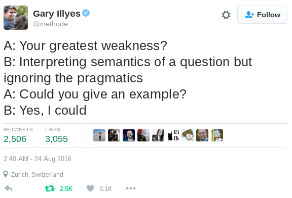
]
.pull-right[
- these rules of conversation is called the **Cooperative Principle**  
- we tend to behave **cooperative** whenever we're collaborating on a common task with a common goal with other people  
- this sounds like a big ask, but people are actually pretty good at it (**subconsciously**)  
- people are said to be cooperative when they follow the **conversational maxims**
]
  

### participants in a conversation tend to say what's **appropriate** for the situation and goals of the conversation

---
class: middle, center

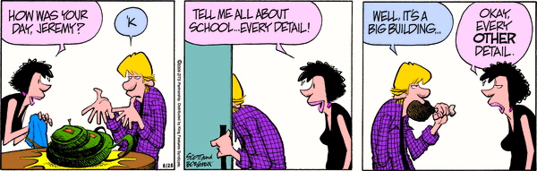

---
## **Grice’s Maxims**
 

  
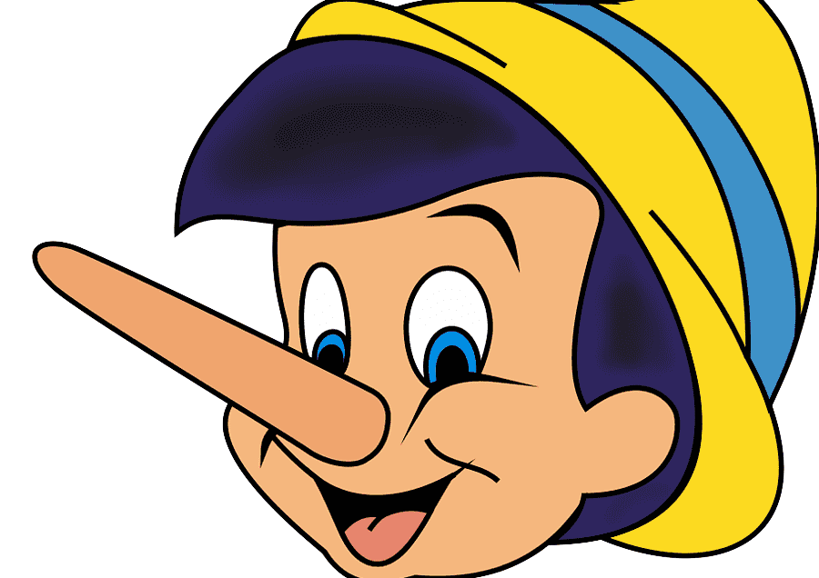

  

    <b>Maxim of Quality</b> 
    be truthful
  

  

  - don't say what you believe to be false 
  - don't say what you don't have evidence for
  

  

  

    <b>Maxim of Quantity</b> 
    be informative as needed
  

  

  - don't say more than you need to 
  - don't say less than you need to
  

  
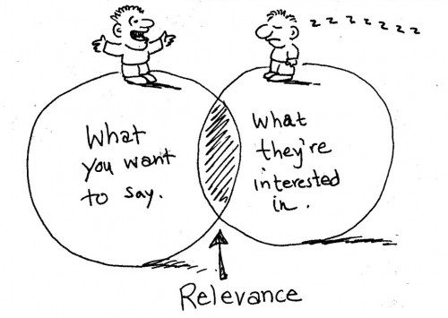

  

    <b>Maxim of Relation (Relevance)</b> 
    be relevant
  

  

  - don't say irrelevant things
  

  
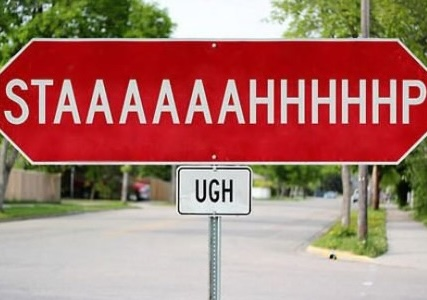

  

    <b>Maxim of Manner</b> 
    be clear
  

  

  \- don't be obscure, ambiguous or wordy 
  \- provide information in a <b>sensible</b> order
  

 
although they're worded like commands, the maxims are intended to describe how people **tend** to behave or are **assumed** to behave, not how they **ought to** behave

---
## **Provide Information in a SENSIBLE Order**
 
.pull-left[
<b>what was reported in the news</b>:   
1. Arthur resigned.  
2. The company decided to launch an investigation into him.  

<b>what actually happened</b>:   
1. The company decided to launch an investigation into him.  
2. Arthur resigned.
]

.pull-right[
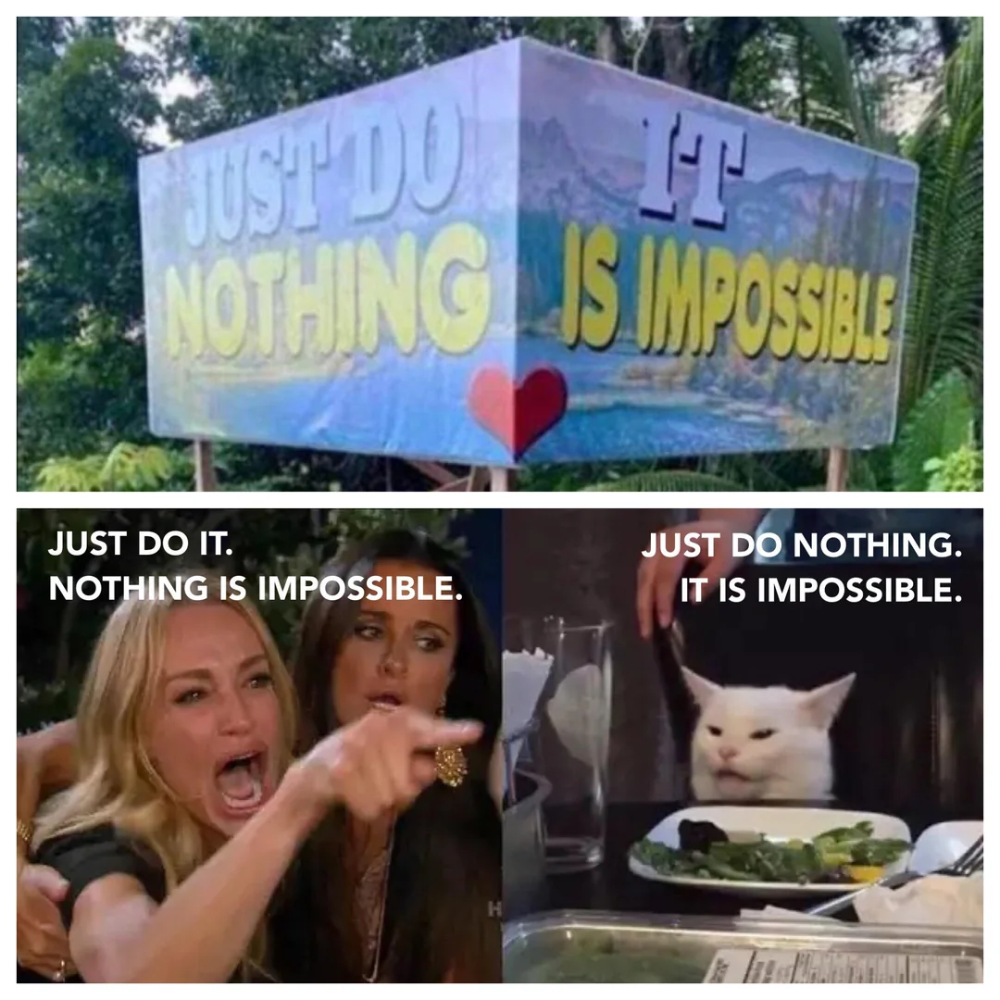
]

---
## **Sometimes We Break (Flout) the Maxims**
 
.pull-left[
- we generally assume interlocutors are following the **Cooperative Principle** and **conversational maxims**  
- yet, sometimes it **seems** we break the maxims:
  - Lancelot: *How was the dinner?* 
  - Percival: *I wish I stayed home*.  
- Percival said something **irrelevant** to the dinner, <u>flouting</u> the **Maxim of Relevance**  
- what if Percival is in fact being **cooperative**?
  - *(The dinner was bad/not that good, so) I wish I stayed home*.
]
.pull-right[
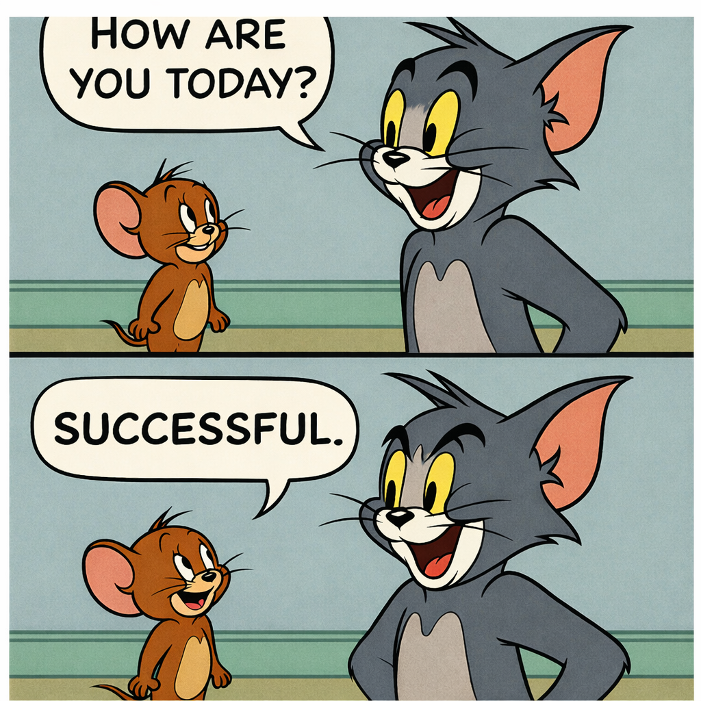   
]
 
**conversational implicature** can be arised when the interlocuter **intentionally** flouts the maxims (they are still cooperative), in this case, Percival's utterance **implicates** that '<i>the dinner was bad</i>'

---
## **Maxim of Quality**
 

<b>maxim of quality</b>: be truthful

  
.pull-left[
- do **not** say what you believe to be **false**
  - not everything is a lie in a conversation  
- do **not** say that for which you **lack adequate evidence**  
- "adequate evidence" depends on the situation
  - a doctor would be held to a **higher standard of evidence** than a regular person on a disease outcome
]

.pull-right[
<b>obeying the maxim</b>  
.pull-left[

 Did you break my bowl?  

  
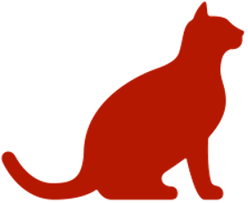

]
.pull-right[

Sorry, it was me. I got too excited chasing a tennis ball.

 

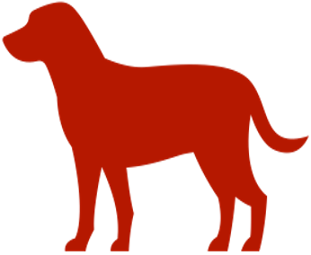

]
]

---
## **Maxim of Quality**
 

<b>maxim of quality</b>: be truthful

  
.pull-left[
- do **not** say what you believe to be **false**
  - not everything is a lie in a conversation  
- do **not** say that for which you **lack adequate evidence**  
- "adequate evidence" depends on the situation
  - a doctor would be held to a **higher standard of evidence** than a regular person on a disease outcome
]

.pull-right[
<b>flouting the maxim</b>  
.pull-left[

 Dogs can fly, right?  

  

]
.pull-right[

And cats can swim in the outer space, I suppose.  

 

]
]

---
## **Maxim of Quality**
 

<b>maxim of quality</b>: be truthful

  
.pull-left[
- do **not** say what you believe to be **false**
  - not everything is a lie in a conversation  
- do **not** say that for which you **lack adequate evidence**  
- "adequate evidence" depends on the situation
  - a doctor would be held to a **higher standard of evidence** than a regular person on a disease outcome  
- **note** here that an **implicature** is not what is literally said
]

.pull-right[
<b>flouting the maxim</b>  
.pull-left[

 Dogs can fly, right?  

]
.pull-right[

And cats can swim in the outer space, I suppose.  

]  

<b>implicature</b>: The cat’s statement is wildly wrong.

 
if we assume the dog is **cooperative**, dog's saying <u>obviously false</u> things **implicate** that the cat’s statement is absurd
]

---
## **Notes on Violation or Flouting**
  
.pull-left[
- we **DO** have cases where people <b>violate</b> or <b>ignore</b> the **maxims**   
- **lying** and **claiming without evidence** would be <b>violating</b> maxim of quality   
- sometimes, **flouting** a maxim is done to convey additional message for sarcastic or comedic effect   
  - A: *My TA gave me 59 as the final grade intentionally just to fail me*!</b>
  - B: *What a lovely and responsible TA he is!*</b>  
- hence, **intentionally** flouting the maxim will arise an **implicature**
]
.pull-right[
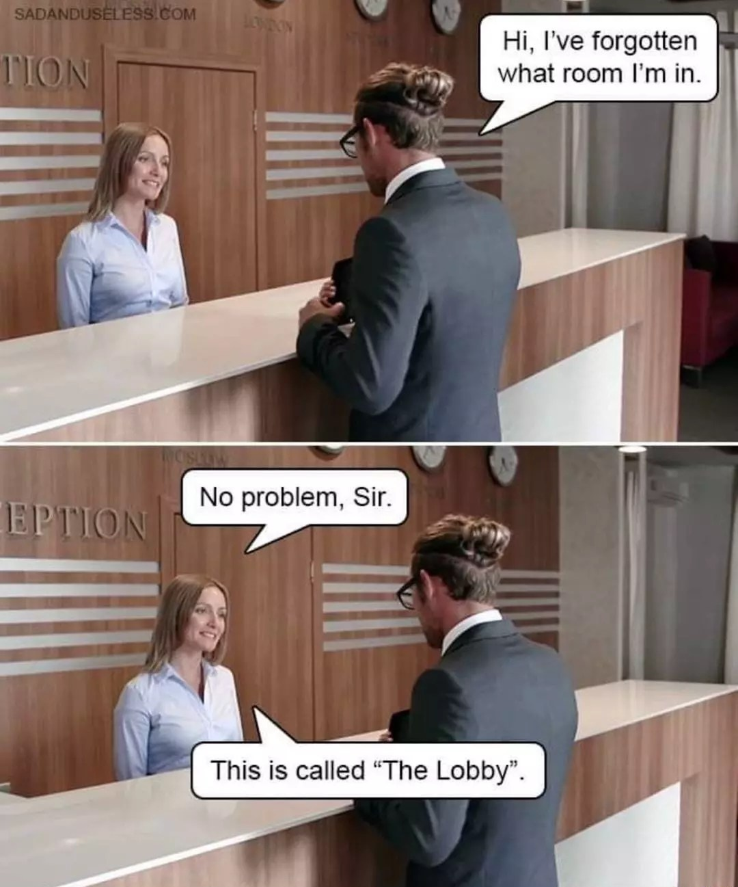
]

---
## **Maxim of Quantity**
 

<b>maxim of quantity</b>: be informative as needed

  
.pull-left[
- be as **informative** as is required   
- do not be either <b>over</b>**informative** or <b>under</b>**informative**   
- this maxim calls for an **appropriate** amount of information  
]
.pull-right[
<b>obeying the maxim</b>  
.pull-left[

 What languages do you speak? 

  

]
.pull-right[

I speak English, Kazakh and Mandarin. 

 

]
]

---
## **Maxim of Quantity**
 

<b>maxim of quantity</b>: be informative as needed

  
.pull-left[
- be as **informative** as is required   
- do not be either <b>over</b>**informative** or <b>under</b>**informative**   
- this maxim calls for an **appropriate** amount of information  
- for the utterance on the right, if the dog also speaks German   
  - is the utterance still true?
  - how does the utterance sound?
]
.pull-right[
<b>flouting the maxim</b>  
.pull-left[

 What languages do you speak? 

  

]
.pull-right[

I speak English, Kazakh, German and Mandarin. 

 

]  
]

---
## **Maxim of Quantity**
 

<b>maxim of quantity</b>: be informative as needed

  
.pull-left[
- be as **informative** as is required   
- do not be either <b>over</b>**informative** or <b>under</b>**informative**   
- this maxim calls for an **appropriate** amount of information  
- for the utterance on the right, if the dog also speaks German   
  - is the utterance still true?
  - how does the utterance sound?
]
.pull-right[
<b>flouting the maxim</b>  
.pull-left[

 What languages do you speak? 

]
.pull-right[

I speak English, Kazakh, German and Mandarin. 

]  

<b>implicature (possible)</b>: The dog does not want to let the cat know that he speaks German as well.

 
if we assume the dog is **cooperative**, dog's intentionally <u>hiding</u> things **implicate** that he thinks it is not necessary to tell the cat about this case
]

---
## **Maxim of Quantity**
 

<h3><b>Judge</b>: <i>Mr. Lachinskaya, have you pleaded guilty to all of the charges listed before this court?</i></h3>
<h3><b>Mr. L</b>: <i>I admit to the first one, Your Honor</i>.</h3> 
what is Mr. lachinskaya <b>implicating</b>?

 

<h3><b>Arthur</b>: <i>What do you do for a living?</i></h3>
<h3><b>Merlin</b>: <i>I work</i>.</h3> 
what is probably <b>implicated</b> Merlin via flouting the <b>maxim of quantity</b>?

---
## **Maxim of Quantity: Scalar Implicature**
 

<b>maxim of quantity</b>: be informative as needed

  
.pull-left[
- **scalar implicature** is a special type of quantity implicature
  - <i>Some students passed the exam.</i>  
- **literal** meaning
  - ⟦student⟧ ∩ ⟦passed the exam⟧ ≠ ∅  
- **implicature**: <i><u>Not all students passed the exam.</u></i>
  - if <i><u>all</u></i> students passed
  - since <i><u>all</u></i> is a stronger statement compared to <i><u>some</u></i>
  - assuming I’m adhering to Maxim of Quantity, I **would have** just used <i><u>all</u></i>
  - but I **intentionally** used <i><u>some</u></i>

]
.pull-right[
<b>obeying the maxim</b>  
.pull-left[

Did you eat the cookies? 

  

]
.pull-right[

I ate <b>some of</b> them. 

 

]  
]

---
## **Maxim of Quantity: Scalar Implicature**
 

<b>maxim of quantity</b>: be informative as needed

  
.pull-left[
- **scalar implicature** is a special type of quantity implicature
  - <i>Some students passed the exam.</i>  
- **literal** meaning
  - ⟦student⟧ ∩ ⟦passed the exam⟧ ≠ ∅  
- **implicature**: <i><u>Not all students passed the exam.</u></i>
  - if <i><u>all</u></i> students passed
  - since <i><u>all</u></i> is a stronger statement compared to <i><u>some</u></i>
  - assuming I’m adhering to Maxim of Quantity, I **would have** just used <i><u>all</u></i>
  - but I **intentionally** used <i><u>some</u></i>
]
.pull-right[
<b>obeying the maxim</b>  
.pull-left[

Did you eat the cookies? 

]
.pull-right[

I ate <b>some of</b> them. 

]  

<b>implicature (possible)</b>: The dog did not eat all cookies.

 
the dog is **cooperative**, and offering information that is as **informative** as needed, but he **intentionally** chose <u><i>weaker</i></u> statement (<i>some</i>), which **implicate** that he did not eat <b>all</b> cookies
]

---
## **Maxim of Relevance**
 

<b>maxim of relevance</b>: be relevant

  
.pull-left[
- it is generally assumed that people will say things **relevant to the current topic** of conversation
]
.pull-right[
<b>obeying the maxim</b>  
.pull-left[

Our TA is nice, isn't he? 

  

]
.pull-right[

He is lovely and responsible. 

 

]  
]

---
## **Maxim of Relevance**
 

<b>maxim of relevance</b>: be relevant

  
.pull-left[
- it is generally assumed that people will say things **relevant to the current topic** of conversation
]
.pull-right[
<b>flouting the maxim</b>  
.pull-left[

Our TA is nice, isn't he? 

  

]
.pull-right[

Cookies are pretty nice for sure. 

 

]  
]

---
## **Maxim of Relevance**
 

<b>maxim of relevance</b>: be relevant

  
.pull-left[
- it is generally assumed that people will say things **relevant to the current topic** of conversation  
- we sometimes **CAN** change the topic without violating this **maxim**  
- but we do need to **literally** signal the change of topic to our interlocutors
  - – Arthur: *How was the movie?* 
  – Merlin: *Actually, there's something else I want to talk to you about*.  
- Merlin is not being relevant, but he signaled his desire to change the topic with "**actually**"
]
.pull-right[
<b>flouting the maxim</b>  
.pull-left[

Our TA is nice, isn't he? 

]
.pull-right[

Cookies are pretty nice for sure. 

]  

<b>implicature</b>: The dog does not like the TA at all.

 
if we assume the dog is **cooperative**, dog's intentionally changing <u>the topic</u> things **implicate** that he does not agree with the cat
]

---
## **Maxim of Relevance**
 
.pull-left[
 
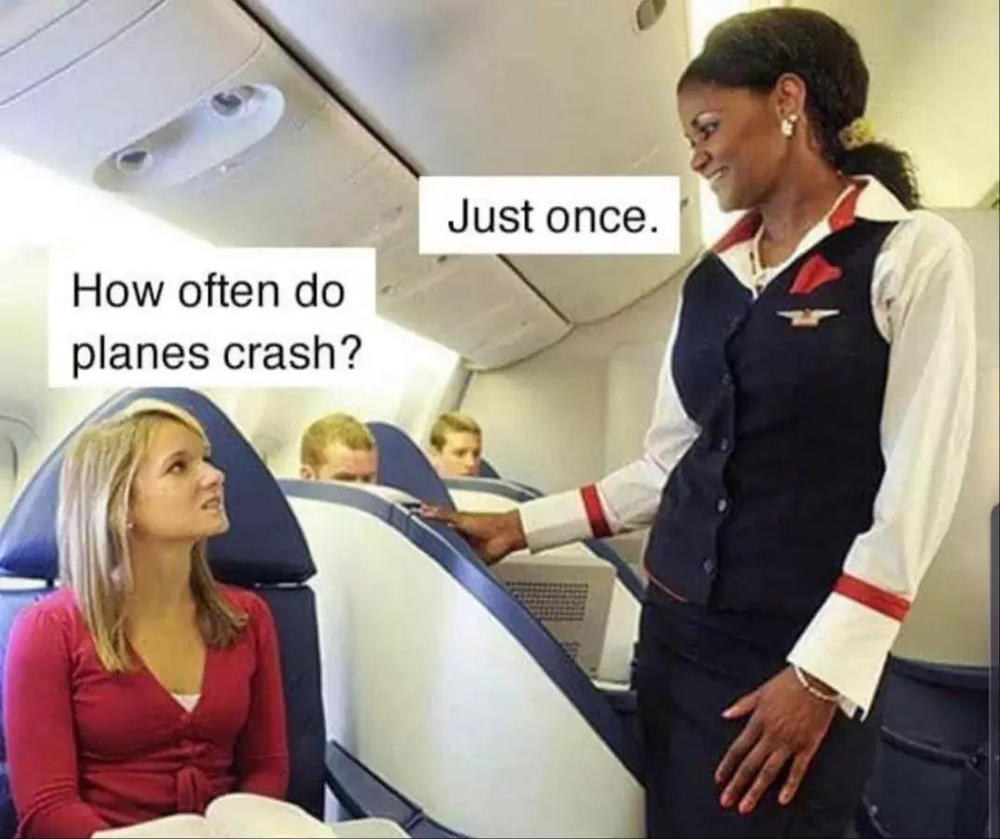
  
<i>we often rely on implied meanings like implicatures because it would be **rude** or **inappropriate** or even just overly **pedantic** to say everything literally</i>
]
.pull-right[
- assuming that people are being **relevant** helps us make sens of people's utterances   
- – Arthur: *Is Lancelot dating anyone these days?* 
– Merlin: *He goes to London every weekend*.  
  - if Merlin (~~as always~~) makes sense (is being **relevant**), what is he **implicating**?   
- a professor writes in the recommendation letter to a graduate programme for Merlin:  
  - *Merlin has good handwriting and he always dresses neatly*  
  - is it relevant?
  - what is the **implicature**?
]

  
---
## **Maxim of Manner**
 

<b>maxim of manner</b>: be clear

 
.pull-left[
- avoid **obscurity** of expression (don't be hard to understand)   
- avoid **ambiguity**  
- be **brief**. (don't be too wordy)  
- be **orderly** (present information in an order that makes sense)
]

.pull-right[
<b>obeying the maxim</b>  
.pull-left[

What did you do this morning? 

What did you do this morning? 

  

]
.pull-right[

A1: I went to the park and had my breakfast. 
A2: I had my breakfast and went to the park. 

 

]  
]

---
## **Maxim of Manner**
 

<b>maxim of manner</b>: be clear

 
.pull-left[
- avoid **obscurity** of expression (don't be hard to understand)   
- avoid **ambiguity**  
- be **brief**. (don't be too wordy)  
- be **orderly**. (present information in an order that makes sense)  
  - *Arthur took the medication and had an allergic reaction*.  
  - *Arthur had an allergic reaction and took the medication*.
]

.pull-right[
<b>obeying the maxim</b>  
.pull-left[

What did you do this morning? 

What did you do this morning? 

]
.pull-right[

A1: I went to the park and had my breakfast. 
A2: I had my breakfast and went to the park. 

]  

<b>A1's implicature</b>: He had breakfast in the park. 
<b>A2's implicature</b>: He had breakfast at home.

 
if the dog is **cooperative**, his intentionally using <u>different</u> orders **implicate** the order of events
]

---
## **Exercise I: Grice's Maxims**
 
identify the **conversational implicatures** in the following dialogues 
identify the **maxims** that lead to each implicature
  
.pull-left[
1. Merlin: Do you have our tickets with you?  
  Arthur: Didn't I give it to you?   
  - Arthur does not have the tickets.
  - maxim of relevance (flouted)    
2. Merlin: How do you like the string quartet?  
  Arthur: I think the violinist is good  
  - Arthur does not think the whole quartet is good
  - maxim of quantity (flouted)
]
.pull-right[
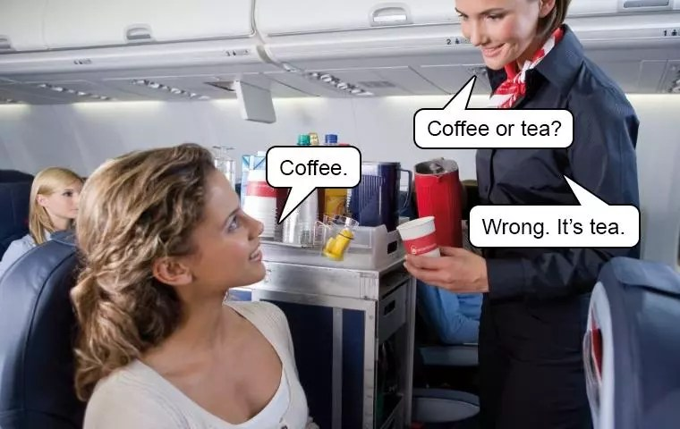
  
what is this violating?
]

---
## **Exercise I: Grice's Maxims**
 
identify the **conversational implicatures** in the following dialogues 
identify the **maxims** that lead to each implicature
  
.pull-left[
1. Merlin: Do you have our tickets with you?  
Arthur: Didn't I give it to you?   
  - Arthur does not have the tickets.
  - Maxim of relevance (flouted)    
2. Merlin: How do you like the string quartet?  
Arthur: I think the violinist is good  
  - Arthur does not think the whole quartet is good
  - Maxim of quantity (flouted)
]
.pull-right[

  
what is this violating?
- maxim of quality
- the original question was not **genuine**
]

---
## **Cancelling and Reinforcing Implicatures**
.pull-left[
  
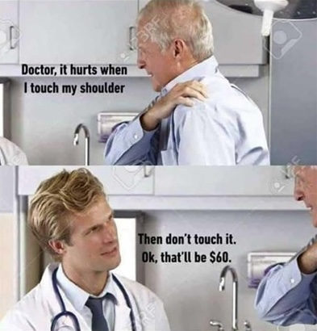
]
.pull-right[ 
- implicatures can be **cancelled** and **reinforced**, but literal meaning cannot  
- what do the following utterances **implicate**?   
  - – *What languages does Anna speak?*  
  – *Anna speaks English, Korean, and Farsi*. 
  - <b><i>implicature</i></b>: *Anna speaks only these three languages*.  
  - *Ian ate a cake and was happy*. 
  - <b><i>implicature</i></b>: *Ian ate a cake and that made him happy*.  
  - – *Does Sue have any siblings?*  
  – *Sue has a brother*. 
  - <b><i>implicature</i></b>: *Sue has only one brother*.
]
---
## **Cancelling and Reinforcing Implicatures**
.pull-left[
  

]
.pull-right[ 
- implicatures can be **cancelled** and **reinforced**, but literal meaning cannot  
- what do the following utterances **implicate**?   
  - – *What languages does Anna speak?*  
  – *Anna speaks English, Korean, and Farsi*. 
  - <b><i>implicature</i></b>: *Anna speaks only these three languages*.  
  - *Ian ate a cake and was happy*. 
  - <b><i>implicature</i></b>: *Ian ate a cake and that made him happy*.  
  - – *Does Sue have any siblings?*  
  – *Sue has a brother*. 
  - <b><i>implicature</i></b>: *Sue has only one brother*.
]

---
## **Cancelling Implicatures**
 
- what if we say the following sentence:   
aaaaaa<i>Anna speaks English, Korean, and Farsi. **In fact, she also speaks Greek**</i>.  

- implicatures can be **cancelled** or **defeated**: we add extra information to the statement that **contradicts** the <b>implicature</b> and makes it go away   

--

- – *Anna speaks English, Korean, and Farsi*. *In fact, she also speaks Greek*.
  - <b><i>implicature</i></b>: ~~*Anna speaks only these three languages*~~.  
- – *Ian ate a cake and was happy*. *In fact, he ate the cake because he was happy*.
  - <b><i>implicature</i></b>: ~~*Ian ate a cake and that made him happy*~~.  
- – *Does Sue have any siblings?*. 
– *Sue has a brother*. *In fact, she has two brothers*.
  - <b><i>implicature</i></b>: ~~*Sue has only one brother*~~.
  
---
## **Reinforcing Implicatures**
 
- what if we say the following sentence:   
aaaaaa<i>Anna speaks English, Korean, and Farsi. **And she doesn't speak any others**</i>.  

- implicatures can be **reinforced** as well: we add extra information to the statement that
**further supports** the <b>implicature</b> and makes it firmer   

--

- – *Anna speaks English, Korean, and Farsi*. *And she doesn't speak any others*.
  - <b><i>implicature</i></b>: *Anna speaks only these three languages*. <b>✔</b>  
- – *Ian ate a cake and was happy*. *It was the cake that made him happy*.
  - <b><i>implicature</i></b>: *Ian ate a cake and that made him happy*. <b>✔</b>  
- – *Does Sue have any siblings?*. 
– *Sue has a brother*, *and only one brother*.
  - <b><i>implicature</i></b>: *Sue has only one brother*. <b>✔</b>
  
---
### **Literal Meaning is NOT Cancellable/Reinforceable**
 
.pull-left[
- **cancelling** and **reinforcing** are important tests for literal **vs.** implied meaning   
  - <b>literal meaning</b> **CANNOT** be cancelled or reinforced  
  - but <b>implicatures</b> **CAN** be   
- if we try to cancel the <b>literal meaning</b>  

- *Merlin speaks English, Kazakh, and Mandarin*.  
  - *but he does not speak Kazakh*. 
  **cancelling → contradiction**  
  - *and he speaks Kazakh*. 
  **reinforcing → redundancy**
]
.pull-right[
  
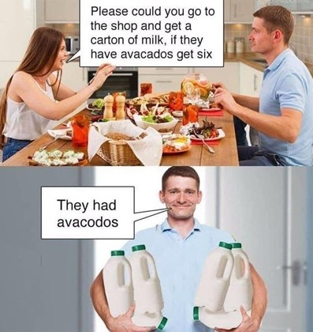
]

---
## **Exercise II: Implicature Cancelling/Reinforcing**
 
for each sentence below, two additional statements are given – one is part of the sentence's literal meaning, one is an implicature, try to **reinforce/cancel** each statement to test whether it is **literal** or an **implicature**    
.pull-left[
1. **I drove home at noon**. 
A: I drove a car. 
B: I drove home during the day.    
2. **I called 10 times and nobody picked up**. 
A: I called at least 5 times. 
B: I was using a phone.
]
.pull-right[

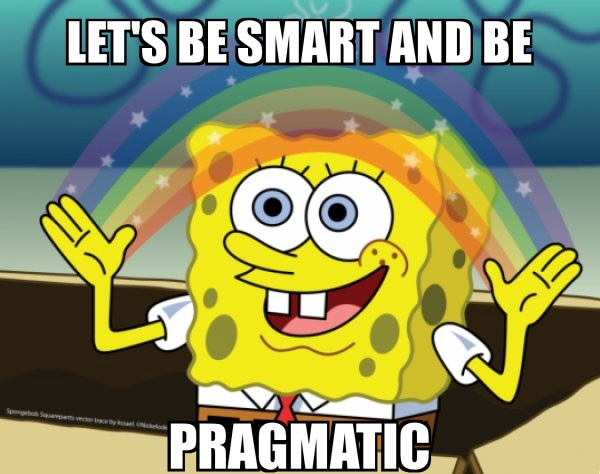
]

---
class: center, middle
**Assignment V** is due this Friday (**Nov 06**) at **11:59 pm**  
**Assignment VI** will be published this Wednesday (**Nov 04**) and is due next Friday (**Nov 13**) at **11:59 pm**  
<b>continue reading</b>: **Chapter 8: Pragmatics** of Griffiths & Cummins’ (2017) <i>An Introduction to English Semantics and Pragmatics</i>  
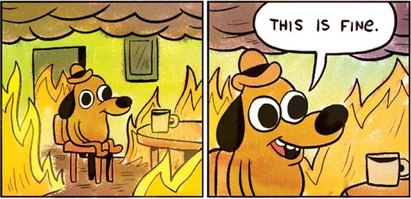
  
Slides created via the R package [**xaringan**](https://github.com/yihui/xaringan).
