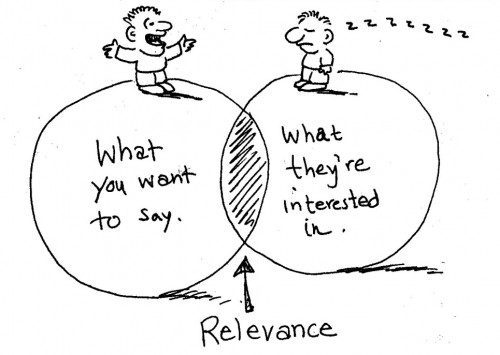
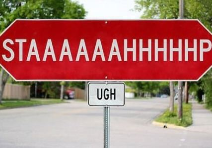
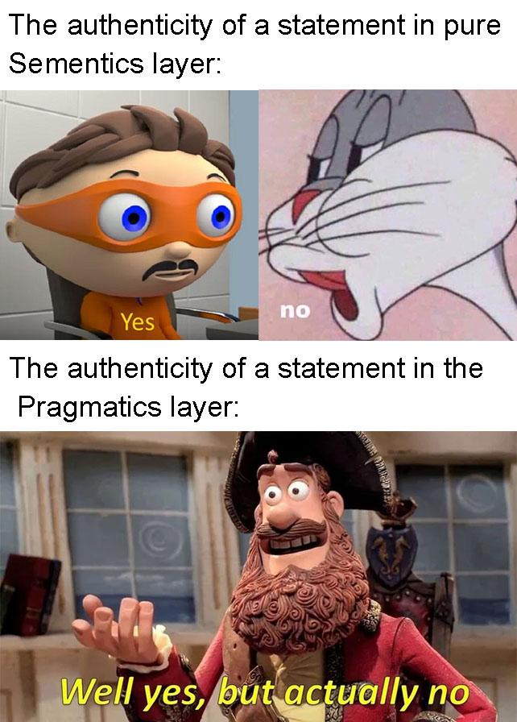
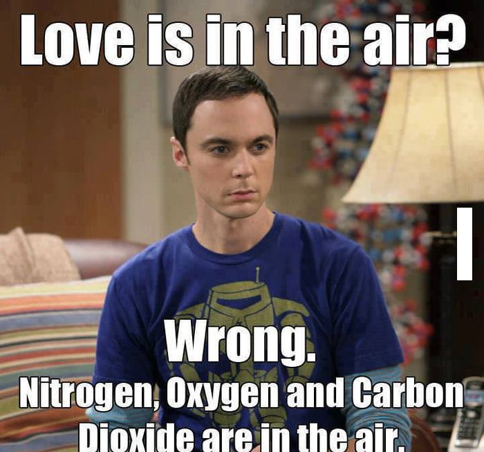
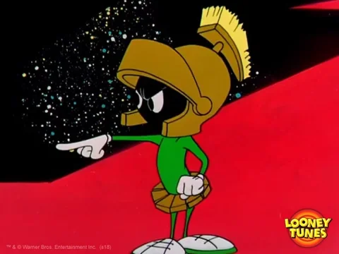
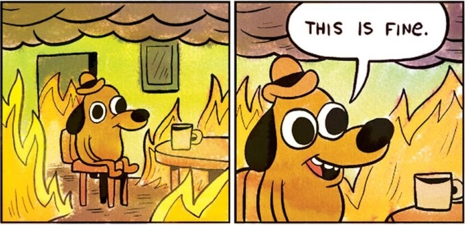

class: center, middle
## Please pick up your **name card** from the front
  
## **office hours**: Mondays, 2:00-3:00 pm 
## Basement, Room 003, **Linguistics Building**

---
## **Previously on 201: Grice’s Maxims**
 

  

  

    <b>Maxim of Quality</b> 
    be truthful
  

  

  - don't say what you believe to be false 
  - don't say what you don't have evidence for
  

  

  

    <b>Maxim of Quantity</b> 
    be informative as needed
  

  

  - don't say more than you need to 
  - don't say less than you need to
  

  

  

    <b>Maxim of Relation (Relevance)</b> 
    be relevant
  

  

  - don't say irrelevant things
  

  

  

    <b>Maxim of Manner</b> 
    be clear
  

  

  \- don't be obscure, ambiguous or wordy 
  \- provide information in a <b>sensible</b> order
  

 
although they're worded like commands, the maxims are intended to describe how people **tend** to behave or are **assumed** to behave, not how they **ought to** behave

---
## **Previously on 201: Cancelling Implicatures**
 
- what if we say the following sentence:   
aaaaaa<i>Anna speaks English, Korean, and Farsi. **In fact, she also speaks Greek**</i>.  

- implicatures can be **cancelled** or **defeated**: we add extra information to the statement that **contradicts** the <b>implicature</b> and makes it go away   

- – *Anna speaks English, Korean, and Farsi*. *In fact, she also speaks Greek*.
  - <b><i>implicature</i></b>: ~~*Anna speaks only these three languages*~~.  
- – *Ian ate a cake and was happy*. *In fact, he ate the cake because he was happy*.
  - <b><i>implicature</i></b>: ~~*Ian ate a cake and that made him happy*~~.  
- – *Does Sue have any siblings?*. 
– *Sue has a brother*. *In fact, she has two brothers*.
  - <b><i>implicature</i></b>: ~~*Sue has only one brother*~~.
  
---
## **Previously on 201: Reinforcing Implicatures**
 
- what if we say the following sentence:   
aaaaaa<i>Anna speaks English, Korean, and Farsi. **And she doesn't speak any others**</i>.  

- implicatures can be **reinforced** as well: we add extra information to the statement that
**further supports** the <b>implicature</b> and makes it firmer   

- – *Anna speaks English, Korean, and Farsi*. *And she doesn't speak any others*.
  - <b><i>implicature</i></b>: *Anna speaks only these three languages*. <b>✔</b>  
- – *Ian ate a cake and was happy*. *It was the cake that made him happy*.
  - <b><i>implicature</i></b>: *Ian ate a cake and that made him happy*. <b>✔</b>  
- – *Does Sue have any siblings?*. 
– *Sue has a brother*, *and only one brother*.
  - <b><i>implicature</i></b>: *Sue has only one brother*. <b>✔</b>

---
class:middle, center

Presupposition Revisit

---
## **Presuppositions**
 
.pull-left[

<i><b>The king of England had lunch.</b></i>  
<b>⬇</b>  
<b>[[King of England]] ∈ [[had lunch]]</b>  

- mentions a <b>person</b>: the king of England
- mentions an <b>action</b>: had lunch
- state a <b>proposition</b> involving the person and the action
]
.pull-right[

<i><b>The king of New Jersey had lunch.</b></i>  
<b>⬇</b>  
<b>[[king of New Jersey]] ∈ [[had lunch]]</b>  

- mentions a <b>person</b>: the king of New Jersey
- mentions an <b>action</b>: had lunch
- state a <b>proposition</b> involving the person and the action
]  

--

both sentences are declarative, only two <b>different</b> entities doing the <b>same</b> action  
yet, the <i><u>king of New Jersey</u></i> does not exist  
how can we make sense of the proposition if it involves <b>someone who doesn't exist</b>?

---
## **Presuppositions**
 
- these two sentences have the same **presupposition**  

.pull-left[

(a) <i>The king of England had lunch</i>.

]
.pull-right[

(b) <i>The king of New Jersey had lunch</i>.

]  

- in order to make sense of each, we have to assume **the person each refers to** exists:  

- <u><i>The king of England had lunch.</i></u> **presupposes** that someone exists called king of England
- not a problem if we put it in our **real world**, since there **IS** this <u><i>king of England</i></u>  

- <u><i>The king of New Jersey had lunch.</i></u> **presupposes** that someone exists called king of New Jersey
- this is a problem if we put it in our **real world**, since there exists **NO** such a <u><i>king of New Jersey</i></u>, and it's what makes this sentence odd  

- a **presupposition** is information that must be **assumed** in order to make
sense of an **utterance**

---
## **Presuppositions**
 
- previously, we have said that it is a **special type** of entailment  
- but we only discussed half of this issue  
- in fact, presupposition is a **special type** only when we consider the **truth value**  

.pull-left[
- entailments are propositions that must be true in order for some other proposition to be true   
- but they're not the same, because entailments rely on **truth values** only, and presuppositions are also about **making sense of** an utterance
]
.pull-right[

]

---
## **Presuppositions**
 
.pull-left[

<h3>(a) <i>Snoopy is a beagle</i>.</h3>

]
.pull-right[

<h3>(b) <i>Snoopy is a dog</i>.</h3>

]  

(a) <b>entails</b> (b), if (a) is true, then (b) must be true  

<h3>(c) <i>It is not the case that Snoopy is a beagle</i>.</h3>

  

- entailment is gone - (c) does **NOT** entail (b)
- but presupposition holds - Snoopy still exists  

- presuppositions do **NOT** rely on truth values **only**  

### HOW TO DO NEGATION

---
## **Family of Sentences**
 
- previously in **Semantics**, we sait that a **presupposes** b iff both a and <i>neg</i>-a entails b  
- that is in fact to say **presuppositions** hold under <b>negation</b>  
- actually <b>questioning</b> can do the same thing, which gives us a way to test whether a given idea is a **presupposition** or part of a sentence's **truth value**  
- a <b>declarative sentence</b>, together with its and <b>negation</b> and <b>questioning</b> forms the **family of sentences**
  - any presuppositions will hold up – we still have to assume them to **make sense**
  - any propositions (ideas that are part of the sentence's **truth value**) will not
  

<table style="width:100%; border-collapse:collapse;">
  <tr>
    <th style="width:15%; text-align:left">sentence type  </th>
    <th style="width:35%; text-align:left">sentence  </th>
    <th style="width:27%; text-align:left">proposition (<i>he had lunch</i>)  </th>
    <th style="width:23%; text-align:left">presupposition (<i>king of NJ exists</i>)  </th>
  </tr>

  <tr>
    <td><b>declarative</b></td>
    <td><i>The king of NJ ate lunch.</i></td>
    <td>asserted</td>
    <td>assumed</td>
  </tr>

  <tr>
    <td><b>negation</b></td>
    <td><i>The king of NJ didn't eat lunch.</i></td>
    <td>denied</td>
    <td>assumed</td>
  </tr>

  <tr>
    <td><b>question</b></td>
    <td><i>Did the king of NJ eat lunch?</i></td>
    <td>questioned</td>
    <td>assumed</td>
  </tr>
</table>
  
---
## **Common Ground**
 
.pull-left[

]
.pull-right[
**presuppositions** interact with a pragmatic concept known as the **common ground**  
**common ground** is the information shared by all participants in a conversation  
- basic info about the current situation
  - participants, event, venue/time
- information being discussed
- previous experience shared by participants
  - <i>Last night was fun!</i>
- general information about the world
  - <i>Merlin is a sorcerer.</i>  

essentially, all the information I know and you know and I know that you know as the interlocutors
]

---
## **Common Ground**
 
- we are constantly updating the **common ground** with **new information** as we talk  
- it is like story-telling, things are added to the **common ground** along the telling  

.pull-left[

<b>conversation</b>

]
.pull-right[

<b>common ground</b>

]  
.pull-left[
1. <i>I have a friend named Lancelot</i>.  
2. <i>Lancelot has a dog</i>.  
3. <i>Last night Lancelot ordered a pizza</i>.  
4. <i>Lancelot went into the kitchen to get a drink</i>.   
5. <i>When he came back, his dog had eaten the whole pizza</i>.
]

--

.pull-right[
<i>Lancelot</i>  
<i>Lancelot, Lancelot's dog</i>  
<i>Lancelot, Lancelot's dog, the pizzaLancelot ordered</i>  
<i>Lancelot, Lancelot's dog, the pizza Lancelot ordered, Lancelot went to the kitchen</i>  
- utterance <b>makes sense</b> because it relies on all of the info in the <b>common ground</b>
]

---
## **Common Ground**
 
.pull-left[
- information needs to be mentioned **in steps**, and they are gradually in the **common ground**  
- once it is in the common ground, we can **refer back** to it  
- information that is **NOT** yet in the common ground will **confuse** other participants in the conversation  
- without any background information clarification  
  - A: <i>When he came back, his dog had eaten the whole pizza!</i>  
  - B: <i>Wait, what?!</i>
]
.pull-right[

]
  
---
## **Presuppositions and the Common Ground**
 
- what presuppositions do is not just **assume** information – they **assume that information is in the common ground** 

<i>The king of England took a nap.</i>

  

- ➡️ **presupposes**: <u>the king of England exists.</u>  
  - both speaker and listener are aware of this – which is <b>true</b>, so we can **accept** the sentence as meaningful  

<i>The king of New Jersey took a nap.</i>

  

- ➡️ **presupposes**: <u>the king of New Jersey exists.</u>  
  - both speaker and listener are aware he exists – which is <b>not true</b>, so we **cannot accept** the sentence as meaningful
]
---
## **Presupposition Triggers**
 
<table style="width:100%">
  <tr>
    <th style="text-align:center; background:green; border: solid green; width:22%; color:white">
    definite expressions
    </th>
    <th style="text-align:center; background:#d3d3d3; border: solid #d3d3d3; width:15%; color:#414141">
    iteratives
    </th>
    <th style="text-align:center; background:#d3d3d3; border: solid #d3d3d3; width:28%; color:#414141">
    change-of-state verbs
    </th>
    <th style="text-align:center; background:#d3d3d3; border: solid #d3d3d3; width:22%; color:#414141">
    factive verbs
    </th>
    <th style="text-align:center; background:#d3d3d3; border: solid #d3d3d3; width:13%; color:#414141">
    clefts
    </th>
  </tr>
</table> 

- <b>definite expressions</b> presuppose <u><b>something exists</b></u> and is in our common ground (existence presuppositions)   

<table style="width:100%; border-collapse:collapse;">
  <tr>
    <th style="width:33%; text-align:left">expression   </th>
    <th style="width:33%; text-align:left">example sentence   </th>
    <th style="width:34%; text-align:left">presupposition   </th>
  </tr>

  <tr>
    <td>definite article: <i>the</i>  </td>
    <td><i>I saw a cat. <b>The cat</b> was fuzzy.</i>  </td>
    <td>a unique cat <u>exists</u>  </td>
  </tr>

  <tr>
    <td>definite pronouns: <i>I, you, she...</i>  </td>
    <td><i><b>He</b> is a good student.</i>  </td>
    <td>a unique male person <u>exists</u>  </td>
  </tr>

  <tr>
    <td>demonstratives: <i>this, that</i>  </td>
    <td><i>Pass me <b>that bottle</b>.</i>  </td>
    <td>a unique bottle <u>exists</u>  </td>
  </tr>

  <tr>
    <td>possessives: <i>my, our, their, Jane’s</i>  </td>
    <td><i><b>Jane’s dog</b> is friendly.</i>  </td>
    <td>Jane <u>has</u> a dog  </td>
  </tr>

  <tr>
    <td>proper nouns: <i>Peter, Jane, Snoopy</i></td>
    <td><i><b>Peter</b> called yesterday.</i></td>
    <td>a unique person named Peter <u>exists</u></td>
  </tr>
</table>

---
## **Presupposition Triggers**
 
<table style="width:100%">
  <tr>
    <th style="text-align:center; background:#d3d3d3; border: solid #d3d3d3; width:22%; color:#414141">
    definite expressions
    </th>
    <th style="text-align:center; background:#CC0033; border: solid #CC0033; width:15%; color:white">
    iteratives
    </th>
    <th style="text-align:center; background:#d3d3d3; border: solid #d3d3d3; width:28%; color:#414141">
    change-of-state verbs
    </th>
    <th style="text-align:center; background:#d3d3d3; border: solid #d3d3d3; width:22%; color:#414141">
    factive verbs
    </th>
    <th style="text-align:center; background:#d3d3d3; border: solid #d3d3d3; width:13%; color:#414141">
    clefts
    </th>
  </tr>
</table> 

- **iterative expressions** presuppose the <b>repetition</b> of some action or state 
- <i>again</i>, <i>too</i>, <i>either</i>, <i>return</i>, <i>come back</i>, <i>restore</i>, <i>more</i>, <i>less</i>  

.pull-left[

<b>utterance</b>

  

- *Sally baked a cake **again**.*  
- *John **returned**.*   
- *I want **more** cake.*   
- *Sam **restored** the watch.*
]
.pull-right[

<b>presupposition</b>

  

- Sally has **previously** baked a cake.  
- John was **previously** here.  
- I **previously** had some cake.  
- The watch was **previously** in good repair.

]

---
## **Presupposition Triggers**
 
<table style="width:100%">
  <tr>
    <th style="text-align:center; background:#d3d3d3; border: solid #d3d3d3; width:22%; color:#414141">
    definite expressions
    </th>
    <th style="text-align:center; background:#d3d3d3; border: solid #d3d3d3; width:15%; color:#414141">
    iteratives
    </th>
    <th style="text-align:center; background:teal; border: solid teal; width:28%; color:white">
    change-of-state verbs
    </th>
    <th style="text-align:center; background:#d3d3d3; border: solid #d3d3d3; width:22%; color:#414141">
    factive verbs
    </th>
    <th style="text-align:center; background:#d3d3d3; border: solid #d3d3d3; width:13%; color:#414141">
    clefts
    </th>
  </tr>
</table> 

- <b>change-of-state verbs</b> presuppose an action was <b>ongoing (or not ongoing) prior to</b> the moment in question 
- <i>stop</i>, <i>start</i>, <i>begin</i>, <i>continue</i>, <i>keep</i>  

.pull-left[

<b>utterance</b>

  

- <i>Sally <b>stopped</b> baking.</i>  
- <i>I <b>started</b> singing.</i>  
- <i>Pablo <b>kept</b> working.</i>
]
.pull-right[

<b>presupposition</b>

  

- Sally was <b>previously</b> baking.  
- I was not <b>previously</b> singing.  
- Pablo was <b>previously</b> working.
]

---
## **Presupposition Triggers**
 
<table style="width:100%">
  <tr>
    <th style="text-align:center; background:#d3d3d3; border: solid #d3d3d3; width:22%; color:#414141">
    definite expressions
    </th>
    <th style="text-align:center; background:#d3d3d3; border: solid #d3d3d3; width:15%; color:#414141">
    iteratives
    </th>
    <th style="text-align:center; background:#d3d3d3; border: solid #d3d3d3; width:28%; color:#414141">
    change-of-state verbs
    </th>
    <th style="text-align:center; background:blue; border: solid blue; width:22%; color:white">
    factive verbs
    </th>
    <th style="text-align:center; background:#d3d3d3; border: solid #d3d3d3; width:13%; color:#414141">
    clefts
    </th>
  </tr>
</table> 

<ul>
  <li><b>factive verbs</b> are verbs that refer to someone's <b>knowledge of</b> or <b>opinion about</b> some fact</li>
  <li><i>know</i>, <i>realize</i>, <i>regret</i>, <i>be aware of</i>, <i>be glad that</i>, <i>be sorry that</i></li>
  <li>they introduce a <b>dependent clause</b> containing the information <b>the subject</b> knows or has an opinion about</li>
  <li>this information is <b>presupposed</b>, since we can't know something if it's false</li>
</ul> 
  
<table style="width:100%; border-collapse:collapse;">
  <tr>
    <th style="width:40%; text-align:left">sample sentence  </th>
    <th style="width:30%; text-align:left">presupposition (dep clause)  </th>
    <th style="width:30%; text-align:left">proposition (main clause)  </th>
  </tr>

  <tr>
    <td><i>I <b>know</b> that you studied.</i></td>
    <td>You studied.</td>
    <td>I know <b>it</b>.</td>
  </tr>

  <tr>
    <td><i>Sally <b>is happy</b> that she bought a book.</i></td>
    <td>Sally bought a book</td>
    <td>Sally is happy about <b>it</b>.</td>
  </tr>

  <tr>
    <td><i>Linda <b>regrets</b> sending the letter.</i></td>
    <td>Linda sent the letter.</td>
    <td>Linda regrets <b>it</b>.</td>
  </tr>

  <tr>
    <td><i>Yuri <b>realized</b> that it was late.</i></td>
    <td>It was late.</td>
    <td>Yuri realized <b>it</b>.</td>
  </tr>
</table> 
  
- test with the <b>family of sentences</b>
  - <i><b>It is not the case that</b> Linda regrets sending the letter.
  - <i><b>Does</b> Linda regret sending the letter?</u>

---
## **Presupposition Triggers**
 
<table style="width:100%">
  <tr>
    <th style="text-align:center; background:#d3d3d3; border: solid #d3d3d3; width:22%; color:#414141">
    definite expressions
    </th>
    <th style="text-align:center; background:#d3d3d3; border: solid #d3d3d3; width:15%; color:#414141">
    iteratives
    </th>
    <th style="text-align:center; background:#d3d3d3; border: solid #d3d3d3; width:28%; color:#414141">
    change-of-state verbs
    </th>
    <th style="text-align:center; background:#d3d3d3; border: solid #d3d3d3; width:22%; color:#414141">
    factive verbs
    </th>
    <th style="text-align:center; background:deeppink; border: solid deeppink; width:13%; color:white">
    clefts
    </th>
  </tr>
</table> 

<ul>
<li><b>clefts</b> are complex sentences formed by taking a simple sentence and putting part of it into a <b>dependent clause</b> as shown below</li>
</ul>
.pull-left[
.pull-left[

X Y'ed ➔

]
.pull-right[

It was X that Y'ed.

]
]
.pull-right[
.pull-left[

What Y'ed was X.

]
.pull-right[

X was who Y'ed.

]
]  

<ul>
<li>the <b>main clause</b> indicates the sentence's <b>claim</b></li>
<li>the information that has been moved to the <b>dependent clause</b> is <b>presupposed</b></li>
</ul> 

<table style="width:100%; border-collapse:collapse;">
  <tr>
    <th style="width:20%; text-align:left">simple sentence  </th>
    <th style="width:30%; text-align:left">cleft sentence  </th>
    <th style="width:25%; text-align:left">presupposition  </th>
    <th style="width:25%; text-align:left">proposition (main clause)  </th>
  </tr>

  <tr>
    <td><i>John ate the pie.</i></td>
    <td>
      <i>
        <b>It was John</b>
         that ate the pie.
      </i>
    </td>
    <td><i>Someone ate the pie.</i></td>
    <td><i>That person was John.</i></td>
  </tr>

  <tr>
    <td><i>Sally bought a souvenir.</i></td>
    <td>
      <i>
        What Sally bought <b>was a souvenir</b>.
      </i>
    </td>
    <td><i>Sally bought something.</i></td>
    <td><i>That thing was a souvenir.</i></td>
  </tr>

  <tr>
    <td><i>I saw Alice.</i></td>
    <td>
      <i>
        <b>Alice was</b> who I saw.
      </i>
    </td>
    <td><i>I saw someone.</i></td>
    <td><i>That person was Alice.</i></td>
  </tr>
</table>

 

- test with the <b>family of sentences</b>
  - <i><b>It was not the case that</b> what Sally bought was a souvenir</i>.
  - <i><b>Is</b> what Sally bought a souvenir</i>

---
.pull-left[
### **Exercise I: Presupposition**
]
.pull-right[
- identify any **definite expressions** and state the existence presuppositions they raise
- identify any **other presupposition trigger** and state the presuppositions they raise
]  

(a) <i>I took my dog for a walk again.</i> 

<table style="width:80%; border-collapse:collapse;">
  <tr>
    <td style="width:30%; text-align:left; color:white"><b><i>I, my dog</i></b></td>
    <td style="width:70%; text-align:left; color:white"><b>again</b> (iterative) – <u>I previously took my dog for a walk.</u></td>
  </tr>
</table>

 

(b) <i>It was Emily that ate the cookie.</i> 

<table style="width:80%; border-collapse:collapse;">
  <tr>
    <td style="width:30%;text-align:left; color:white"><b><i>Emily, the cookie</i></b></td>
    <td style="width:70%;text-align:left; color:white"><b>it was X that Y</b> (cleft) – <u>Someone ate the cookie.</u></td>
  </tr>
</table>

 

(c) <i>Juliana found out that Toby had returned.</i> 

<table style="width:80%; border-collapse:collapse;">
  <tr>
    <td style="width:30%; text-align:left; color:white"><b><i>Juliana, Toby</i></b></td>
    <td style="width:70%; text-align:left; color:white"><b>found out</b> (factive) – <u>Toby had in fact returned.</u> <b>returned</b> (iterative) – <u>Toby was previously there.</u></td>
  </tr>
</table>

 

(d) <i>Eli wants more popcorn.</i> 

<table style="width:80%; border-collapse:collapse;">
  <tr>
    <td style="width:30%; text-align:left; color:white"><b><i>Eli</i></b></td>
    <td style="width:70%; text-align:left; color:white"><b>more</b> (iterative) – <u>Eli previously had popcorn.</u></td>
  </tr>
</table>

 

(e) <i>The elephant will continue to be endangered until we stop destroying its natural habitat.</i> 

<table style="width:80%; border-collapse:collapse;">
  <tr>
    <td style="width:30%; text-align:left; color:white"><b><i>the elephant, its natural habitat</i></b></td>
    <td style="width:70%; text-align:left; color:white"><b>continue</b> (CoS) – <u>The elephant was previously endangered.</u> <b>stop</b> (CoS) – <u>We were previously destroying its habitat.</u></td>
  </tr>
</table>

 

---
.pull-left[
### **Exercise I: Presupposition**
]
.pull-right[
- identify any **definite expressions** and state the existence presuppositions they raise
- identify any **other presupposition trigger** and state the presuppositions they raise
]  

(a) <i>I took my dog for a walk again.</i> 

<table style="width:80%; border-collapse:collapse;">
  <tr>
    <td style="width:30%; text-align:left; color:white"><b><i>I, my dog</i></b></td>
    <td style="width:70%; text-align:left; color:white"><b>again</b> (iterative) – <u>I previously took my dog for a walk.</u></td>
  </tr>
</table>

 

(b) <i>It was Emily that ate the cookie.</i> 

<table style="width:80%; border-collapse:collapse;">
  <tr>
    <td style="width:30%;text-align:left; color:white"><b><i>Emily, the cookie</i></b></td>
    <td style="width:70%;text-align:left; color:white"><b>it was X that Y</b> (cleft) – <u>Someone ate the cookie.</u></td>
  </tr>
</table>

 

(c) <i>Juliana found out that Toby had returned.</i> 

<table style="width:80%; border-collapse:collapse;">
  <tr>
    <td style="width:30%; text-align:left; color:white"><b><i>Juliana, Toby</i></b></td>
    <td style="width:70%; text-align:left; color:white"><b>found out</b> (factive) – <u>Toby had in fact returned.</u> <b>returned</b> (iterative) – <u>Toby was previously there.</u></td>
  </tr>
</table>

 

(d) <i>Eli wants more popcorn.</i> 

<table style="width:80%; border-collapse:collapse;">
  <tr>
    <td style="width:30%; text-align:left; color:white"><b><i>Eli</i></b></td>
    <td style="width:70%; text-align:left; color:white"><b>more</b> (iterative) – <u>Eli previously had popcorn.</u></td>
  </tr>
</table>

 

(e) <i>The elephant will continue to be endangered until we stop destroying its natural habitat.</i> 

<table style="width:80%; border-collapse:collapse;">
  <tr>
    <td style="width:30%; text-align:left; color:white"><b><i>the elephant, its natural habitat</i></b></td>
    <td style="width:70%; text-align:left; color:white"><b>continue</b> (CoS) – <u>The elephant was previously endangered.</u> <b>stop</b> (CoS) – <u>We were previously destroying its habitat.</u></td>
  </tr>
</table>

 

---
.pull-left[
### **Exercise I: Presupposition**
]
.pull-right[
- identify any **definite expressions** and state the existence presuppositions they raise
- identify any **other presupposition trigger** and state the presuppositions they raise
]  

(a) <i>I took my dog for a walk again.</i> 

<table style="width:80%; border-collapse:collapse;">
  <tr>
    <td style="width:30%; text-align:left"><b><i>I, my dog</i></b></td>
    <td style="width:70%; text-align:left"><b>again</b> (iterative) – <u>I previously took my dog for a walk.</u></td>
  </tr>
</table>

 

(b) <i>It was Emily that ate the cookie.</i> 

<table style="width:80%; border-collapse:collapse;">
  <tr>
    <td style="width:30%;text-align:left"><b><i>Emily, the cookie</i></b></td>
    <td style="width:70%;text-align:left"><b>it was X that Y</b> (cleft) – <u>Someone ate the cookie.</u></td>
  </tr>
</table>

 

(c) <i>Juliana found out that Toby had returned.</i> 

<table style="width:80%; border-collapse:collapse;">
  <tr>
    <td style="width:30%; text-align:left"><b><i>Juliana, Toby</i></b></td>
    <td style="width:70%; text-align:left"><b>found out</b> (factive) – <u>Toby had in fact returned.</u> <b>returned</b> (iterative) – <u>Toby was previously there.</u></td>
  </tr>
</table>

 

(d) <i>Eli wants more popcorn.</i> 

<table style="width:80%; border-collapse:collapse;">
  <tr>
    <td style="width:30%; text-align:left"><b><i>Eli</i></b></td>
    <td style="width:70%; text-align:left"><b>more</b> (iterative) – <u>Eli previously had popcorn.</u></td>
  </tr>
</table>

 

(e) <i>The elephant will continue to be endangered until we stop destroying its natural habitat.</i> 

<table style="width:80%; border-collapse:collapse;">
  <tr>
    <td style="width:30%; text-align:left"><b><i>the elephant, its natural habitat</i></b></td>
    <td style="width:70%; text-align:left"><b>continue</b> (CoS) – <u>The elephant was previously endangered.</u> <b>stop</b> (CoS) – <u>We were previously destroying its habitat.</u></td>
  </tr>
</table>

 

---
## **Presupposition Accommodation and Failure**
 
.pull-left[
- presuppositions **assume that something is in the common ground**  

<i>The king of England took a nap.</i>

 
- ➡️ <b>presupposes</b>: <i><u>England has a king.</u></i>  
  - it is in our common ground and it **makes sense**  
- what if a presupposition assumes something that is **NOT** actually in our common ground?  

<i>The king of New Jersey took a nap.</i>

 
- ➡️ <b>presupposes</b>: <i><u>New Jersey has a king.</u></i>  
  - it is NOT in our common ground  
]
.pull-right[
- we either **accommodate to** or **dispute on** the presupposition   
  - presupposition <b>accommodation</b>
  - presupposition <b>failure</b>  

]

---
## **Presupposition Accommodation**
 
**accommodating** a presupposition: assuming (or at least pretending) that a presupposition is **true** in order to **make sense** out of the utterance 

<h3><i>I need to pick up my dragon from the vet.</i></h3>

 

- ➡️ **presupposes** <u><i>I have a dragon.</i></u>  

that's not in the common ground, but can be **accommodated** - assuming that <b>I do have a dragon</b>
which is reasonable if you know I am <b>MERLIN</b> and it doesn't conflict with your knowledge of the **fantasy** world  
- by **accommodating** the presupposition, I am allowing it to be added to the **common ground**  
- now I can say something further about **"him"** (the dragon)  
- you know who I'm talking about, because you've **allowed** <u><i>my dragon</i></u> to be added to the **common ground**
]
  
---
## **Presupposition Failure**
 
sometimes a presupposition is **harder to accommodate** 
<h3><i>the Martian in our class is going to give a presentation.</i></h3> 

.pull-left[
- ➡️ **presupposes** <u><i>There is a Martian in our class.</i></u>  
- this is harder to accommodate so it leads to **presupposition failure**  
- the result is the utterance **doesn't make sense**   
- it's not that the sentence is **true or false**, it's just **nonsensical**
]
.pull-right[
- if I say you're lying or that's false, I'm denying the claim, **NOT** the presupposition  
- to deny the presupposition, we would have to say something like   
  - <u><i>There cannot be Martian in the class.</u></i>  

]

---
## **Presuppositions and Misleading Language**
 
- because presupposition failure leads to a breakdown in communication but we do want our conversation to go on, so  
- **we have a tendency to accommodate to presuppositions**  
- sometimes people take advantage of this property and trick others to **accomodate to the presupposition**  

___

.pull-left[
- <b>in the court room, the lawyer asked a defendant</b>  
  - <i>Have you stopped embezzling money?</i>
  - <i>Yes or no?</i>  
- what is the lawyer <b>presupposing</b>?
- can the defendant answer <b>without looking guilty</b>?
]
.pull-right[
- <b>in the restaurant, someone asked their boyfriend</b>  
  - <i> Has she alwayes liked it here as well</i>?  
- what is this someone <b>presupposing</b>?
- what would probably be after this boyfriend <b>answers yes or no</b>?
]

---
## **Presuppositions and Misleading Language**
 
.pull-left[
- <b>clickbait headlines</b>, <b>advertisements</b>, and other persuasive language sometimes uses **presuppositions** to influence people:  
- <u><i>what local dad found will surprise you!</i></u>
  - proposition: X will surprise you
  - presuppositions: local dad found something worth knowing about   
- the author's goal here is to get the reader to accept the **presupposition** by accommodating it without questioning it directly
  - because we figure out **presupposition** so unintentionally  
- in each **clickbait** headline to the right, identify at least one **presupposition** and its trigger
]
.pull-right[
 
1. <i>Why You Should Create a Vision Board for 2024</i>  
2. <i>Why You Should Ditch the ‘Diet’ and Go Keto Instead</i>  
3. <i>You Won’t Believe This Dog’s Dance Moves!</i>  
4. <i>Did You Know HOW Healthy Mushrooms Are for Your Brain?</i>  
5. <i>This is How Designers Can Make More Money With Fewer Clients</i>  
6. <i>This Is Why Business Owners are Investing in Bitcoin</i>
]

---
class: center, middle
**Assignment V** is due this Friday (**Nov 06**) at **11:59 pm**  
**Assignment VI** will be published this Wednesday (**Nov 04**) and is due next Friday (**Nov 13**) at **11:59 pm**  
<b>reading</b>: Michael Dobrovolsky's chapter **Phonetics**  (from O'Grady et al.'s <i>Contemporary Linguistics: An Introduction</i>  

  
Slides created via the R package [**xaringan**](https://github.com/yihui/xaringan).
