class: center, middle
## Please pick up your **name card** from the front
  
## **office hours**: Mondays, 2:00-3:00 pm 
## Basement, Room 003, **Linguistics Building**
      
---
## **Previously on 201**
 
.pull-left[
  
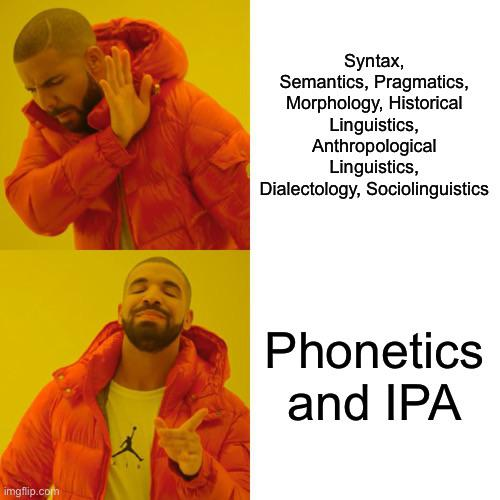   
]
.pull-right[
**Pragmatics** 
- the study of how **context** contributes to meaning or it is the study of <b>implied meaning</b>  

**presuppositions**  
- background information that is taken for granted or in the <b>common ground</b> for an utterance to make sense   

**conversational implicatures** 
- meaning arises from our understanding of <b>how people behave</b> in conversation   

**Gricean Maxims** 
- quality, <b>quantity</b>, relevance, <b>manner</b>
]

---
background-image: url("../pic/1109/heart.png")
background-size: 100% 100%
background-position: center
background-repeat: no-repeat

class: center, middle

  
## <b>NEVER EVER</b> 
## <b>BE FRIGHTENED BY</b>  
## **PHONETICS**  
## <b>AT ALL</b>

---
## **Sounds of Language**
 
.pull-left[  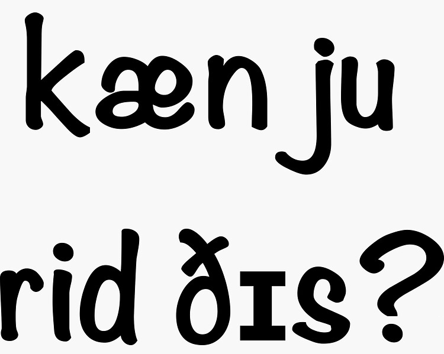]
.pull-right[
- the **smallest** element of language: **sounds**  
- language can be spoken, written, signed, etc  
- the use of voice (=speech) remains the most common modality used for language  
- human have an anatomic specialization for speech and production  

<a href="https://www.youtube.com/watch?v=qjJ-IcCbN6s">an MRI video of English production</a>  
<a href="https://www.youtube.com/watch?v=ezOwCf835YA">an MRI video of Mandarin Chinese production</a>  
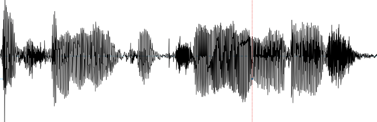

]

---
## **Phonetics vs Phonology**
 
.pull-left[
- **Phonetics** is the study of **how speech sounds are produced** by articulators in the vocal tract and **perceived** by are auditory apparatus  
  - <b>articulatory phonetics</b>: how different sounds are produced in vocal tract  
  - <b>acoustic phonetics</b>: the physical properties of speech sounds  
  - <b>perceptual phonetics</b>: how sounds are perceived by listeners  
- **Phonology** is the study of the **pattern** and **function** of sounds (how your brain categorises sounds associated with speech)
]
.pull-right[
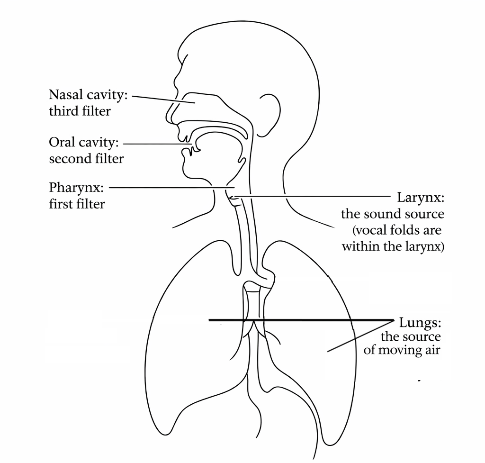
]

---
## **Articulation: How Do We Make Speech Sounds?**
 
**articulation**: moving parts of body to produce speech sounds  
.pull-left[
1. speaker **exhales**, pushing air out of **lungs** and up the **trachea** (windpipe)  
2. air passes through **larynx** (voicebox), which contains **vocal folds** (cords), primary source of speech sounds  
3. air passes through **upper vocal tract**, including **oral cavity** (mouth) and **nasal cavity** and leaves body  
4. within the vocal tract, **articulators** such as the tongue, lips, teeth, and soft palate move to **modify** the sound
coming from the larynx and produce additional sounds
]
.pull-right[
 
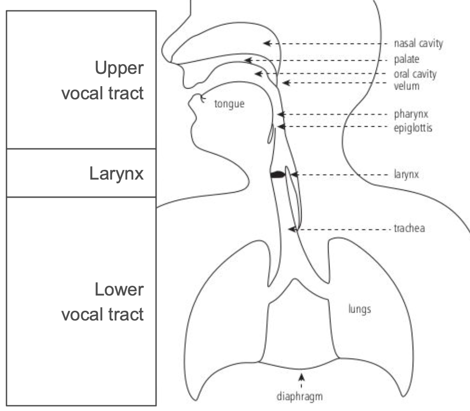
]

---
## **Perception: How Do We Hear Sounds?**
 
.pull-left[
 

perception involves both <b>ear</b> and <b>brain</b>
  
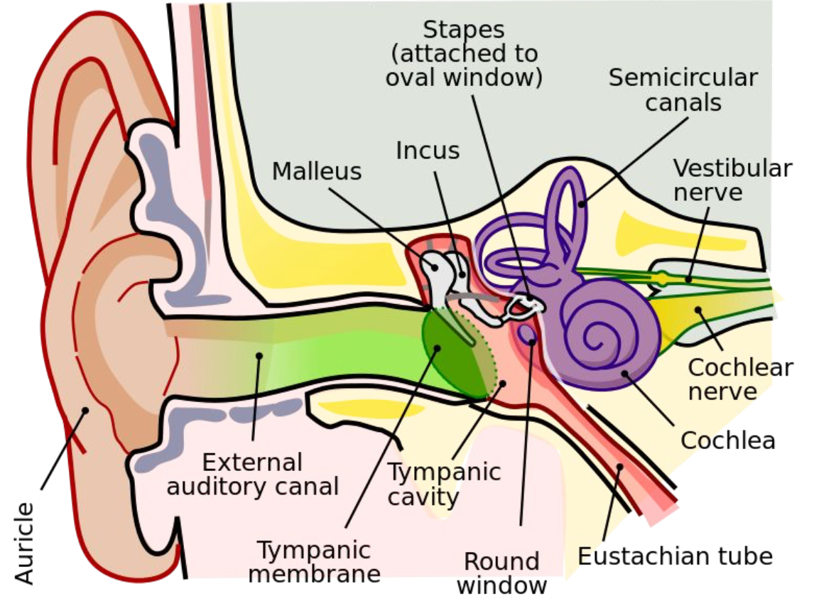

]
.pull-right[
- sound waves are channeled by the outer ear through the ear canal to the **eardrum**, causing it to **vibrate**  
- these vibrations are transmitted by the ossicles and tympanic cavity to the **inner ear**  
- the inner ear is full of **fluid** and vibrations pass through the fluid into the spiral-shaped **cochlea**  
- at the cochlea, the vibrations cause movements in a series of tiny **hairs** – different hairs for different pitches  
- and the hairs connect to **nerves**, which send neural impulses to the brain, where sounds are decoded into language  
]

---
## **Segments and Supra-segmentals**
 
- **segment**: discrete, **individual** unit of sound
  - for example a consonant, vowel, or glide
  - speech stream can be cleanly divided into segments: <b>< cats ></b> = [k], [æ],[t], [s]  
- but some sounds occur **above the level of the segment**, affecting **multiple** segments
  - prosodic sounds or **suprasegmentals**, for example, **stress**  

--

.pull-left[

<h3><b>fantastic</b></h3>

]

--

.pull-right[

<h3><b>fanTAStic</b></h3>

]  

--

- <b>fanTAStic</b> – stressed syllables tend to be <u>louder</u>, <u>longer</u>, <u>more clearly</u> enunciated, and pronounced with a <u>change in pitch</u>  
- this affects **all** sounds in the syllable <b>[ tas ]</b>  

- we'll focus on sound **segments** in this class

---
## **Segments**
 
.pull-left[
    
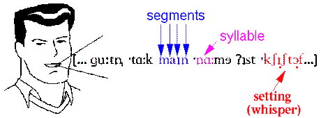
]
.pull-right[
say these words out loud and try breaking them down into **segments**  
(1). what and how many segments does each word have? 
(2). what letters do they correspond to and does one letter always correspond to one sound?  
- banana  
- ship  
- peak  
- knock  
- rough
]

---
## **Letters ≠ Sounds**
 
- different languages also use different alphabets to represent sounds  
- but alphabets are not good reflections of sounds, therefore we distinguish **orthography** from **pronunciation**  

<b>< letter ></b> = orthography; <b>[ phonetic symbol ]</b> = pronunciation  

<table style="width:100%"; collapse-border="collapse;">
  <tr>
    <td style="width:30%; text-align:center">
    </td>
    <td colspan="2" style="text-align:left"><b>words in different language</b>  </td>
    <td style="width:10%; text-align:center"><b>< letter ></b>  </td>
    <td style="width:20%; text-align:center"><b>[ phonetic symbol ]</b>  </td>
    <td style="width:10%; text-align:center">  </td>
  </tr>
  <tr>
    <td style="width:30%; text-align:center">
    <audio controls>
    <source src="record/r-eng.m4a" type="audio/mp4">
    Your browser does not support the audio element.
    </audio>  
    </td>
    <td style="width:15%; text-align:left">English  </td>
    <td style="width:20%; text-align:left"><i><b>r</b>egard</i>  </td>
    <td style="width:10%; text-align:center"><b>< r ></b>  </td>
    <td style="width:20%; text-align:center"><b>[ ɹ ]</b>  </td>
    <td style="width:10%; text-align:center">  </td>
  </tr>
  <tr>
    <td style="width:30%; text-align:center">
    <audio controls>
    <source src="record/r-fre.m4a" type="audio/mp4">
    Your browser does not support the audio element.
    </audio>  
    </td>
    <td style="width:15%; text-align:left">French  </td>
    <td style="width:20%; text-align:left"><i><b>r</b>egarder</i> ('look')  </td>
    <td style="width:10%; text-align:center"><b>< r ></b>  </td>
    <td style="width:20%; text-align:center"><b>[ ʁ ]</b>  </td>
    <td style="width:10%; text-align:center">  </td>
  </tr>
  <tr>
    <td style="width:30%; text-align:center">
    <audio controls>
    <source src="record/r-chi.m4a" type="audio/mp4">
    Your browser does not support the audio element.
    </audio>  
    </td>
    <td style="width:15%; text-align:left">Mandarin  </td>
    <td style="width:20%; text-align:left"><i><b>r</b>è gǒu</i> ('hot dog')  </td>
    <td style="width:10%; text-align:center"><b>< r ></b>  </td>
    <td style="width:20%; text-align:center"><b>[ ʐ ]</b>  </td>
    <td style="width:10%; text-align:center">  </td>
  </tr>
  <tr>
    <td style="width:30%; text-align:center">
    <audio controls>
    <source src="record/r-spa.m4a" type="audio/mp4">
    Your browser does not support the audio element.
    </audio>  
    </td>
    <td style="width:15%; text-align:left">Spanish  </td>
    <td style="width:20%; text-align:left"><i><b>r</b>egalo</i> ('present')  </td>
    <td style="width:10%; text-align:center"><b>< r ></b>  </td>
    <td style="width:20%; text-align:center"><b>[ r ]</b>  </td>
    <td style="width:10%; text-align:center">  </td>
  </tr>
  <tr>
    <td style="width:30%; text-align:center">
    <audio controls>
    <source src="record/r-jap.m4a" type="audio/mp4">
    Your browser does not support the audio element.
    </audio>  
    </td>
    <td style="width:15%; text-align:left">Japanese  </td>
    <td style="width:20%; text-align:left"><i><b>r</b>ingo</i>('apple')  </td>
    <td style="width:10%; text-align:center"><b>< r ></b>  </td>
    <td style="width:20%; text-align:center"><b>[ ɾ ]</b>  </td>
    <td style="width:10%; text-align:center">  </td>
  </tr>
</table>

---
## **Letters ≠ Sounds**
 
.pull-left[
**spelling** (orthography) has a problem: one sound doesn't always equal one letter   

- two letters, one sound
  - *<b>th</b>* and *<b>ng</b>* in *<b>th</b>i<b>ng</b>*
- one letter, two sounds
  - *<b>x</b>* in *ta<b>x</b>*
- one letter, no sound
  - *<b>k</b>*, *<b>g</b>*, and *<b>h</b>* in *<b>k</b>ni<b>gh</b>t* 
- one sound, many spellings
  - *ru<b>sh</b>*, *no<b>t</b>ion*, *o<b>c</b>ean*, *ni<b>ch</b>e*, *i<b>ss</b>ue*, *<b>sch</b>lep*, *fu<b>chs</b>ia*
- one spelling, many sounds
  - *thr<b>ou</b>gh* ≠ *pl<b>ou</b>gh* ≠ *<b>ou</b>ght* ≠ *r<b>ou</b>gh* ≠ *c<b>ou</b>gh* ≠ *th<b>ou</b>gh*
]
.pull-right[
   
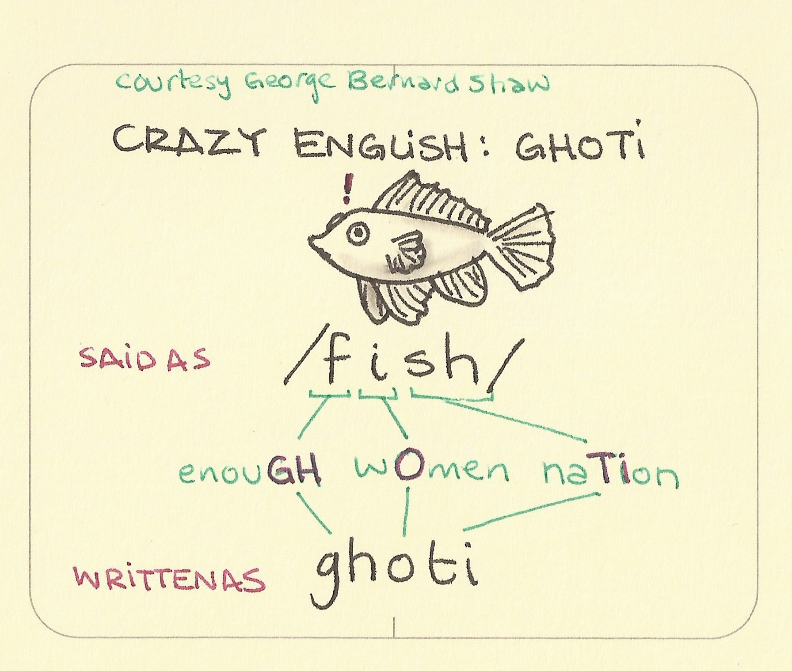
]

---
## **Letters ≠ Sounds**
.pull-left[
  
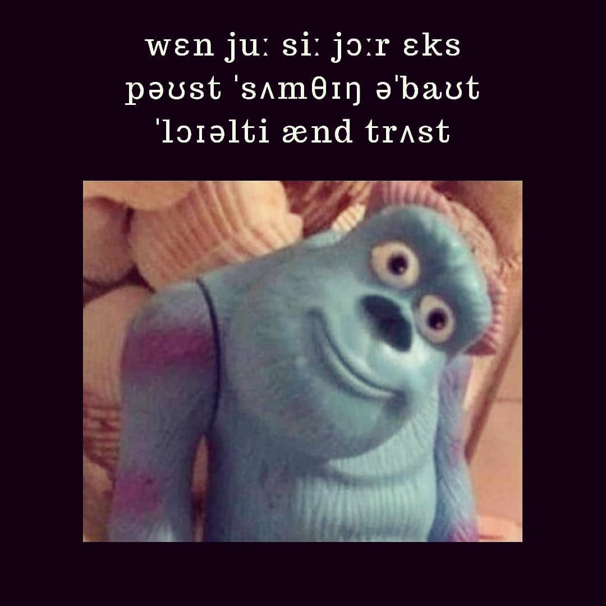
]
.pull-right[
- no language has a writing system that can **perfectly** represent its speech sounds  
- pronunciation **changes over time**; writing doesn't always reflect these changes 
  - *knight*, *time*
- pronunciation **varies by place and social group**; writing doesn't usually reflect this 
  - *schedule*, *cot*/*caught*
- **loanwords** (words borrowed from another language) often have spellings that reflect the pronunciation in the source language, not target language 
  - *zucchini*, *psychology*  
- this becomes a problem when we want to talk precisely about **phonetics**, and we want to accurately represent the **pronunciation**
]

---
## **An Easy Cryptographic Game**
 
.pull-left[
.pull-left[
<b>A</b>: **I** 
<b>B</b>: **II**  
<b>C</b>: **III**  
<b>D</b>: **IV**  
<b>E</b>: **V**  
<b>F</b>: **VI**  
<b>G</b>: **VII**  
<b>H</b>: **VIII**  
<b>I</b>: **IX**  
<b>J</b>: **X**  
<b>K</b>: **XI**  
<b>L</b>: **XII**  
<b>M</b>: **XIII**  
]
.pull-right[
<b>N</b>: **XIV**  
<b>O</b>: **XV**  
<b>P</b>: **XVI**  
<b>Q</b>: **XVII**  
<b>R</b>: **XVIII**  
<b>S</b>: **XIX**  
<b>T</b>: **XX**  
<b>U</b>: **XXI**  
<b>V</b>: **XXII**  
<b>W</b>: **XXIII**  
<b>X</b>: **XXIV**  
<b>Y</b>: **XXV**  
<b>Z</b>: **XXVI**  
]
]
.pull-right[

<b>IX XVI I</b>  
<b>XVIII XXI XII V XIX</b>   
<b>XXI XIX</b>

  
]

---
## **An Easy Cryptographic Game**
 
.pull-left[
.pull-left[
<b>A</b>: **I** 
<b>B</b>: **II**  
<b>C</b>: **III**  
<b>D</b>: **IV**  
<b>E</b>: **V**  
<b>F</b>: **VI**  
<b>G</b>: **VII**  
<b>H</b>: **VIII**  
<b>I</b>: **IX**  
<b>J</b>: **X**  
<b>K</b>: **XI**  
<b>L</b>: **XII**  
<b>M</b>: **XIII**  
]
.pull-right[
<b>N</b>: **XIV**  
<b>O</b>: **XV**  
<b>P</b>: **XVI**  
<b>Q</b>: **XVII**  
<b>R</b>: **XVIII**  
<b>S</b>: **XIX**  
<b>T</b>: **XX**  
<b>U</b>: **XXI**  
<b>V</b>: **XXII**  
<b>W</b>: **XXIII**  
<b>X</b>: **XXIV**  
<b>Y</b>: **XXV**  
<b>Z</b>: **XXVI**  
]
]
.pull-right[

<b>IX XVI I</b>  
<b>XVIII XXI XII V XIX</b>   
<b>XXI XIX</b>
  
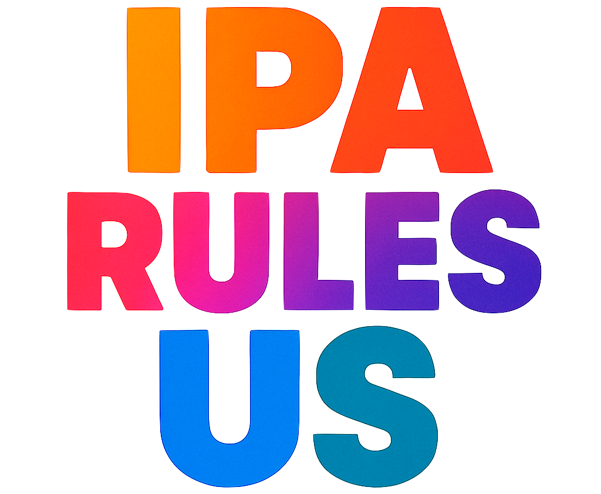
  
<i>'IPA rules us.' (not U-S)</i>

]

---
class: center, middle
 
.pull-left[ 
# **International**
# **Phonetic** 
# **Alphabet**
# **(IPA)**
]
.pull-right[
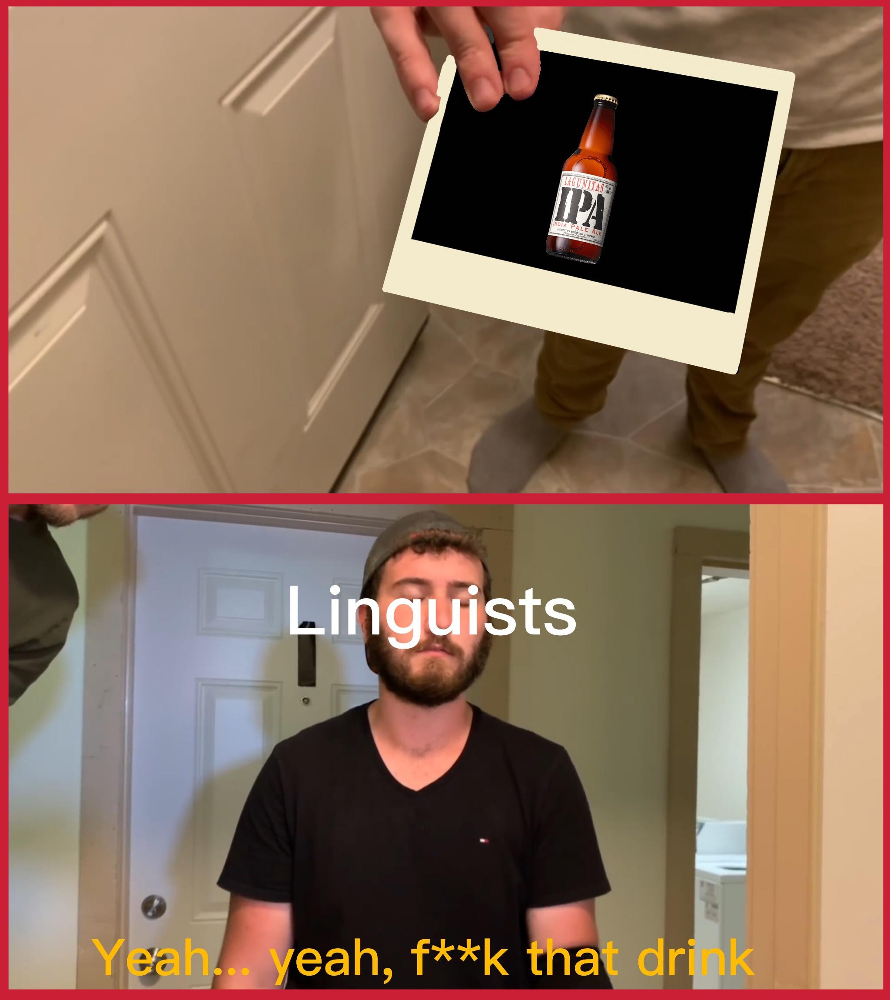
]

---
## **International Phonetic Alphabet (IPA)** 
### [ˌɪnəɹˈnæʃənəl fəˈnɛɾɪk ˈælfəˌbɛt]
 
.pull-left[
- to **accurately** represent speech sounds, we use the **International Phonetic Alphabet (IPA)**
  - one symbol **=** one sound  
- same symbols for **all** spoken languages – all languages use some **subset** of these symbols (plus additional symbols on the full IPA chart)  
- many IPA symbols represent roughly the same sounds as the corresponding English letter
  - [p, t, k, b, d, g, f, v, s, z, h, m, n, l]  
- some IPA symbols do not
  - IPA [**j**] = English y, *yes* [jɛs]
  - [**c**, **q**, **x**] & most vowels ≠ English letters
]
.pull-right[
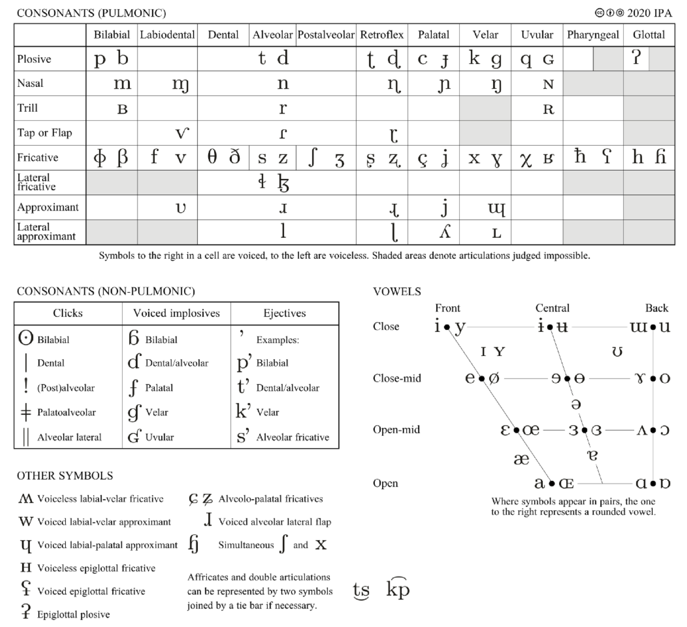
]

---
## **International Phonetic Alphabet (IPA)**
### [ˌɪnəɹˈnæʃənəl fəˈnɛɾɪk ˈælfəˌbɛt]
 
.pull-left[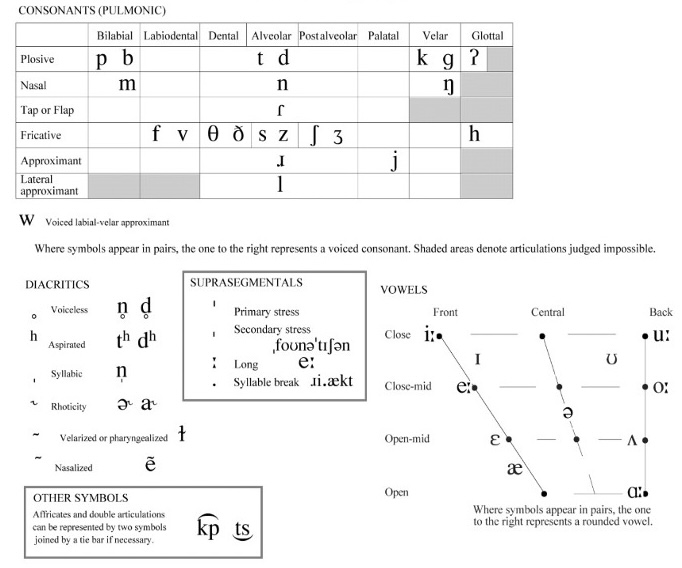]
.pull-right[]

---
## **International Phonetic Alphabet (IPA)**
### [ˌɪnəɹˈnæʃənəl fəˈnɛɾɪk ˈælfəˌbɛt] &nbsp;&nbsp;&nbsp;&nbsp;&nbsp;&nbsp;&nbsp;&nbsp;&nbsp;&nbsp;&nbsp;&nbsp;&nbsp;&nbsp;&nbsp; <b>conventions</b>
 
.pull-left[
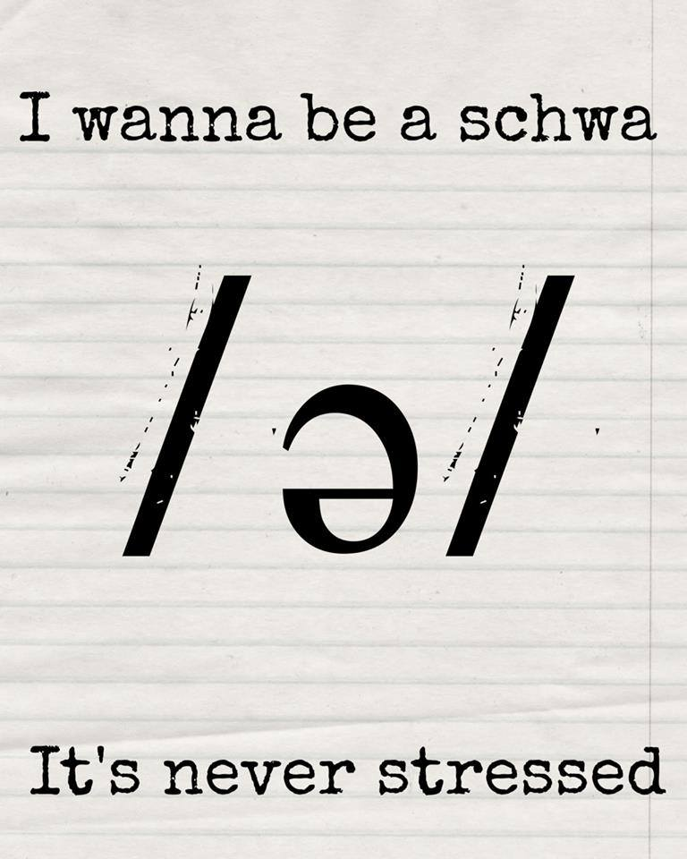
]
.pull-right[

1. phonetic transcriptions are put between **square brackets [</b>**bə.ˈnæ.nə**]**
2. spelling (orthography) is written in *<b>italics</b>* or <b>angle brackets</b>: *banana*, <b>&lt;b&gt;</b>
3.  <b>all</b> sounds and <b>only</b> sounds are written:
  
  - no silent letters 
  <b>ph</b>on<b>e</b> [ˈfown]; throu<b>gh</b> [ˈθɹu]
  - write out actually pronounced sounds 
  ne<b>x</b>t [ˈnɛkst], e<b>x</b>am [əɡ.ˈzæm]
  
4. a dot (.) indicates <b>syllable divisions</b>: pronunciation [prə<b>.</b>ˌnʌn<b>.</b>si<b>.</b>ˈej<b>.</b>ʃən]
5. <b>primary</b> and <b>secondary</b> stress are indicated with <b>ˈ</b> and <b>ˌ</b> <b>before</b> the stressed syllable
]

---
## **Consonant and Vowels**
 
.pull-left[
- the segments can be roughly divided into **three** groups - <b>vowels</b>, <b>consonants</b> and <b>glides</b>  
- the various parts of the vocal tract (vocal folds, tongue, lips, etc.) can create different ‘filters’ that modulate how air passes through  
  - <b>vowels</b>: little to no obstruction of the airstream, always **voiced**  
  - <b>consonants</b>: some degree of obstruction of the airstream, **voicing** depends  
  - <b>glides</b>: these sounds are between vowels and consonants
]
.pull-right[

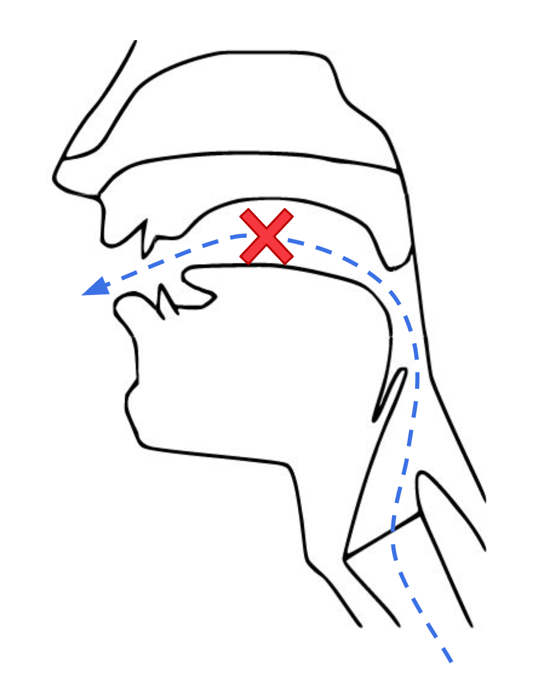  
<i>a consonant's airflow must have obstruction</i>

]

  
---
## **Consonants**
 
- all consonants are produced by restricting or obstructing the airflow in some way – whether partially or totally
- but the nature of the obstruction **varies** from consonant to consonant  
- consonants can be characterized with three properties – which all serve to describe that obstruction
  1. **voicing**: presence or absence of vocal fold vibration
  2. **place of articulation**: where the obstruction of airflow takes place
  3. **manner of articulation**: how the airflow is modulated
  

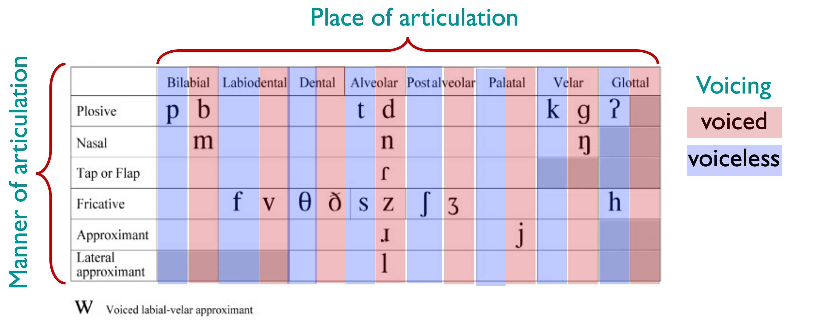

---
## **Anatomy of the Vocal Tract**
 
.pull-left[
as we exhale:  
1. air flows up from our lungs via the **trachea**  
2. through the **larynx** (source of **voicing**)  
3. through the **pharynx** (open space behind tongue)  
4. through the **oral cavity** (mouth) and/or **nasal cavity** (nasal sinuses)  
5. and out of body
]
.pull-right[
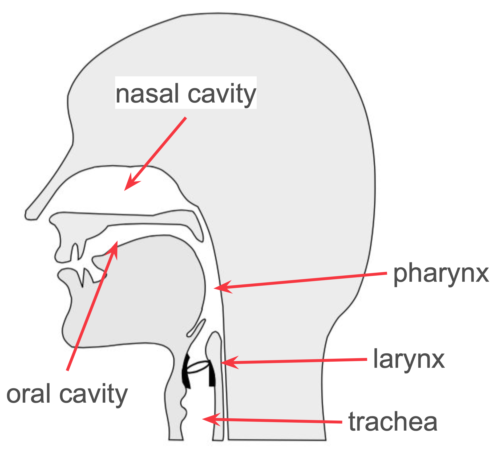
]

---
## **Anatomy of the Vocal Tract**
 
.pull-left[
- to make a consonant, airflow must be **obstructed** (somewhere and somehow)  
- this is realised by moving **active articulator** toward a **passive articulator** to restrict airflow  
- active articulators in clude **lips** and **tongue**   
- **tongue** is further divded into four areas  
  - tongue tip
  - tongue blade
  - tongue back
  - tongue root
]
.pull-right[
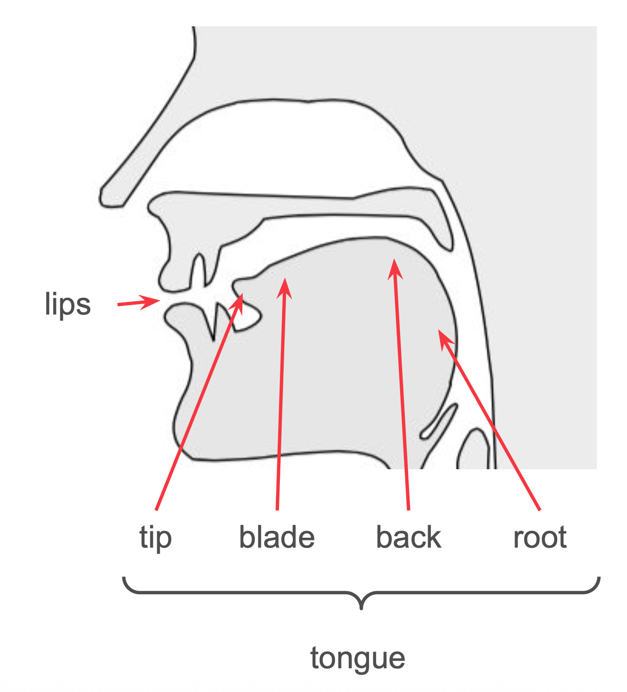
]

---
## **Anatomy of the Vocal Tract**
 
.pull-left[
- and the rest are the **passive articulators**  
  - teeth  
  - alveolar ridge  
  - hard palate  
  - velum (soft palate)  
  - uvula  
  - pharyngeal wall

]
.pull-right[
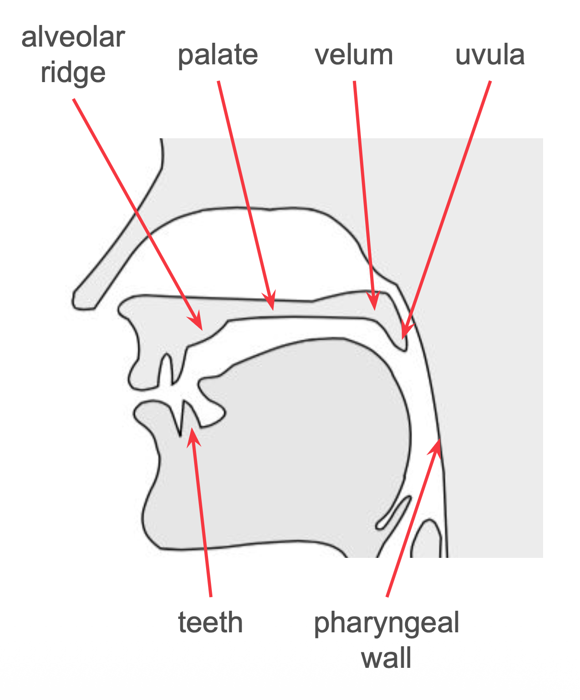
]

---
## **Voicing**
 
.pull-left[
**voiceless**: vocal folds pulled apart and are not vibrating; air goes right through  
- <b>[p]</b> in <i><b>p</b>ark</i>
- <b>[t]</b> in <i><b>t</b>art</i>
- <b>[k]</b> in <i><b>c</b>ard</i>
  

**voiced**: vocal folds brought close together and are vibrating  
- <b>[b]</b> in <i><b>b</b>ark</i>
- <b>[d]</b> in <i><b>d</b>ark</i>
- <b>[g]</b> in <i><b>g</b>uard</i>  

try pronouncing the sequences ffffffvvvvvv and sssssszzzzzzz

]

.pull-right[
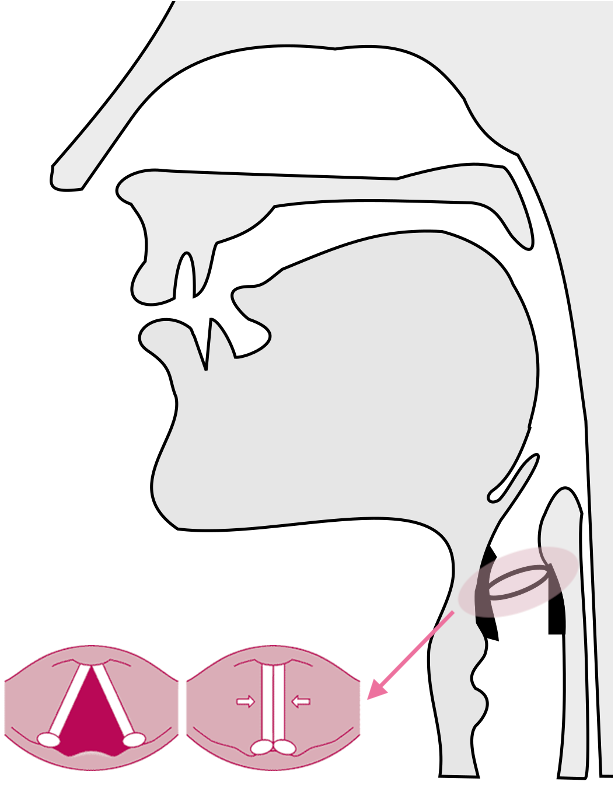
]

---
class: center, middle
## **Voicing**
### (whether vocal cords vibrate or not)
 
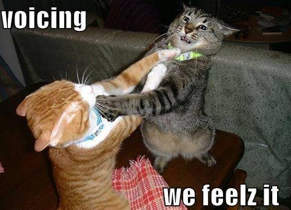

---
## **Place of Articulation**
### (where the obstruction is in the vocal tract)
 
.pull-left[
<ol start = "1">
<li> <b>bilabial</b>: obstruction occurs at the <b>lips</b></li>
</ol>   

.pull-left[
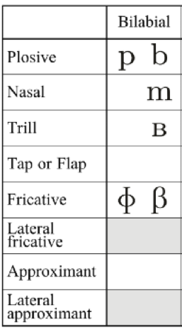
]
.pull-right[
.pull-left[   
< <b>m</b>an >   
< <b>b</b>an >   
< <b>p</b>an >   
]
.pull-right[   
<b>[ m ]</b>   
<b>[ b ]</b>   
<b>[ p ]</b>
]
]
]
.pull-right[

]

---
## **Place of Articulation**
### (where the obstruction is in the vocal tract)
 
.pull-left[
<ol start = "2">
<li> <b>labiodental</b>: obstruction occurs with the <b>lower lip</b> and the
 <b>upper teeth</b></li>
</ol>  

.pull-left[
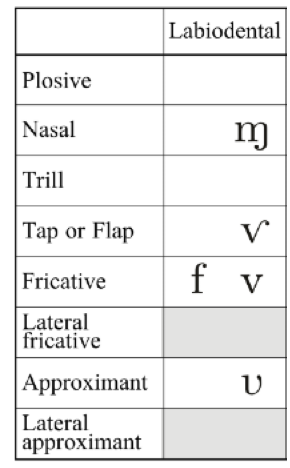
]
.pull-right[
.pull-left[   
< <b>f</b>an >   
< <b>v</b>an >
]
.pull-right[   
<b>[ f ]</b>   
<b>[ v ]</b>
]
]
]
.pull-right[
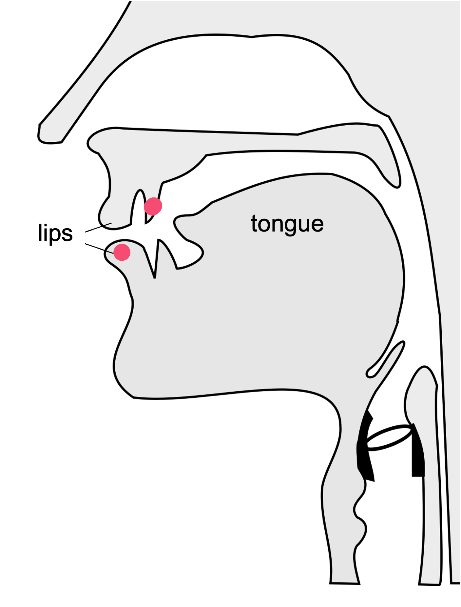
]

---
## **Place of Articulation**
### (where the obstruction is in the vocal tract)
 
.pull-left[
<ol start = "3">
<li> <b>dental/interdental</b>: obstruction occurs when the <b>tongue tip</b> is between the <b>teeth</b></li>
</ol>  

.pull-left[
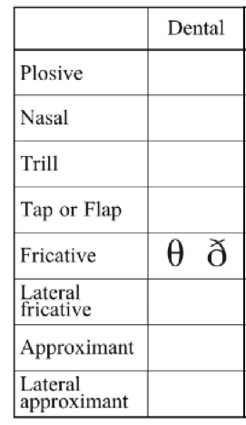
]
.pull-right[
.pull-left[   
< <b>th</b>is >   
< <b>th</b>ick >
]
.pull-right[   
<b>[ ð ]</b>   
<b>[ θ ]</b>
]
]
]
.pull-right[
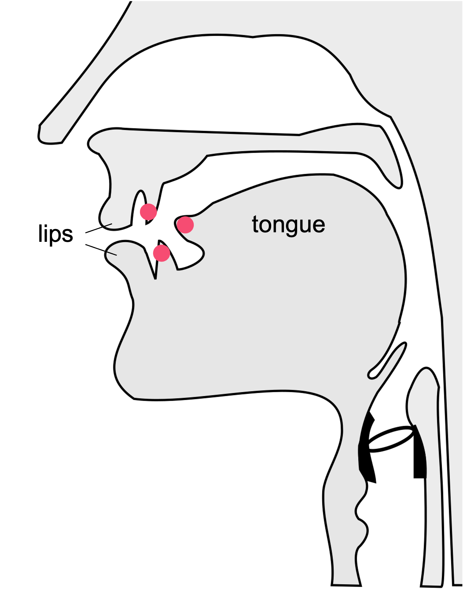
]

---
## **Place of Articulation**
### (where the obstruction is in the vocal tract)
 
.pull-left[
<ol start = "4">
<li> <b>alveolar</b>:
obstruction occurs when the <b>tongue tip</b> raises toward the <b>alveolar ridge</b> behind the teeth</li>
</ol>

.pull-left[
 
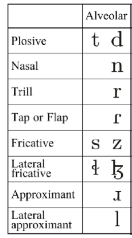
]
.pull-right[
.pull-left[
< <b>d</b>ate >   
< <b>t</b>ight >   
< <b>n</b>ate >   
< bu<b>tt</b>er >   
< <b>s</b>ate >   
< <b>l</b>ate >   
< <b>r</b>ate >
]
.pull-right[
<b>[ d ]</b>   
<b>[ t ]</b>   
<b>[ n ]</b>   
<b>[ ɾ ]</b>   
<b>[ s ]</b>   
<b>[ l ]</b>   
<b>[ ɹ ]</b>
]
]
]
.pull-right[
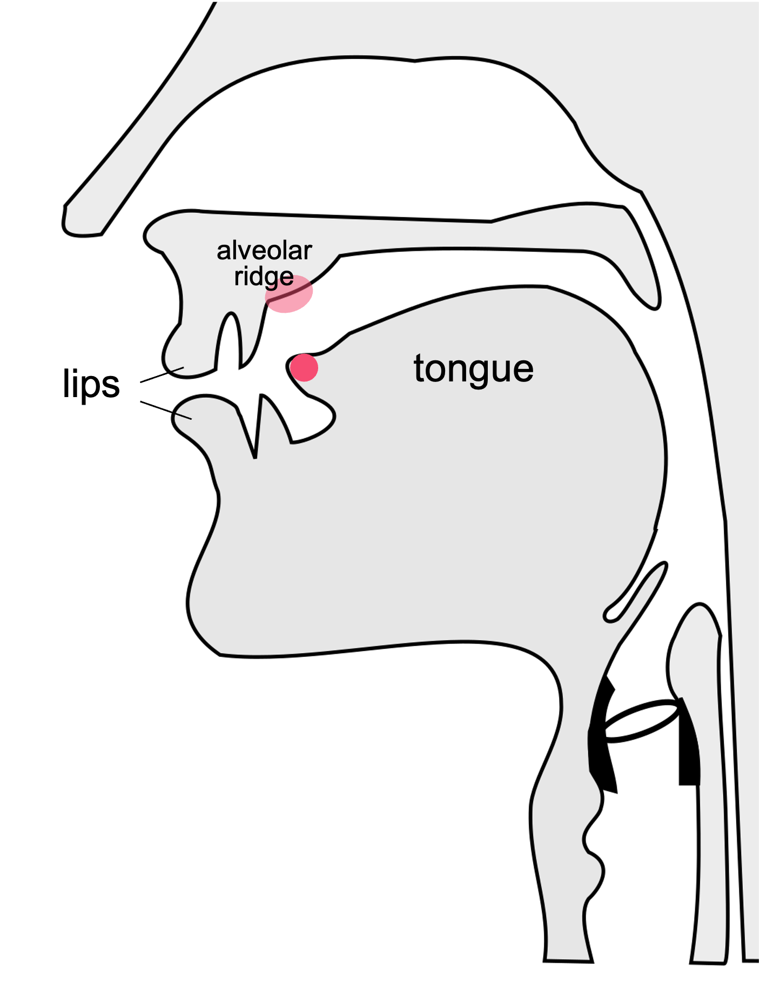
]

---
## **Place of Articulation**
### (where the obstruction is in the vocal tract)
 
.pull-left[
<ol start = "5">
<li> <b>postalveolar</b>: 
obstruction occurs when the <b>tongue tip</b> raises between the <b>alveolar ridge</b> and the <b>palate</b></li>
</ol>

.pull-left[
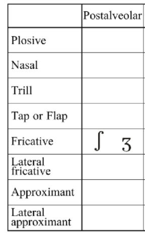
]
.pull-right[
.pull-left[ 
< rou<b>g</b>e >   
< cru<b>sh</b> >   
< <b>ch</b>eat >   
< a<b>g</b>e >
]
.pull-right[ 
<b>[ ʒ ]</b>   
<b>[ ʃ ]</b>   
<b>[ t͡ʃ ]</b>   
<b>[ d͡ʒ ]</b>
]
] 
<b>t͡ʃ</b>: voiceless palato-alveolar **affricate** 
<b>d͡ʒ</b>: voiced palato-alveolar **affricate**
]
.pull-right[
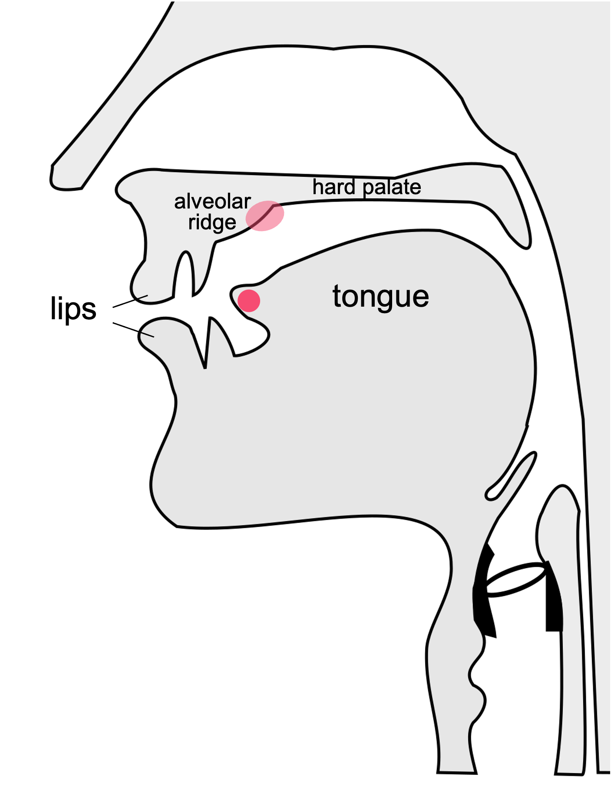
]

---
## **Place of Articulation**
### (where the obstruction is in the vocal tract)
 
.pull-left[
<ol start = "6">
<li> <b>palatal</b>: 
obstruction occurs when the <b>tongue body</b> raises towards the <b>palate</b></li>
</ol>  

.pull-left[
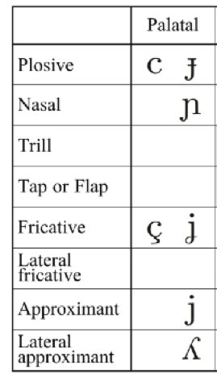
]
.pull-right[
.pull-left[   
< <b>y</b>es >
]
.pull-right[   
<b>[ j ]</b>
]
]
]
.pull-right[
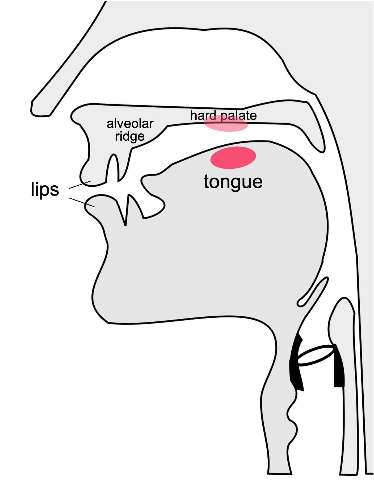
]

---
## **Place of Articulation**
### (where the obstruction is in the vocal tract)
 
.pull-left[
<ol start = "7">
<li> <b>velar</b>: 
obstruction occurs when the <b>tongue body</b> raises towards the <b>velum</b></li>
</ol>  

.pull-left[
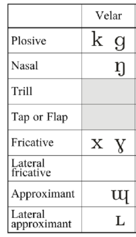
]
.pull-right[
.pull-left[   
< <b>c</b>oat >   
< <b>g</b>oat >  
< si<b>ng</b> >
]
.pull-right[   
<b>[ k ]</b>   
<b>[ g ]</b>   
<b>[ ŋ ]</b>
]
]
]
.pull-right[
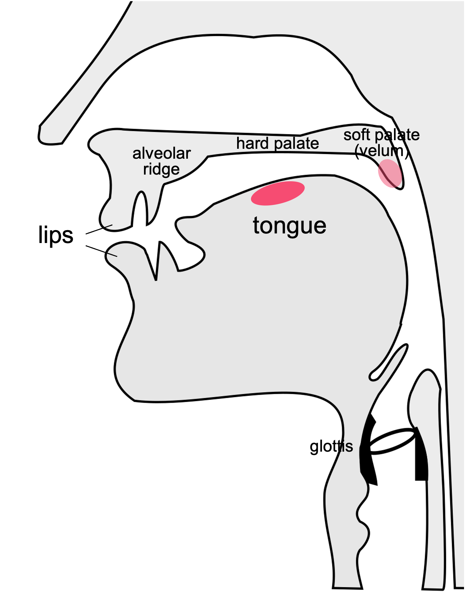
]

---
## **Place of Articulation**
### (where the obstruction is in the vocal tract)
 
.pull-left[
<ol start = "8">
<li> <b>glottal</b>: obstruction occurs at the <b>glottis</b></li>
</ol>   

.pull-left[
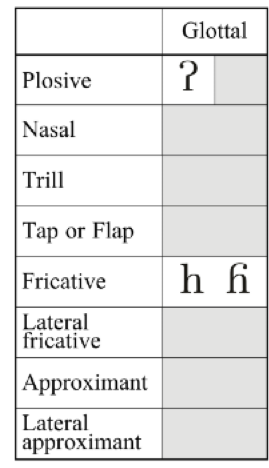
]
.pull-right[
.pull-left[   
< a<b>h</b>a >   
< <b>u</b>h-<b>o</b>h >
]
.pull-right[   
<b>[ h ]</b>   
<b>[ ʔ ]</b>
]
]
]
.pull-right[
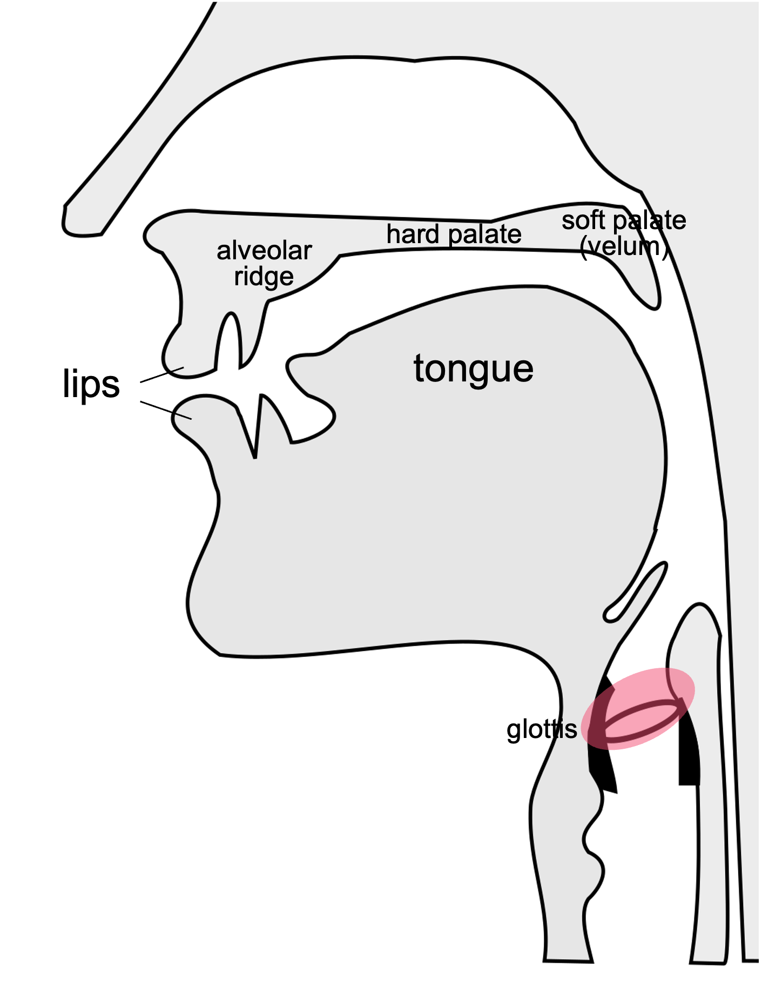
]

---
## **Place of Articulation**
### (where the obstruction is in the vocal tract)
 
the IPA chart is organized so that the place of articulation progresses from the front of the **vocal tract** to the back

 
.pull-left[
.pull-left[
.pull-left[

]
.pull-right[
<b>front</b>
]
]
.pull-right[

]
]
.pull-right[
.pull-left[

]
.pull-right[
.pull-left[
<b>back</b>
]
.pull-right[

]
]
]
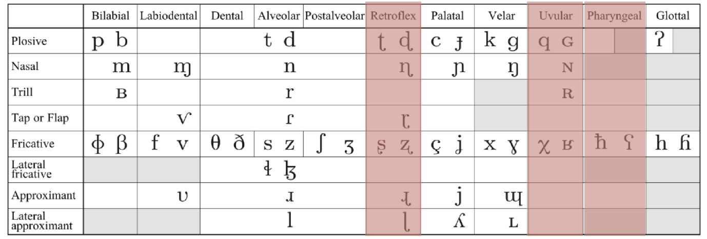

 
- English does NOT exhibit above places of articulation for consonants (marked red)

---
## **Manner of Articulation**
### (what type of obstruction of airflow occurs)
 
.pull-left[
**complete blockage of airflow**  
- stops/plosives **[p/b, t/d, k/g]**
  - < <b>p</b>ark >, [ <b>p</b> ]
  - < <b>b</b>ark >, [ <b>b</b> ]
  - < <b>t</b>art >, [ <b>t</b> ]
  - < <b>d</b>ark >, [ <b>d</b> ]
  - < <b>c</b>ard >, [ <b>k</b> ]
  - < <b>g</b>uard >, [ <b>g</b> ]  
- trills, taps/flaps **[r, ɾ]**
  - obstruction doesn't last long enough to cause a **release of pressure** at the end
  - < bu<b>tt</b>er >, [ <b>ɾ</b> ]
]
.pull-right[
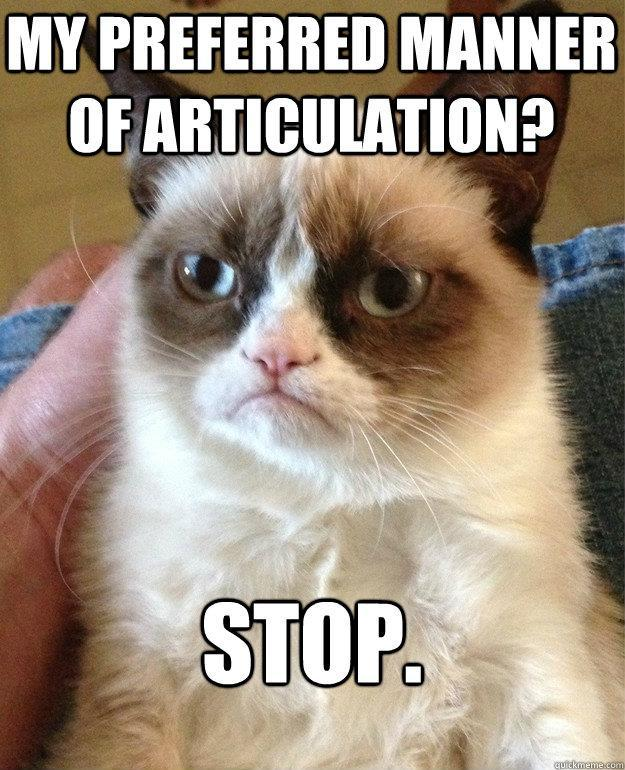
]

---
## **Manner of Articulation**
### (what type of obstruction of airflow occurs)
 
.pull-left[
**partial blockage of airflow**  
- fricatives **[ʃ, ʒ]**
  - < ten<b>s</b>ion >, [ <b>ʃ</b> ]
  - < le<b>s</b>ion >, [ <b>ʒ</b> ]  
- approximants **[ɹ]**
  - less obstruction than **fricatives**
  - < <b>r</b>ed >, [ <b>ɹ</b> ]  
- laterals **[l]**
  - obstruction in the center, but air flows past the tongue on the side(s)
  - < <b>l</b>esion >, [ <b>l</b> ]
]
.pull-right[
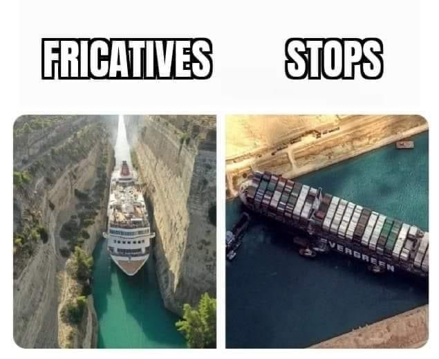
]

---
## **Manner of Articulation**
### (what type of obstruction of airflow occurs)
 
.pull-left[
airflow blocked in **one part** of the vocal tract but flow through **a different part**  
- affricates **[t͡ʃ, d͡ʒ]** ???[d͡ʃ]
  - a combination of stops and fricatives
  - < <b>ch</b>oke >, [ <b>t͡ʃ</b> ]
  - < <b>j</b>oke >, [ <b>d͡ʒ</b> ]  
- nasals **[m, n, ŋ]**
  - complete obstruction through the oral cavity but air is **redirected** to flow through the nasal cavity with **lowered velum**
  - < <b>m</b>ail >, [ <b>m</b> ]
  - < <b>n</b>ail >, [ <b>n</b> ]
  - < sing<b></b> >, [ <b>ŋ</b> ]
]
.pull-right[
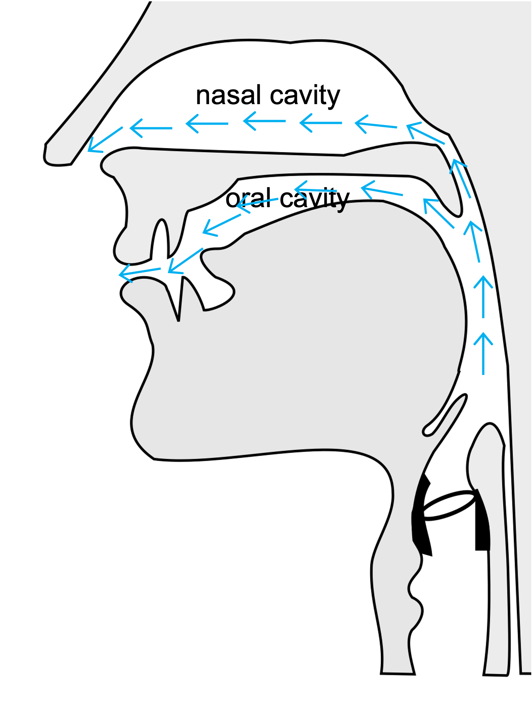
]

---
## **Manner of Articulation**
### (what type of obstruction of airflow occurs)
 
.pull-left[
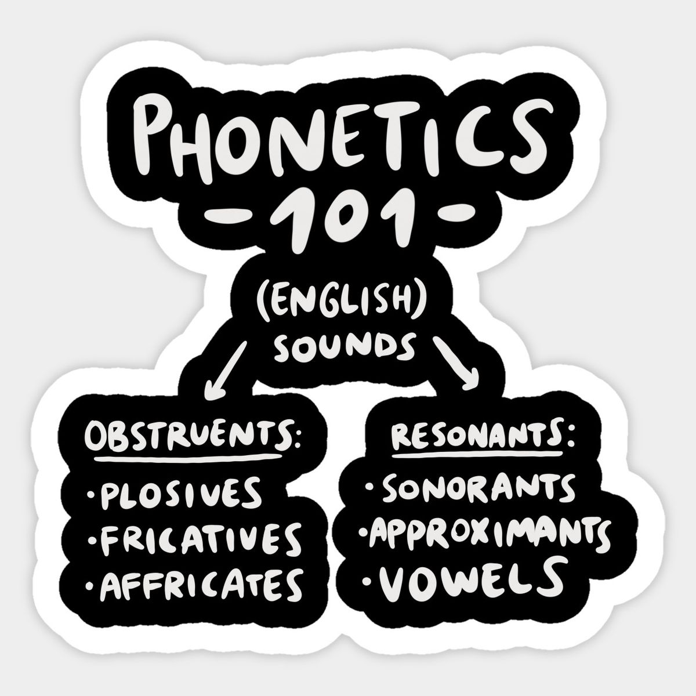
]
.pull-right[
further grouping into **sound class**  
- rhotics: **<i>r</i>**-like sounds **[ɹ, ɻ, r, ʀ, ɾ, ɽ, ʁ...]**  
- liquids: rhotics and laterals  
- obstruents
  - consonants with **more** obstruction
  - stops, fricatives, affricates  
- sonorants
  - consonants with **less** obstruction
  - nasals, liquids, approximants
]

---
## **One More Property: Aspiration**
 
.pull-left[
compare <b>< space ></b> and <b>< pace ></b>  
compare <b>< scare ></b> and <b>< care ></b>  
- any difference in the <b>< p ></b> s and <b>< c ></b> s?  
- put a piece of paper in front of you and pronounce the sound  

**aspiration**: a puff of air  
- <b>[ph]</b> vs <b>[p]</b>  
- <b>[kh]</b> vs <b>[k]</b>
]
.pull-right[
  
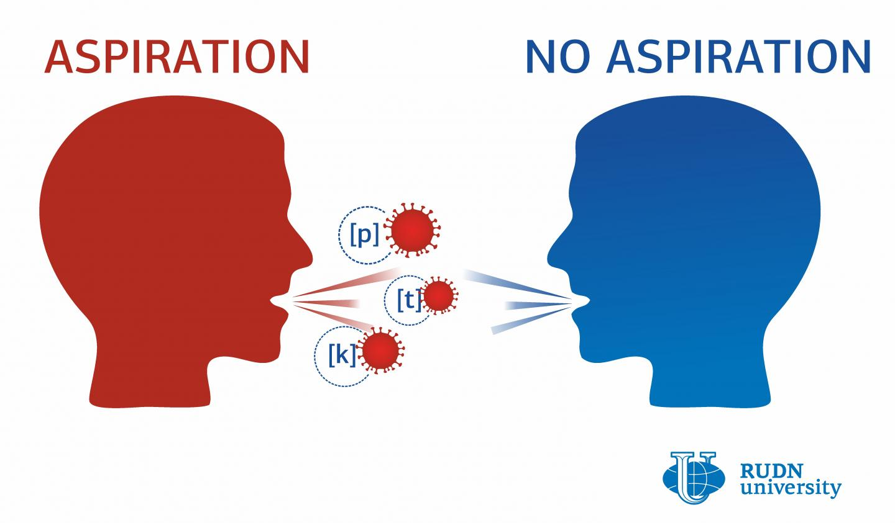
]

---
## **Feel Consonants**
 
.pull-left[
<b>stops/plosives</b> - <b>fricatives</b>: try to pronounce a **long** sequence of a consonant  
- if it can be pronounced with non-stop, the sound is a <b>fricative</b>
- if it cannot be pronounced with non-stop, the sound is a <b>stop</b>  

<b>oral</b> - <b>nasal</b>: hold **nose** and produce the sound  
- if it becomes hard to produce, the sound is a <b>nasal</b>
- if it still sounds similar, the sound is a <b>oral</b>  

try these tests on the first sound in < fan >, < pan > and < man >  
]
.pull-right[

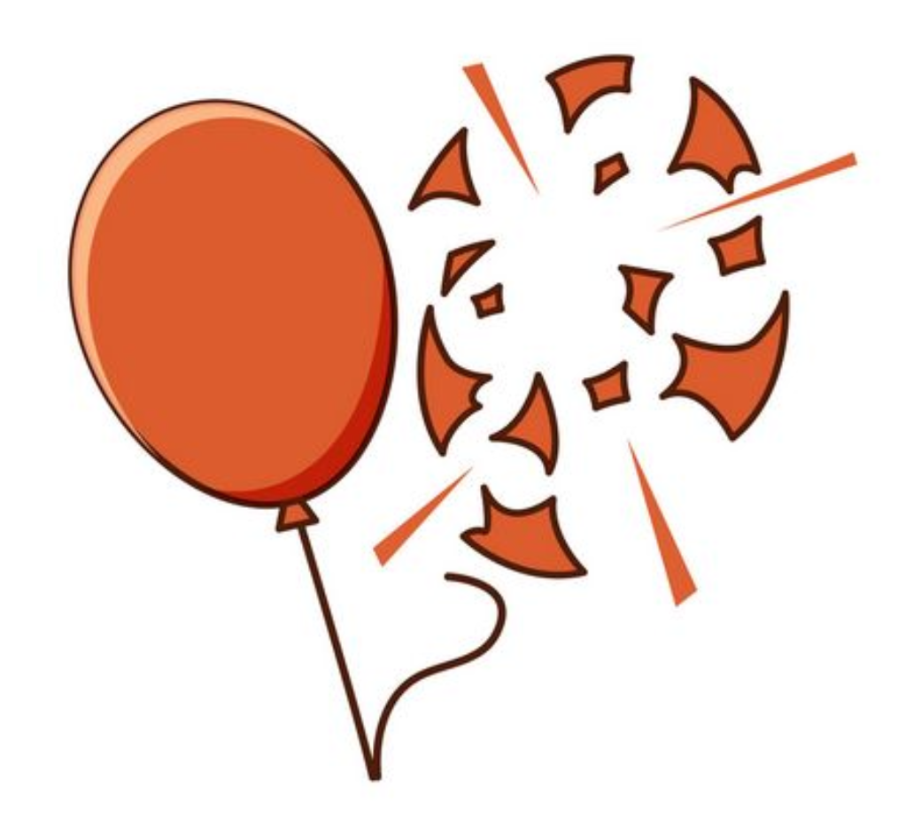  
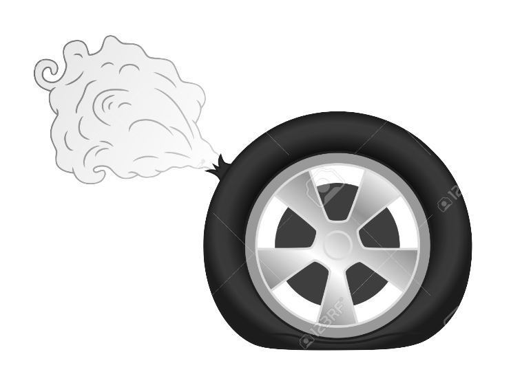

]

---
## **Feel Consonants: Notes about Affricates**
 
.pull-left[
- say the words <i><b>t</b>ie</i>, <i><b>shy</b></i>, <i><b>ch</b>ai</i> and do the **stop - fricative** test
  - with which words does your tongue **touch** the upper part of your mouth?
  - which words produce a hissing sound?  
- <b>affricates</b> are a sort of combination between stops and fricatives
  - a complete closure is made, building up pressure
  - when it is released, the articulators are kept close together enough to produce the hissing sound characteristic of fricatives   
- affricates are considered **one sound**, but with two phases, and they are written with two IPA symbols joined with a **tie bar**
  - <i>check</i> [t͡ʃɛk]
]
.pull-right[

  
<h3><b>+</b></h3> 

]

---
## **Exercise: Feel Consonants**
 
**differentiate** the following consonants considering properties we have mentioned above

.pull-left[

<b>fricative - stop</b> 
<b>voiced - voiceless</b>

]
.pull-right[

<b>oral - nasal</b> 
<b>aspirated - unaspirated</b>

]  

<table style="width:100%; collapse-border:collapse">
<tr>
  <th>sound</th>
  <th>transcription</th>
  <th>fricative/stop?</th>
  <th>oral/nasal?</th>
  <th>voiced/voiceless?</th>
  <th>aspirated/unaspirated?</th>
</tr>
<tr>
  <td>-</td>
</tr>
<tr>
   <td style="text-align:left">1st in <b>< phone ></b></td>
</tr>
<tr>
  <td>-</td>
</tr>
<tr>
   <td style="text-align:left">1st in <b>< think ></b></td>
</tr>
<tr>
  <td>-</td>
</tr>
<tr>
   <td style="text-align:left">1st in <b>< tiger ></b></td>
</tr>
<tr>
  <td>-</td>
</tr>
<tr>
   <td style="text-align:left">1st in <b>< milk ></b></td>
</tr>
<tr>
  <td>-</td>
</tr>
<tr>
   <td style="text-align:left">1st in <b>< cat ></b></td>
</tr>
<tr>
  <td>-</td>
</tr>
<tr>
   <td style="text-align:left">3rd in <b>< vision ></b></td>
</tr>
</table>

---
## **Exercise: Feel Consonants**
 
**differentiate** the following consonants considering properties we have mentioned above

.pull-left[

<b>fricative - stop</b> 
<b>voiced - voiceless</b>

]
.pull-right[

<b>oral - nasal</b> 
<b>aspirated - unaspirated</b>

]  

<table style="width:100%; collapse-border:collapse">
<tr>
  <th>sound</th>
  <th>transcription</th>
  <th>fricative/stop?</th>
  <th>oral/nasal?</th>
  <th>voiced/voiceless?</th>
  <th>aspirated/unaspirated?</th>
</tr>
<tr>
  <td>-</td>
</tr>
<tr>
   <td style="text-align:left">1st in <b>< phone ></b></td>
   <td style="text-align:center"><b>[f]</b></td>
</tr>
<tr>
  <td>-</td>
</tr>
<tr>
   <td style="text-align:left">1st in <b>< think ></b></td>
   <td style="text-align:center"><b>[θ]</b></td>
</tr>
<tr>
  <td>-</td>
</tr>
<tr>
   <td style="text-align:left">1st in <b>< tiger ></b></td>
   <td style="text-align:center"><b>[th]</b></td>
</tr>
<tr>
  <td>-</td>
</tr>
<tr>
   <td style="text-align:left">1st in <b>< milk ></b></td>
   <td style="text-align:center"><b>[m]</b></td>
</tr>
<tr>
  <td>-</td>
</tr>
<tr>
   <td style="text-align:left">1st in <b>< cat ></b></td>
   <td style="text-align:center"><b>[kh]</b></td>
</tr>
<tr>
  <td>-</td>
</tr>
<tr>
   <td style="text-align:left">3rd in <b>< vision ></b></td>
   <td style="text-align:center"><b>[ʒ]</b></td>
</tr>
</table>

---
## **Exercise: Feel Consonants**
 
**differentiate** the following consonants considering properties we have mentioned above

.pull-left[

<b>fricative - stop</b> 
<b>voiced - voiceless</b>

]
.pull-right[

<b>oral - nasal</b> 
<b>aspirated - unaspirated</b>

]  

<table style="width:100%; collapse-border:collapse">
<tr>
  <th>sound</th>
  <th>transcription</th>
  <th>fricative/stop?</th>
  <th>oral/nasal?</th>
  <th>voiced/voiceless?</th>
  <th>aspirated/unaspirated?</th>
</tr>
<tr>
  <td>-</td>
</tr>
<tr>
   <td style="text-align:left">1st in <b>< phone ></b></td>
   <td style="text-align:center"><b>[f]</b></td>
   <td style="text-align:center"><b>fricative</b></td>
</tr>
<tr>
  <td>-</td>
</tr>
<tr>
   <td style="text-align:left">1st in <b>< think ></b></td>
   <td style="text-align:center"><b>[θ]</b></td>
   <td style="text-align:center"><b>fricative</b></td>
</tr>
<tr>
  <td>-</td>
</tr>
<tr>
   <td style="text-align:left">1st in <b>< tiger ></b></td>
   <td style="text-align:center"><b>[th]</b></td>
   <td style="text-align:center"><b>stop</b></td>
</tr>
<tr>
  <td>-</td>
</tr>
<tr>
   <td style="text-align:left">1st in <b>< milk ></b></td>
   <td style="text-align:center"><b>[m]</b></td>
   <td style="text-align:center"><b>stop</b></td>
</tr>
<tr>
  <td>-</td>
</tr>
<tr>
   <td style="text-align:left">1st in <b>< cat ></b></td>
   <td style="text-align:center"><b>[kh]</b></td>
   <td style="text-align:center"><b>stop</b></td>
</tr>
<tr>
  <td>-</td>
</tr>
<tr>
   <td style="text-align:left">3rd in <b>< vision ></b></td>
   <td style="text-align:center"><b>[ʒ]</b></td>
   <td style="text-align:center"><b>fricative</b></td>
</tr>
</table>

---
## **Exercise: Feel Consonants**
 
**differentiate** the following consonants considering properties we have mentioned above

.pull-left[

<b>fricative - stop</b> 
<b>voiced - voiceless</b>

]
.pull-right[

<b>oral - nasal</b> 
<b>aspirated - unaspirated</b>

]  

<table style="width:100%; collapse-border:collapse">
<tr>
  <th>sound</th>
  <th>transcription</th>
  <th>fricative/stop?</th>
  <th>oral/nasal?</th>
  <th>voiced/voiceless?</th>
  <th>aspirated/unaspirated?</th>
</tr>
<tr>
  <td>-</td>
</tr>
<tr>
   <td style="text-align:left">1st in <b>< phone ></b></td>
   <td style="text-align:center"><b>[f]</b></td>
   <td style="text-align:center">fricative</td>
   <td style="text-align:center"><b>oral</b></td>
</tr>
<tr>
  <td>-</td>
</tr>
<tr>
   <td style="text-align:left">1st in <b>< think ></b></td>
   <td style="text-align:center"><b>[θ]</b></td>
   <td style="text-align:center">fricative</td>
   <td style="text-align:center"><b>oral</b></td>
</tr>
<tr>
  <td>-</td>
</tr>
<tr>
   <td style="text-align:left">1st in <b>< tiger ></b></td>
   <td style="text-align:center"><b>[th]</b></td>
   <td style="text-align:center">stop</td>
   <td style="text-align:center"><b>oral</b></td>
</tr>
<tr>
  <td>-</td>
</tr>
<tr>
   <td style="text-align:left">1st in <b>< milk ></b></td>
   <td style="text-align:center"><b>[m]</b></td>
   <td style="text-align:center">stop</td>
   <td style="text-align:center"><b>nasal</b></td>
</tr>
<tr>
  <td>-</td>
</tr>
<tr>
   <td style="text-align:left">1st in <b>< cat ></b></td>
   <td style="text-align:center"><b>[kh]</b></td>
   <td style="text-align:center">stop</td>
   <td style="text-align:center"><b>oral</b></td>
</tr>
<tr>
  <td>-</td>
</tr>
<tr>
   <td style="text-align:left">3rd in <b>< vision ></b></td>
   <td style="text-align:center"><b>[ʒ]</b></td>
   <td style="text-align:center">fricative</td>
   <td style="text-align:center"><b>oral</b></td>
</tr>
</table>

---
## **Exercise: Feel Consonants**
 
**differentiate** the following consonants considering properties we have mentioned above

.pull-left[

<b>fricative - stop</b> 
<b>voiced - voiceless</b>

]
.pull-right[

<b>oral - nasal</b> 
<b>aspirated - unaspirated</b>

]  

<table style="width:100%; collapse-border:collapse">
<tr>
  <th>sound</th>
  <th>transcription</th>
  <th>fricative/stop?</th>
  <th>oral/nasal?</th>
  <th>voiced/voiceless?</th>
  <th>aspirated/unaspirated?</th>
</tr>
<tr>
  <td>-</td>
</tr>
<tr>
   <td style="text-align:left">1st in <b>< phone ></b></td>
   <td style="text-align:center"><b>[f]</b></td>
   <td style="text-align:center">fricative</td>
   <td style="text-align:center">oral</td>
   <td style="text-align:center"><b>voiceless</b></td>
</tr>
<tr>
  <td>-</td>
</tr>
<tr>
   <td style="text-align:left">1st in <b>< think ></b></td>
   <td style="text-align:center"><b>[θ]</b></td>
   <td style="text-align:center">fricative</td>
   <td style="text-align:center">oral</td>
   <td style="text-align:center"><b>voiceless</b></td>
</tr>
<tr>
  <td>-</td>
</tr>
<tr>
   <td style="text-align:left">1st in <b>< tiger ></b></td>
   <td style="text-align:center"><b>[th]</b></td>
   <td style="text-align:center">stop</td>
   <td style="text-align:center">oral</td>
   <td style="text-align:center"><b>voiceless</b></td>
</tr>
<tr>
  <td>-</td>
</tr>
<tr>
   <td style="text-align:left">1st in <b>< milk ></b></td>
   <td style="text-align:center"><b>[m]</b></td>
   <td style="text-align:center">stop</td>
   <td style="text-align:center">nasal</td>
   <td style="text-align:center"><b>voiced</b></td>
</tr>
<tr>
  <td>-</td>
</tr>
<tr>
   <td style="text-align:left">1st in <b>< cat ></b></td>
   <td style="text-align:center"><b>[kh]</b></td>
   <td style="text-align:center">stop</td>
   <td style="text-align:center">oral</td>
   <td style="text-align:center"><b>voiceless</b></td>
</tr>
<tr>
  <td>-</td>
</tr>
<tr>
   <td style="text-align:left">3rd in <b>< vision ></b></td>
   <td style="text-align:center"><b>[ʒ]</b></td>
   <td style="text-align:center">fricative</td>
   <td style="text-align:center">oral</td>
   <td style="text-align:center"><b>voiced</b></td>
</tr>
</table>

---
## **Exercise: Feel Consonants**
 
**differentiate** the following consonants considering properties we have mentioned above

.pull-left[

<b>fricative - stop</b> 
<b>voiced - voiceless</b>

]
.pull-right[

<b>oral - nasal</b> 
<b>aspirated - unaspirated</b>

]  

<table style="width:100%; collapse-border:collapse">
<tr>
  <th>sound</th>
  <th>transcription</th>
  <th>fricative/stop?</th>
  <th>oral/nasal?</th>
  <th>voiced/voiceless?</th>
  <th>aspirated/unaspirated?</th>
</tr>
<tr>
  <td>-</td>
</tr>
<tr>
   <td style="text-align:left">1st in <b>< phone ></b></td>
   <td style="text-align:center"><b>[f]</b></td>
   <td style="text-align:center">fricative</td>
   <td style="text-align:center">oral</td>
   <td style="text-align:center">voiceless</td>
   <td style="text-align:center"><b>unaspirated</b></td>
</tr>
<tr>
  <td>-</td>
</tr>
<tr>
   <td style="text-align:left">1st in <b>< think ></b></td>
   <td style="text-align:center"><b>[θ]</b></td>
   <td style="text-align:center">fricative</td>
   <td style="text-align:center">oral</td>
   <td style="text-align:center">voiceless</td>
   <td style="text-align:center"><b>unaspirated</b></td>
</tr>
<tr>
  <td>-</td>
</tr>
<tr>
   <td style="text-align:left">1st in <b>< tiger ></b></td>
   <td style="text-align:center"><b>[th]</b></td>
   <td style="text-align:center">stop</td>
   <td style="text-align:center">oral</td>
   <td style="text-align:center">voiceless</td>
   <td style="text-align:center"><b>aspirated</b></td>
</tr>
<tr>
  <td>-</td>
</tr>
<tr>
   <td style="text-align:left">1st in <b>< milk ></b></td>
   <td style="text-align:center"><b>[m]</b></td>
   <td style="text-align:center">stop</td>
   <td style="text-align:center">nasal</td>
   <td style="text-align:center">voiced</td>
   <td style="text-align:center"><b>unaspirated</b></td>
</tr>
<tr>
  <td>-</td>
</tr>
<tr>
   <td style="text-align:left">1st in <b>< cat ></b></td>
   <td style="text-align:center"><b>[kh]</b></td>
   <td style="text-align:center">stop</td>
   <td style="text-align:center">oral</td>
   <td style="text-align:center">voiceless</td>
   <td style="text-align:center"><b>aspirated</b></td>
</tr>
<tr>
  <td>-</td>
</tr>
<tr>
   <td style="text-align:left">3rd in <b>< vision ></b></td>
   <td style="text-align:center"><b>[ʒ]</b></td>
   <td style="text-align:center">fricative</td>
   <td style="text-align:center">oral</td>
   <td style="text-align:center">voiced</td>
   <td style="text-align:center"><b>unaspirated</b></td>
</tr>
</table>

---
class: center, middle
**Assignment VI** is due this Friday (**Nov 13th**)  
**Assignment VII** will be published this Wednesday (**Nov 11**) and is due next Friday (**Nov 20th**)
**continue reading**: 
Phonetics in O'Grady et al.'s *Contemprary Linguistics: An Introduction*   
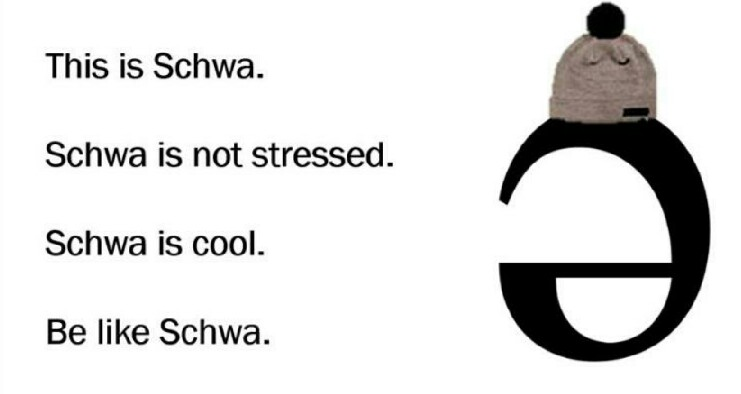
  
Slides created via the R package [**xaringan**](https://github.com/yihui/xaringan).

