class: center, middle
## Please pick up your **name card** from the front
  
## **office hours**: Mondays, 2:00-3:00 pm 
## Basement, Room 003, **Linguistics Building**
      
---
## **Previously on 201: Phonetics vs Phonology**
 
.pull-left[
- **Phonetics** is the study of **how speech sounds are produced** by articulators in the vocal tract and **perceived** by are auditory apparatus  
  - <b>articulatory phonetics</b>: how different sounds are produced in vocal tract  
  - <b>acoustic phonetics</b>: the physical properties of speech sounds  
  - <b>perceptual phonetics</b>: how sounds are perceived by listeners  
- **Phonology** is the study of the **pattern** and **function** of sounds (how your brain categorises sounds associated with speech)
]
.pull-right[
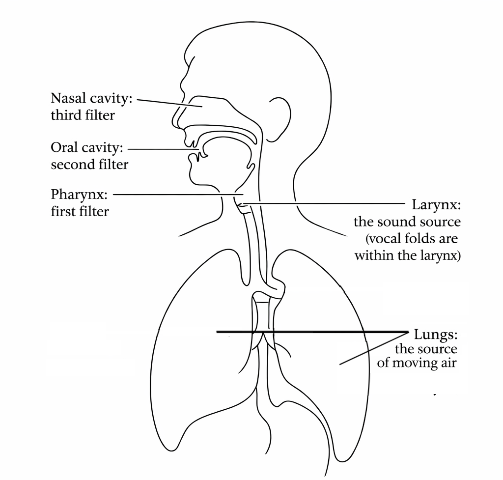
]

---
.pull-left[
## **Vocal Tract Anatomy**
]
.pull-right[

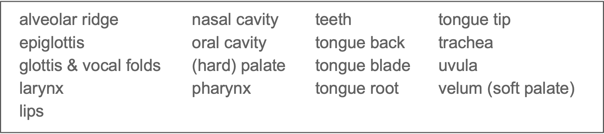

]

 
Fill in the blanks with the appropriate **anatomical term** for each **articulator** from the box. <u>#5, 9, 10</u> refer to **cavities** (open spaces), not structures. (You may consult the reading, page 22)
  

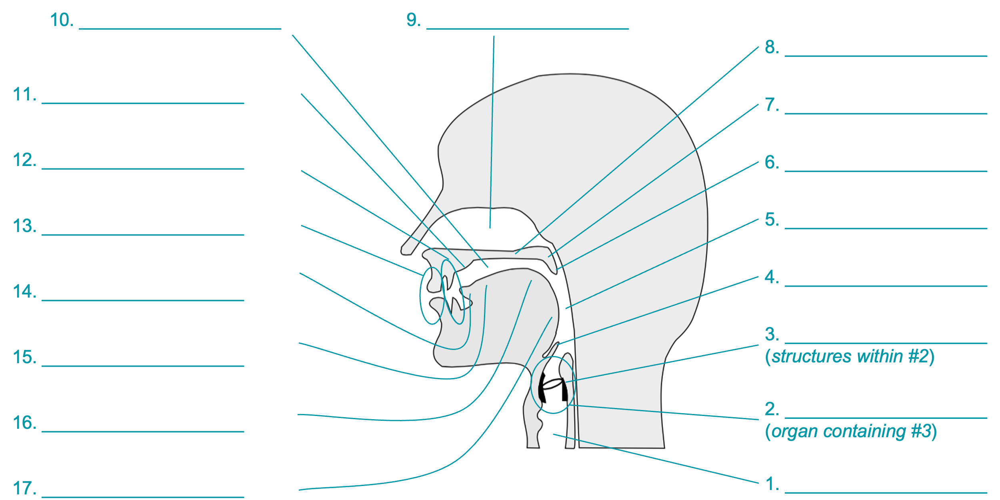

---
.pull-left[
## **Vocal Tract Anatomy**
]
.pull-right[

]

 
Fill in the blanks with the appropriate **anatomical term** for each **articulator** from the box. <u>#5, 9, 10</u> refer to **cavities** (open spaces), not structures. (You may consult the reading, page 22)
  

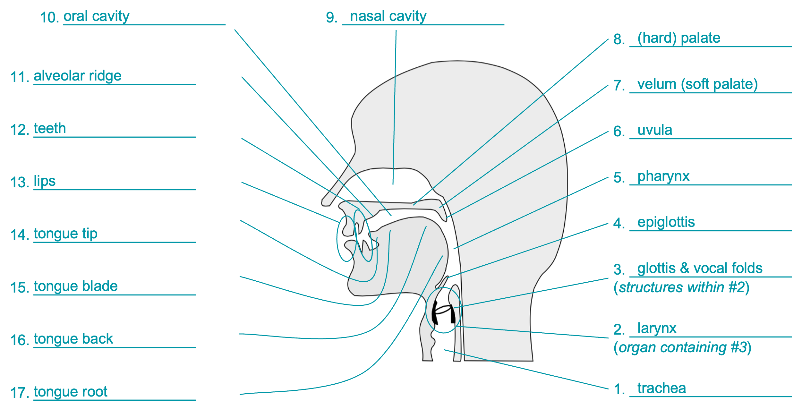

---
## **Previously on 201: Consonants**
 
- all consonants are produced by restricting or obstructing the airflow in some way – whether partially or totally
- but the nature of the obstruction **varies** from consonant to consonant  
- consonants can be characterized with three properties – which all serve to describe that obstruction
  1. **voicing**: presence or absence of vocal fold vibration
  2. **place of articulation**: where the obstruction of airflow takes place
  3. **manner of articulation**: how the airflow is modulated
  

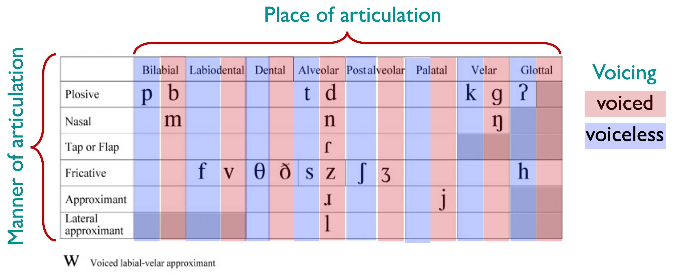

---
## **Previously on 201: Feel Consonants**
 
.pull-left[
<b>stops/plosives</b> - <b>fricatives</b>: try to pronounce a **long** sequence of a consonant  
- if it can be pronounced with non-stop, the sound is a <b>fricative</b>
- if it cannot be pronounced with non-stop, the sound is a <b>stop</b>  

<b>oral</b> - <b>nasal</b>: hold **nose** and produce the sound  
- if it becomes hard to produce, the sound is a <b>nasal</b>
- if it still sounds similar, the sound is a <b>oral</b>  

try these tests on the first sound in < fan >, < pan > and < man >  
]
.pull-right[

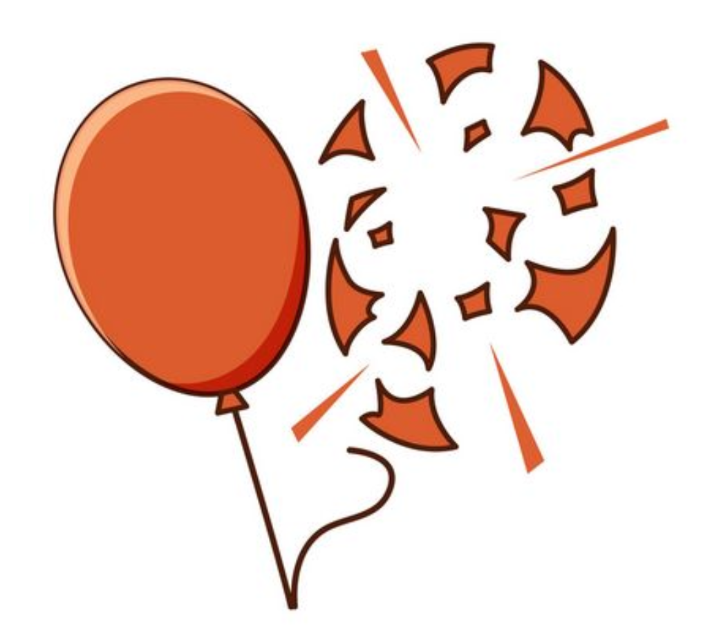  
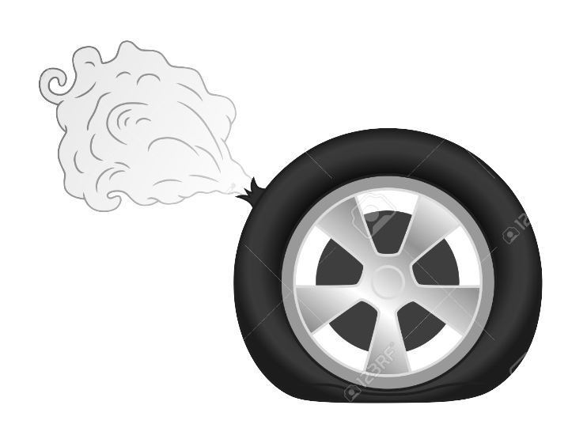

]

---
class: center, middle
## **Previously on 201: Voicing**
### (whether vocal cords vibrate or not)
 
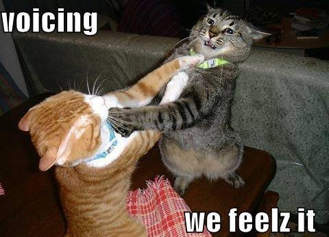

---
## **Categories to Differentiate Consonants**
 

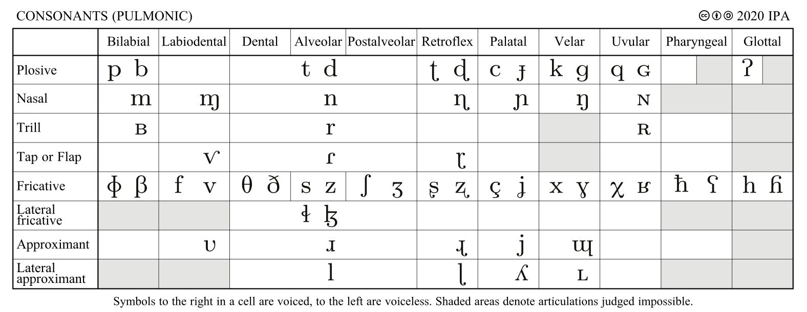

 

<b>columns</b> - place - where the obstruction of airflow in the vocal tract is  
<b>row</b> - manner - what type of obstruction of airflow occurs  
in a <b>single cell</b> - voicing - whether the vocal cords vibrate or not (the right is <i>voiced</i>)  

  <a href="https://www.ipachart.com"><b>IPA clickable chart</b></a>

---
## **Exercise I: Identifying Consonants**
 
give a full description for <b>voicing</b>, <b>place</b>, and <b>manner</b> of **each consonant** in the following words and give the corresponding **IPA** symbol   
.pull-left[
move  
cloth  
gosh 
]
.pull-right[
hide  
stove  
bank 
]

---
## **Exercise I: Identifying Consonants**
 
give a full description for <b>voicing</b>, <b>place</b>, and <b>manner</b> of **each consonant** in the following words and give the corresponding **IPA** symbol   
.pull-left[
move-----<b>[m]</b>: <b>voiced</b> <b>bilabial</b> <b>nasal</b> 
move-----<b>[v]</b>: <b>voiced</b> <b>labio-dental</b> <b>fricative</b>  
cloth------<b>[k]</b>: <b>voiceless</b> <b>velar</b> <b>stop</b> 
cloth------<b>[l]</b>: <b>voiced</b> <b>alveolar</b> <b>lateral approximant</b> 
cloth------<b>[θ]</b>: <b>voiceless</b> <b>dental</b> <b>fricative</b>  
gosh------<b>[g]</b>: <b>voiced</b> <b>velar</b> <b>stop</b> 
gosh------<b>[ʃ]</b>: <b>voiceless</b> <b>post-alveolar</b> <b>fricative</b>  
]
.pull-right[
hide------<b>[h]</b>: <b>voiceless</b> <b>glottal</b> <b>fricative</b> 
hide------<b>[d]</b>: <b>voiced</b> <b>bilabial</b> <b>stop</b>  
stove-----<b>[s]</b>: <b>voiceless</b> <b>alveolar</b> <b>fricative</b> 
stove-----<b>[t]</b>: <b>voiceless</b> <b>alveolar</b> <b>stop</b> 
stove-----<b>[v]</b>: <b>voiced</b> <b>labio-dental</b> <b>fricative</b>  
bank------<b>[b]</b>: <b>voiced</b> <b>bilabial</b> <b>stop</b> 
bank------<b>[ŋ]</b>: <b>voiced</b> <b>velar</b> <b>nasal</b> 
bank------<b>[k]</b>: <b>voiceless</b> <b>velar</b> <b>stop</b>  
]

---
## **Practice: Identifying Consonants**
 
give a full description for <b>voicing</b>, <b>place</b>, and <b>manner</b> of **each consonant** in the following words and give the corresponding **IPA** symbol   

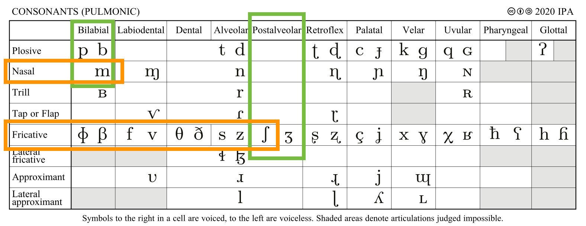

---
## **Vowels and Consonants**
 
- the way we articulate vowels and consonants differs in two important ways  

- **airflow** – when we speak, we exhale, forcing air to flow outward through our **vocal tract**
  - with **consonants**, the airflow is blocked completely or partially
  - with **vowels**, there is no obstruction  
- **voicing** – when we cause our vocal cords to vibrate during speech
  - **vowels** are usually voiced
  - **consonants** may be voiced or voiceless
  

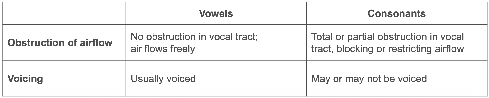

---
## **Voicing and the Larynx**
 
.pull-left[
- **larynx** is the primary source of speech sounds and it contains  
  - <b>vocal folds</b> (vocal cords): two sheets of muscle that can be brought together or pulled apart
  - <b>glottis</b>: opening between the vocal folds through which air passes
  - other structures of muscle, cartilage, and ligament that **support** and **move** the vocal folds  
]
.pull-right[

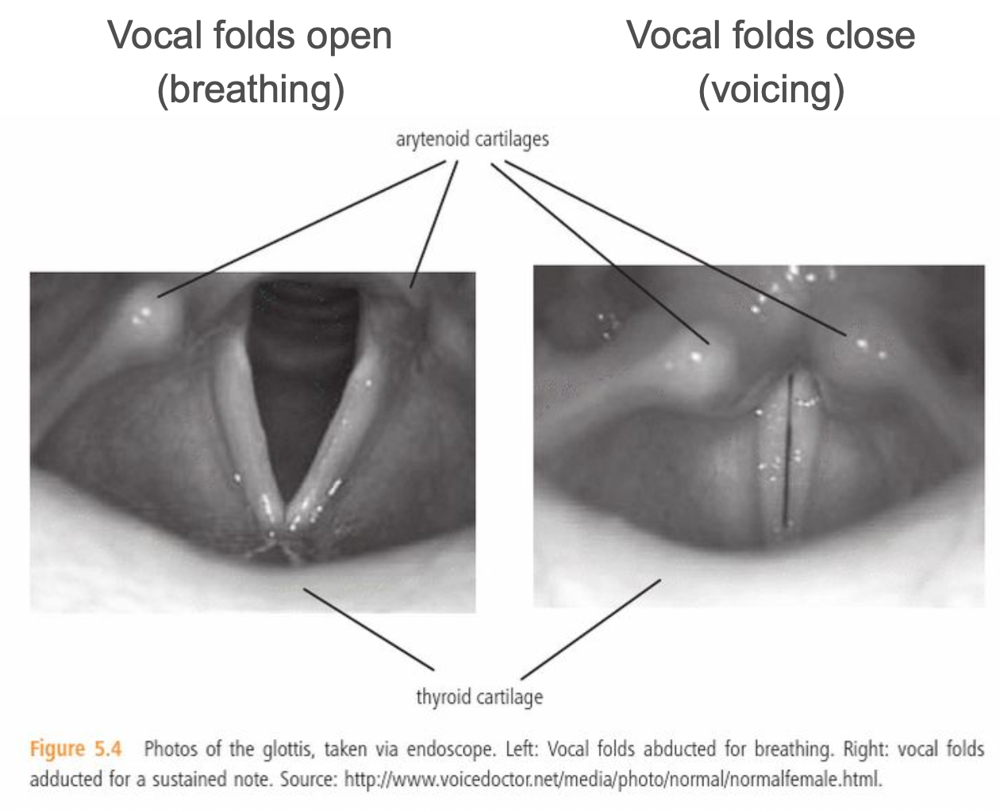  
<a href="https://www.youtube.com/watch?v=-1Fv7IPmJo4"><b>video</b>: the larynx of an opera singer during breathing and phonation</a>

]  

- if vocal folds are **abducted close together** and the air comes out, they’ll **vibrate** due to <b>Bernoulli’s effect</b>
  - the <b>vibration</b> leads to **voicing** a</b>nd is used in vowels [a, e, i, o, u] and certain consonants [b, d, g]  
- if vocal folds are **moved apart**, they’ll stop vibrating, leading to **voicelessness** [p, t, k]

---
## **Feel the Vowels**
 
.pull-left[
- three different vowels were produced, and the processes have been captured with **real-time MRI**  
- the three vowels are <b>[i]</b>, <b>[u]</b>, <b>[a]</b>, as in < st<b>ee</b>p >, < st<b>oo</b>p >, < st<b>o</b>p >  
- which one is which?
]

.pull-right[
.pull-left[
<video controls width="100%">
  <source src="mri/stop.mp4" type="video/mp4">
  Your browser does not support the video element.
</video>

<b>[a]</b> in < st<b>o</b>p >

 

<b>[i]</b> in < st<b>ee</b>p >

<video controls width="100%">
  <source src="mri/steep.mp4" type="video/mp4">
  Your browser does not support the video element.
</video>
]
.pull-right[
<video controls width="100%">
  <source src="mri/stoop.mp4" type="video/mp4">
  Your browser does not support the video element.
</video> 

<b>[u]</b> in < st<b>oo</b>p >

]
]

---
.pull-left[
## **Feel the Vowels**
 
- three different vowels were produced, and the processes have been captured with **real-time MRI**  
- the three vowels are <b>[i]</b>, <b>[u]</b>, <b>[a]</b>, as in < st<b>ee</b>p >, < st<b>oo</b>p >, < st<b>o</b>p >
]
.pull-right[
 

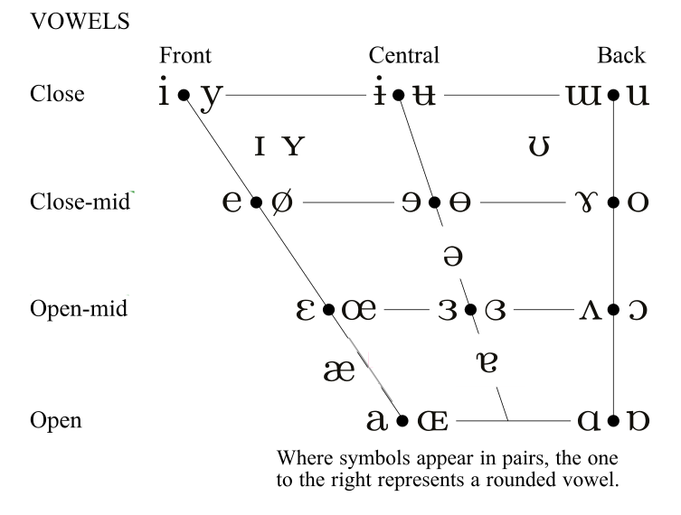

]

- it’s no coincidence that our **oral cavity** and **the vowel chart** resemble  
- the relevant articulator for vowels is the **tongue**, which **shapes** the air flow

.pull-left[
.pull-left[

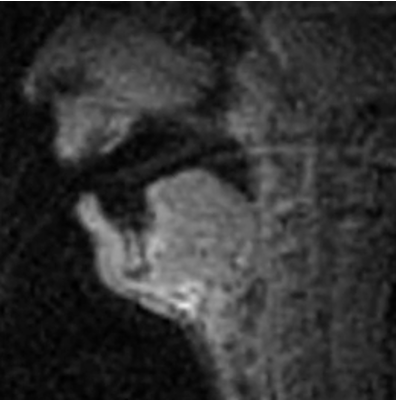 
<b>[a]</b> in < st<b>o</b>p >

]
.pull-right[

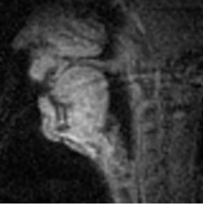 
<b>[i]</b> in < st<b>ee</b>p >

]
]
.pull-right[
.pull-left[

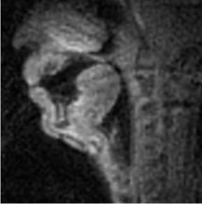 
<b>[u]</b> in < st<b>oo</b>p >

]
]

---
## **Cardinal Vowels**
 
.pull-left[
- **vowels** are articulated with
  1. constant airflow (NO **obstruction**)
  2. voicing (**vibration** of vocal folds)  
- it’s useful to establish a few simple vowels – **cardinal vowels** – and build up from there  
- 5 cardinal vowels of Spanish is in the chart on the right, and many other languages have a similar 5-vowel system  
- English key words are attached with the vowel to show roughly how these vowels sound  
- **note** that the International Phonetic Alphabet’s symbols for vowels don’t always match our English names for them
]
.pull-right[
  
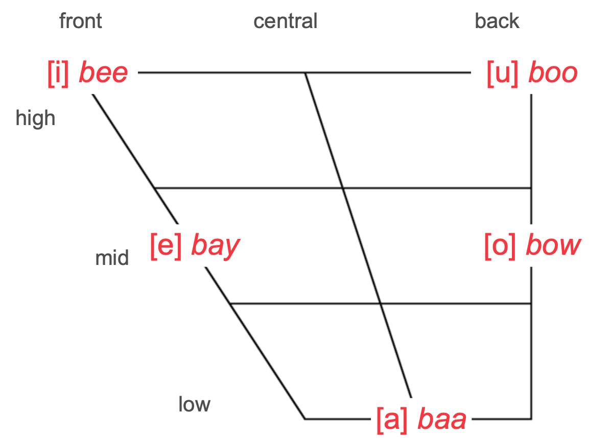
  

<i>Spanish Vowels</i>

]

---
## **Vowel Articulation**
 
.pull-left[
different vowel qualities can be primarily be distinguished based on **four** features  
1. tongue <b>height</b>
  - high, mid, low  
2. tongue <b>backness</b>
  - front, central, back  
3. lip <b>roundness</b>
  - rounded, unrounded  
4. <b>tenseness</b>
  - tense and lax (**lax**: relaxed tongue)
  - English-specific
  - ATR (advanced tongue root)
]
.pull-right[ 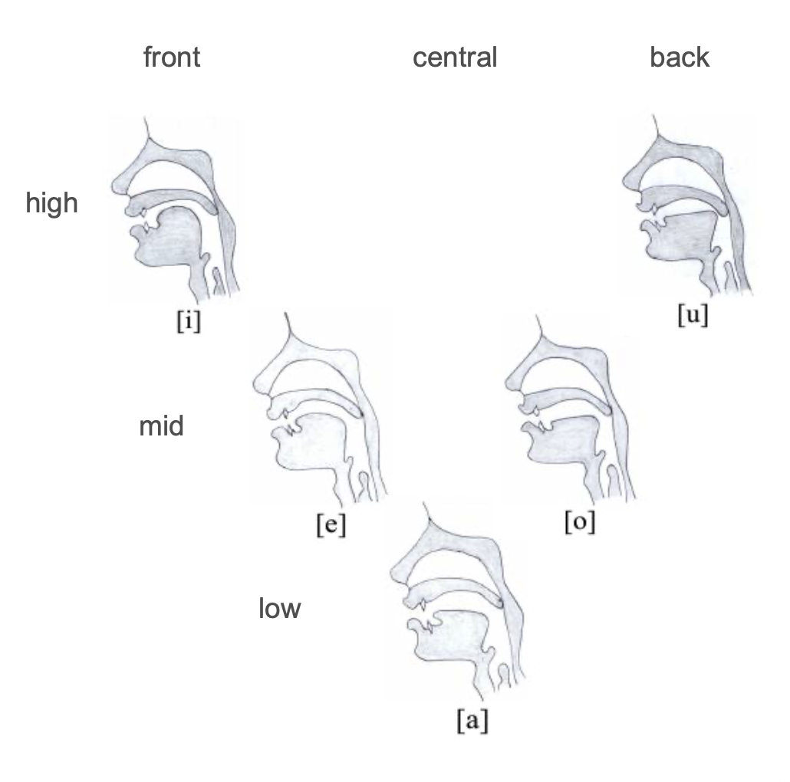]

---
## **Vowels in a Real-time MRI**
 
.pull-left[
- the link below is to a video that is produced by an **MRI** (magnetic resonance imaging) scanner  
- watch how the tongue and lips move as these people sing [a, e, i, o, u]    

<a href="https://www.youtube.com/watch?v=jaIquq_4560">vowel MRI</a>

]
.pull-right[
  

  

<i>Spanish Vowels</i>

]

---
## **Vowel Features**
 
.pull-left[
- in different vowel qualities, we can distinguish various levels of **tongue height**
  - high [ + high, - low ]
  - mid [ - high, -low ]
  - low [ - high, +low ]
  - why don't we use <b>high</b> or <b>low</b> only  
- and we can distinguish various levels of **tongue backness**
  - front [ + front, - back ]
  - central [ - front, - back ]
  - back [ - front, + back ]   
- for English, we actually do not have **central** vowels, so using only <b>back</b> is enough
]
.pull-right[ 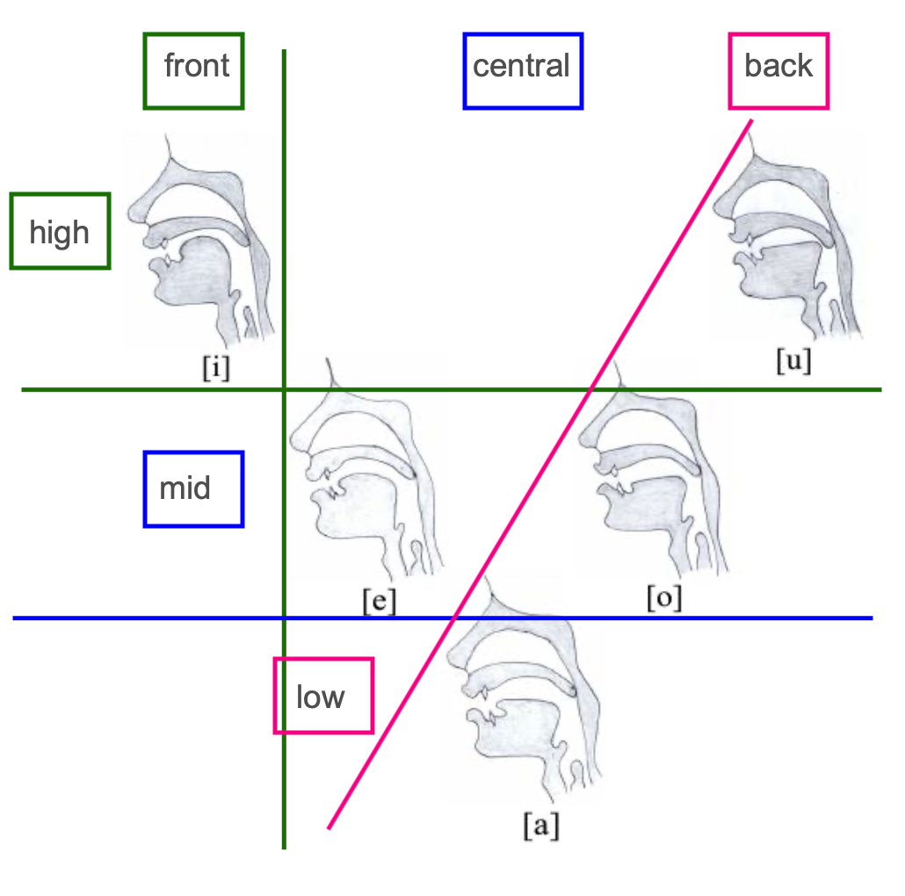] 

- arranging them by tongue position, they form a triangle, so vowels are often arranged in a **vowel triangle/trapezoid**

---
## **Height of the Tongue: American English**
 
.pull-left[
  
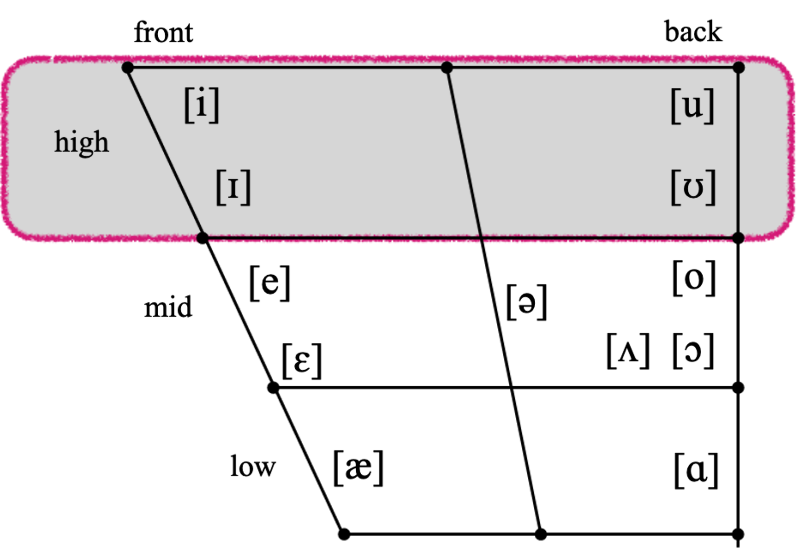
]
.pull-right[
<h3><b>high vowels</b></h3> 
<b>[+high, -low]</b>   

.pull-left[
<b>< b<u>ee</u>t ></b>  
<b>< b<u>i</u>t ></b>  
<b>< b<u>oo</u>t ></b>  
<b>< b<u>oo</u>k ></b>  
]
.pull-right[
<b>[ i ]</b>  
<b>[ ɪ ]</b>  
<b>[ u ]</b>  
<b>[ ʊ ]</b>
]
]

---
## **Height of the Tongue: American English**
 
.pull-left[
  
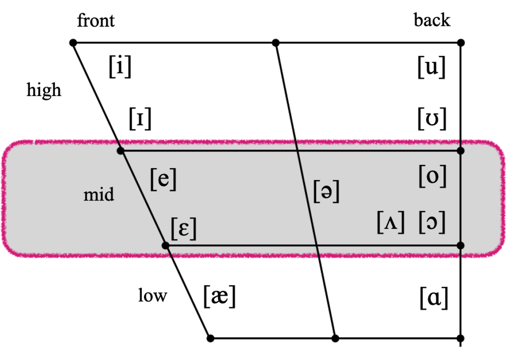
]
.pull-right[
<h3><b>mid vowels</b></h3> 
<b>[-high, -low]</b>   

.pull-left[
<b>< b<u>e</u>t ></b>  
<b>< b<u>ai</u>t ></b>  
<b>< <u>a</u>bout ></b>  
<b>< b<u>u</u>t ></b>  
<b>< b<u>oa</u>t ></b>  
<b>< b<u>ough</u>t ></b>
]
.pull-right[
<b>[ ɛ ]</b>  
<b>[ eɪ ]</b>  
<b>[ ə ]</b>  
<b>[ ʌ ]</b>  
<b>[ oʊ ]</b>  
<b>[ ɔ ]</b>
]
]

---
## **Height of the Tongue: American English**
 
.pull-left[
  
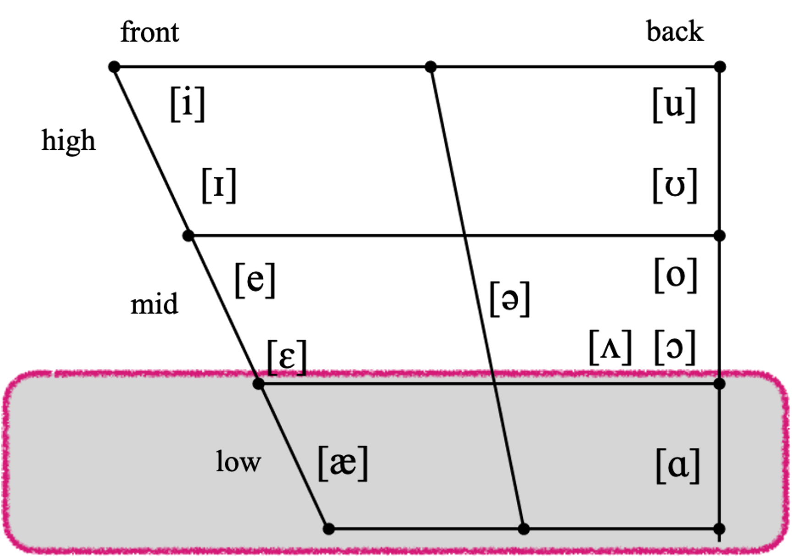
]
.pull-right[
<h3><b>low vowels</b></h3> 
<b>[-high, +low]</b>   

.pull-left[
<b>< b<u>a</u>t ></b>  
<b>< b<u>o</u>t ></b>
]
.pull-right[
<b>[ æ ]</b>  
<b>[ ɑ ]</b>
]
]

---
## **Backness of the Tongue: American English**
 
.pull-left[
<h3><b>front vowels</b></h3> 
<b>[+front, -back]</b>   

.pull-left[
<b>< b<u>ea</u>d ></b>  
<b>< b<u>i</u>d ></b>  
<b>< b<u>a</u>de ></b>  
<b>< b<u>e</u>d ></b>  
<b>< b<u>a</u>d ></b>
]
.pull-right[
<b>[ i ]</b>  
<b>[ ɪ ]</b>  
<b>[ eɪ ]</b>  
<b>[ ɛ ]</b>  
<b>[ æ ]</b>
]
]
.pull-right[
  
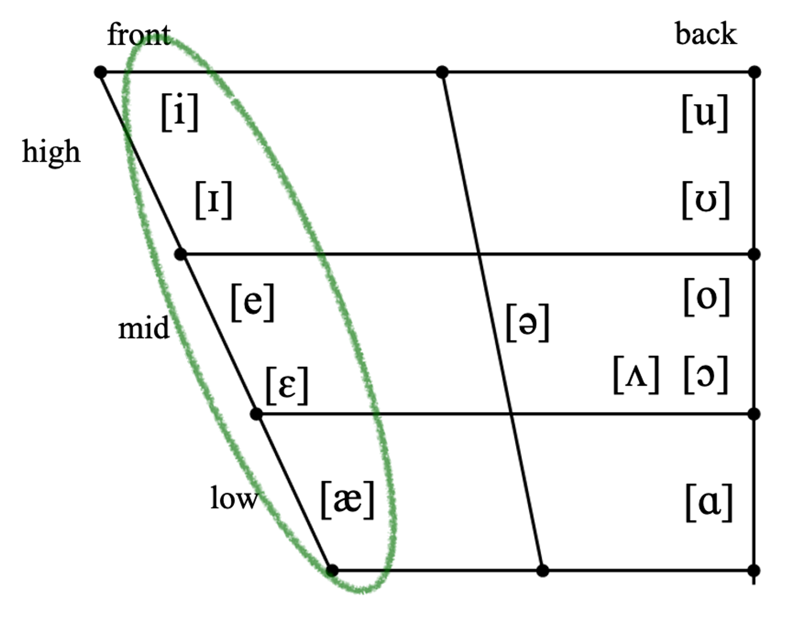
]
---
## **Backness of the Tongue: American English**
 
.pull-left[
<h3><b>central vowels</b></h3> 
<b>[-front, -back]</b>   

.pull-left[
<b>< <u>a</u>bout ></b>
]
.pull-right[
<b>[ ə ]</b>
]
]
.pull-right[
  
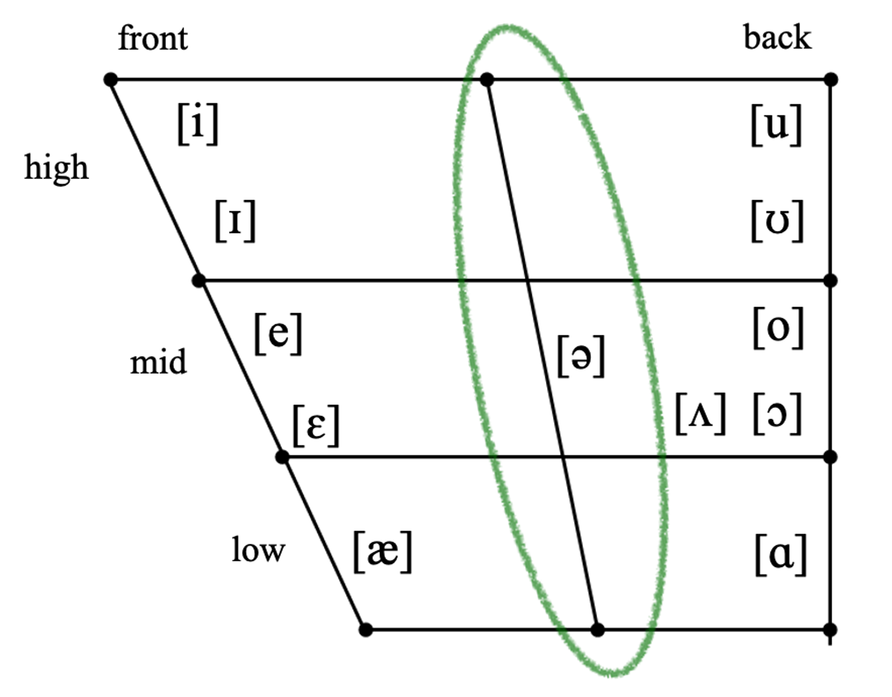
]
---
## **Backness of the Tongue: American English**
 
.pull-left[
<h3><b>back vowels</b></h3> 
<b>[-front, +back]</b>   

.pull-left[
<b>< b<u>oo</u>t ></b>  
<b>< p<u>u</u>t ></b>  
<b>< b<u>oa</u>t ></b>  
<b>< b<u>ough</u>t ></b>  
<b>< b<u>u</u>t ></b>  
<b>< b<u>o</u>t ></b>
]
.pull-right[
<b>[ u ]</b>  
<b>[ ʊ ]</b>  
<b>[ oʊ ]</b>  
<b>[ ɔ ]</b>  
<b>[ ʌ ]</b>  
<b>[ ɑ ]</b>
]
]
.pull-right[
  
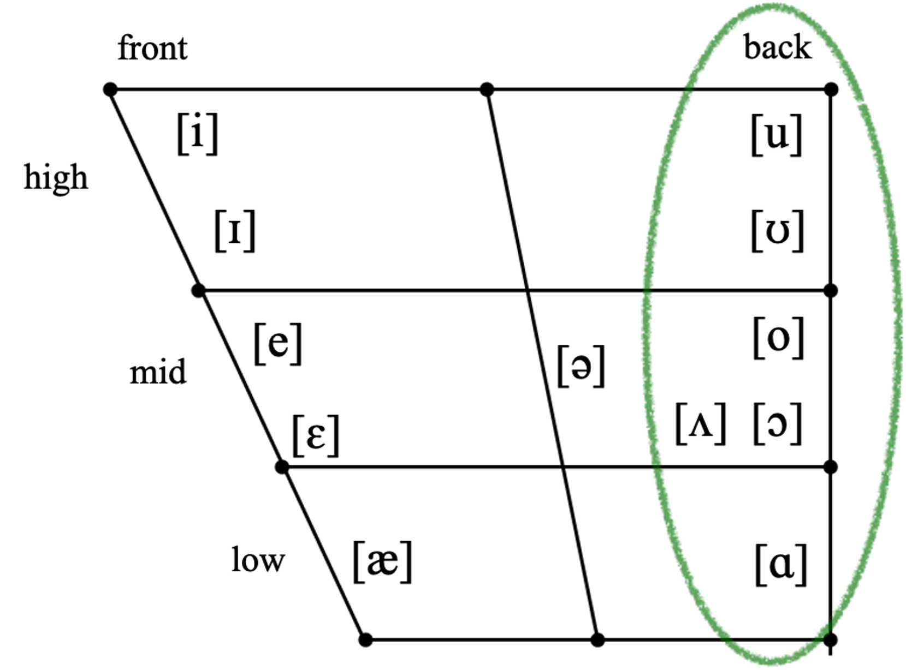
]

---
## **Lip Rounding**
 
.pull-left[
 
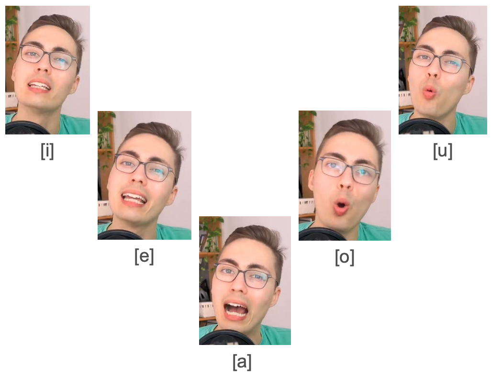
  

<a href="https://www.youtube.com/watch?v=UL9Czh_LG34"><b>image source</b>: <i>Podcast Italiano</i> - Le vocali dell’italiano standard</a>

]
.pull-right[
- the third vowel feature is **lip rounding**  
  - rounded [ + round ]
  - unrounded [ - round ] (spread)  
- in the link on the right, there are our **five vowels** as pronounced by a speaker of Italian  
  - how does his mouth shape change for each vowel? 
  - which ones are rounded/unrounded?  
- **note** that he's **exaggerating** a bit for the purposes of demonstration  
  - since in the video he’s trying to **teach** Italian pronunciation
]

---
## **Lip Rounding**
 
.pull-left[
 

  

<a href="https://www.youtube.com/watch?v=UL9Czh_LG34"><b>image source</b>: <i>Podcast Italiano</i> - Le vocali dell’italiano standard</a>

]
.pull-right[
- [o, u] are <b>rounded</b>; [i, e, a] are unrounded</b>  
- which follows a **crosslinguistic tendency**  
- <b>back</b> vowels tend to be <b>rounded</b>  
  - <b>front</b> and low vowels tend to be <b>unrounded</b>  
- <u>front rounded</u> vowels exist but are **less common**  
  - <b>German</b>: <i>schön</i> [ʃøːn] 'beautiful'
  - <b>Kazakh</b>: <i>үру</i> [yru] 'to bark'  
- **as are** <u>back unrounded</u> vowels  
  - <b>Japanese</b>: <i>kuzu</i> [kɯzɯ] 'kudzu vine'
]

---
## **Roundness of the Lips: American English**
 
.pull-left[
  
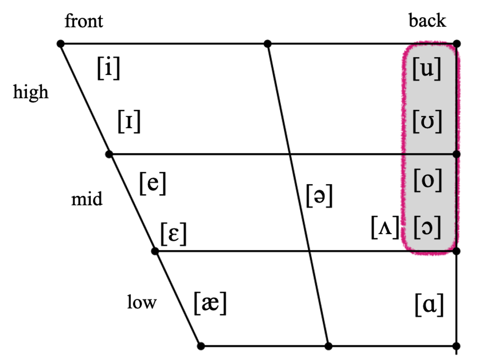
]
.pull-right[
<h3><b>rounded vowels</b></h3> 
<b>[+round]</b>   

.pull-left[
<b>< p<u>u</u>t ></b>  
<b>< b<u>oo</u>t ></b>  
<b>< b<u>oa</u>t ></b>  
<b>< b<u>ough</u>t ></b>
]
.pull-right[
<b>[ ʊ ]</b>  
<b>[ u ]</b>  
<b>[ oʊ ]</b>  
<b>[ ɔ ]</b>
]
]  

- the rest of the vowels are **unrounded** (<b>[-round]</b>)

---
## **Roundness of the Lips: American English**
 
.pull-left[
  

]
.pull-right[
match the words with the images for vowels  
.pull-left[
(a) <b>< m<u>ea</u>n ></b>  
(c) <b>< m<u>i</u>ne ></b>
]
.pull-right[
(b) <b>< m<u>oo</u>n ></b>  
(d) <b>< m<u>o</u>th ></b>
]  

.pull-left[

<b>[i]</b>

]
.pull-right[

<b>[u]</b>

] 

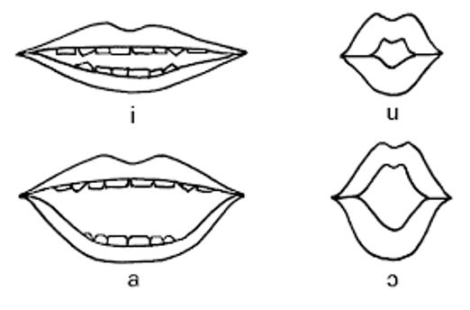

.pull-left[

<b>[ɑj]</b>

]
.pull-right[

<b>[ɔ]</b>

]
]

---
## **Roundness of the Lips: American English**
 
.pull-left[
  

]
.pull-right[
match the words with the images for vowels  
.pull-left[
(a) <b>< m<u>ea</u>n ></b>  
(c) <b>< m<u>i</u>ne ></b>
]
.pull-right[
(b) <b>< m<u>oo</u>n ></b>  
(d) <b>< m<u>o</u>th ></b>
]  

.pull-left[

<b>[i]</b>

]
.pull-right[

<b>[u]</b>

] 

.pull-left[

<b>[ɑj]</b>

]
.pull-right[

<b>[ɔ]</b>

]
]

---
## **Vowel Feature**
 
.pull-left[
- so these are the three **articulatory features** we use to distinguish different vowel qualities:  
  - <b>tongue height</b>: how high is the tongue in the mouth
  - <b>tongue backness</b>: is tongue further forward or back in mouth
  - <b>lip roundedness</b>: are the lips rounded or unrounded  
- when we describe vowels, we typically do so in terms of <b>height</b> - <b>backness</b> - <b>roundedness</b>  
  - **[i]** = high front unrounded
  - **[e]** = mid front unrounded
  - **[a]** = low central unrounded
  - **[o]** = mid back rounded
  - **[u]** = high back rounded
]
.pull-right[
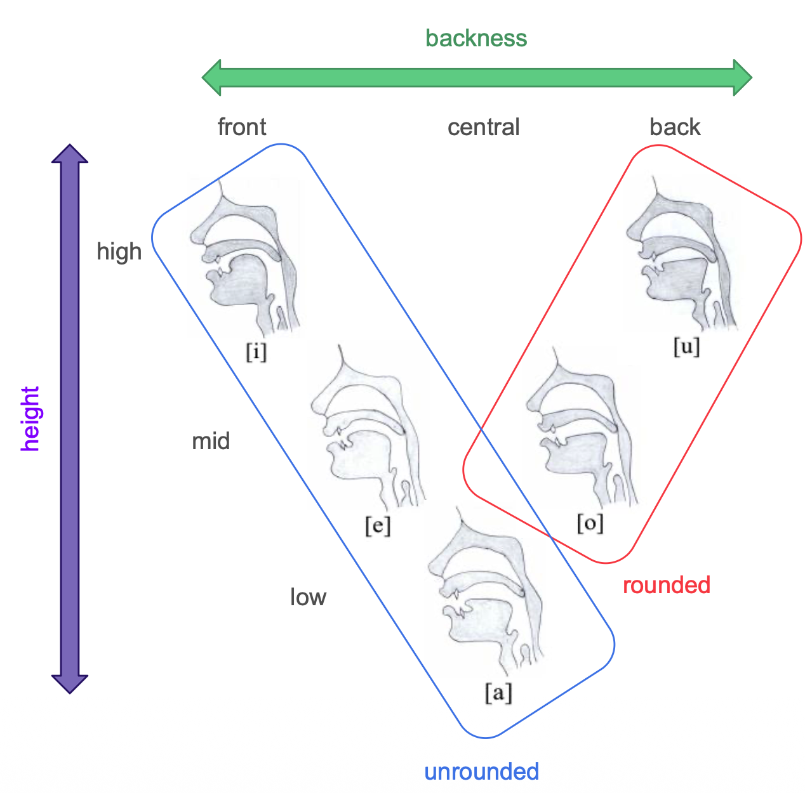
]

---
## **Vowel Feature**
 
.pull-left[
- so these are the three **articulatory features** we use to distinguish different vowel qualities:  
  - <b>tongue height</b>: how high is the tongue in the mouth
  - <b>tongue backness</b>: is tongue further forward or back in mouth
  - <b>lip roundedness</b>: are the lips rounded or unrounded  
- when we describe vowels, we typically do so in terms of <b>height</b> - <b>backness</b> - <b>roundedness</b>  
  - **[i]** = high front unrounded vowel
  - **[e]** = mid front unrounded vowel
  - **[a]** = low central unrounded vowel
  - **[o]** = mid back rounded vowel
  - **[u]** = high back rounded vowel
]
.pull-right[

]

---
## **Beyond the Cardinal Vowels**
 
.pull-left[
  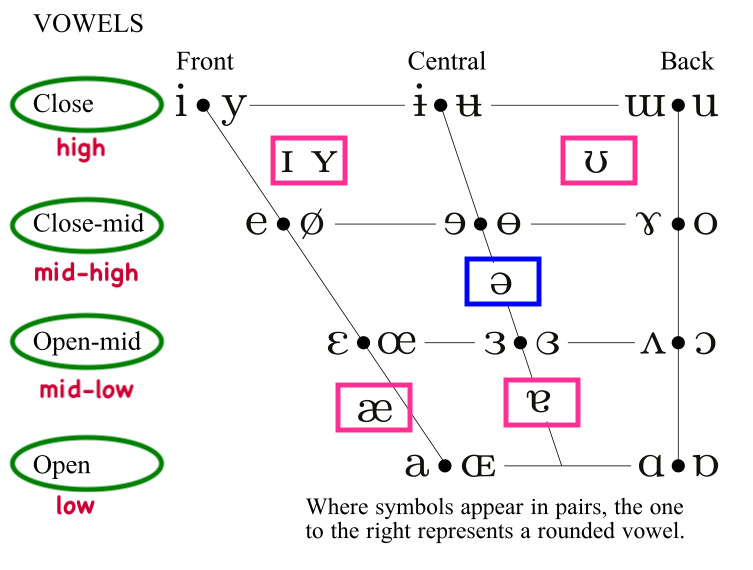
]
.pull-right[
- IPA chart uses **28 cardinal vowels** to try to represent all of the world's languages – though **no language uses them all**  
- <b>some notes</b>  
  1. IPA chart uses terms <b>close/open</b> instead of <b>high/low</b>, but mostly we use **high/low** 
  <i>[close = high; clode-mid = mid-high, etc]</i>
  2. IPA chart distinguishes <b>4 levels of height</b> instead of 3
  3. IPA chart includes some <b>vowels between these levels</b> 
  [ɪ, ʏ, ʊ, æ, ɐ] and terms like <u>near high</u>, <u>near front</u> are used for them
  4. <b>[ə]</b> (schwa) is in the **center** of the chart and is the mid central vowel
]

---
## **Beyond the Cardinal Vowels**
 
.pull-left[
  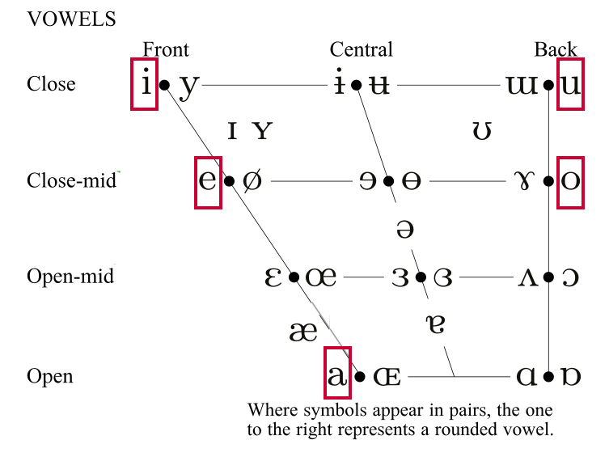
]
.pull-right[
- how do we figure out what sound these symbols **represent**?  
- **five cardinal vowels** as a starting point   
- how is [y] pronounced?
  - start with [i]and make it rounded  
- how is [ɛ] pronounced?
  - tongue about halfway between [e] and [a]  
- how is [ɨ] pronounced?
  - tongue about halfway between [i] and [u]  
- how is [ɵ] pronounced?
  - tongue about halfway between [e] and [o]
]

---
## **American English Vowels Summary**
 
.pull-left[
- American English has around **12-14** vowels  
- exact number and pronunciation varies by region – English accents **tend to differ** in terms of vowels  
- a few **notes** about American English vowels  
  1. there is a 5-way **height** contrast  
  2. Speakers tend to **diphthongize** some of these vowels, especially the vowels in <u><i>bait</i></u> and <u><i>boat</i></u>, but also to a certain degree in <u><i>beet</i></u> and <u><i>boot</i></u>  
  3. some American English speakers don't differentiate [ə] and [ʌ], and some don’t differentiate [ɑ] and [ɔ]
]
.pull-right[
  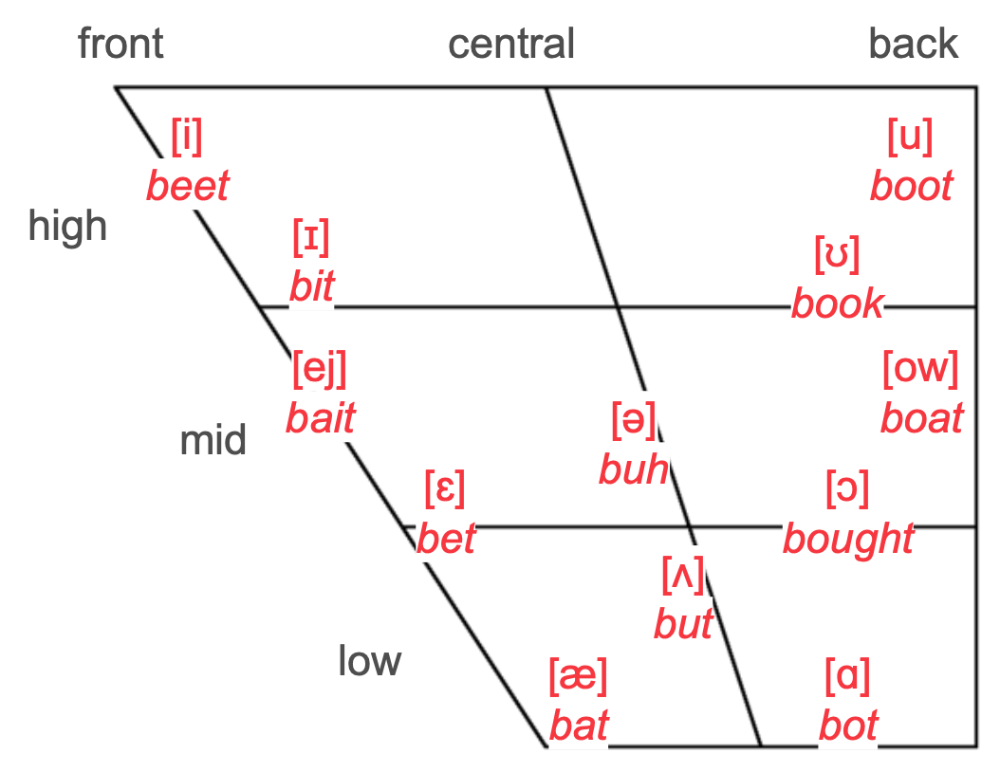
]

---
## **Tense and Lax Vowels**
 
.pull-left[
- 5 height differences is a bit unwieldy  
- a common solution is to divide the vowels into **two groups**   

- **tense** vowels
  - [i], [u], [eɪ̯ ] (or [ej]), [oʊ̯ ] (or [ow])
  - a bit higher and more peripheral, tend to be diphthongized in American English  
- **lax** vowels
  - the rest
  - tongue a bit more relaxed
  - **cannot end a word** in American English
]
.pull-right[
  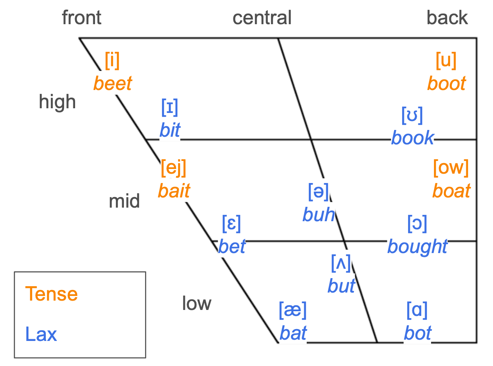
]

---
## **Diphthongs and Glides**
 
.pull-left[
  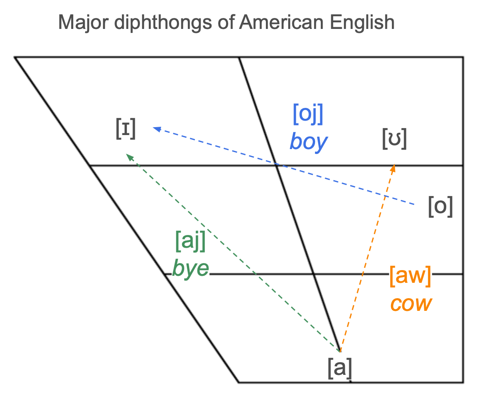
]
.pull-right[
- a diphthong is **two vowel sounds** that are combined into a single sound 
  - **vowel** + <b>glide</b> or <b>glide</b> + **vowel**  
- a <b>glide</b> is considered **semi-vowel**
  - it is a vowel-like sound produced by moving your tongue while saying a vowel  
- by combining a glide with a vowel, we get a **diphthong**
  - the tongue is gliding around the mouth as you make a diphthong  
- there also exist triphthongs
  - <b>glide</b> + **vowel** + <b>glide</b>
  - <i>yay</i>, <i>wow</i>, <i>way</i>
]

---
## **Other Vowel Features**
.pull-left[
  
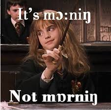
]
.pull-right[
**nasalisation**: articulated by lowering the velum/soft palate, so that air flows through both the **nasal** and **oral** cavity

- <b>English</b> 
<b>æ</b>t '*at*' **vs.** <b>æ̃</b>nt '*ant*'  

**length**: long vowels **contrast** with short vowels
- <b>Mongolian</b> 
[t͡s<b>ɑ</b>ˈsɯn] '*snow*' **vs.** [t͡s<b>ɑɑ</b>ˈsɯn] '*paper*'
- since adding or removing the **length feature** changes the meaning completely
- we say that length is **contrastive** in mongolian
  

**pitch**: tonal languages **contrast** pitch
- <b>Mandarin Chinese</b> 

ma<b>55</b>
<b>----</b>
ma<b>35</b>
<b>----</b>
ma<b>214</b>
<b>----</b>
ma<b>51</b>
<b>----</b>
ma<b>00</b>
 
'*mom*'<b>--</b>
'*numb*'<b>--</b>
'*horse*'<b>----</b>
'*scold*'<b>---</b>
'*Q-mark*'
]

---
class: center, middle
**Assignment VI** is due this Friday (**Nov 13th**)  
**Assignment VII** will be published today (**Nov 11**) and is due next Friday (**Nov 20th**)
<b>continue reading</b>: 
**Phonetics** in O'Grady et al.'s *Contemporary Linguistics: An Introduction*  
<b>start reading</b> for phonology: 
**Phonology**: The Function and Patterning of Sounds 
in O'Grady et al.'s *Contemporary Linguistics: An Introduction*  
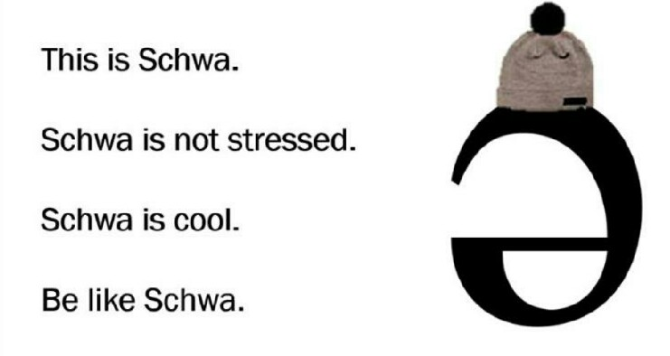&nbsp;&nbsp;&nbsp;&nbsp; 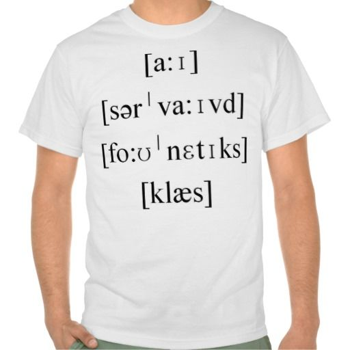
  
Slides created via the R package [**xaringan**](https://github.com/yihui/xaringan).

