class: center, middle
## Please pick up your **name card** from the front
  
## **office hours**: Mondays, 2:00-3:00 pm 
## Basement, Room 003, **Linguistics Building**
      
---
## **Categories to Differentiate Consonants**
 

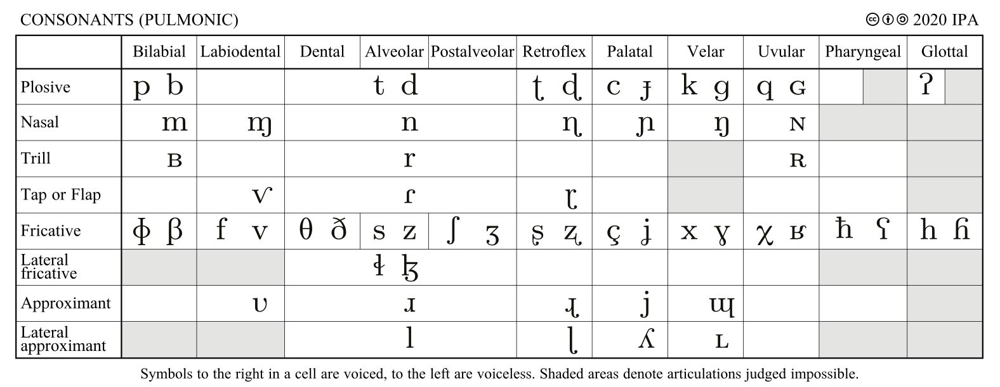

 

<b>columns</b> - place - where the obstruction of airflow in the vocal tract is  
<b>row</b> - manner - what type of obstruction of airflow occurs  
in a <b>single cell</b> - voicing - whether the vocal cords vibrate or not (the right is <i>voiced</i>)  

  <a href="https://www.ipachart.com"><b>IPA clickable chart</b></a>

---
## **Categories to Differentiate Vowels**
 

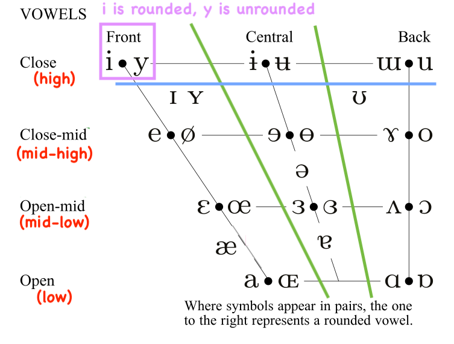

 
<b>in terms of the</b> tongue position  
<b>horizontally</b> - height - the **height** of the tongue in the oral cavity  
<b>vertically</b> - backness - the **backness** of the tongue in the oral cavityoccurs  
in a <b>pair</b> - roundedness - whether the lips are **rounded** (the right is <i>voiced</i>)  

---
## **Get Familiar with English Sounds**
 
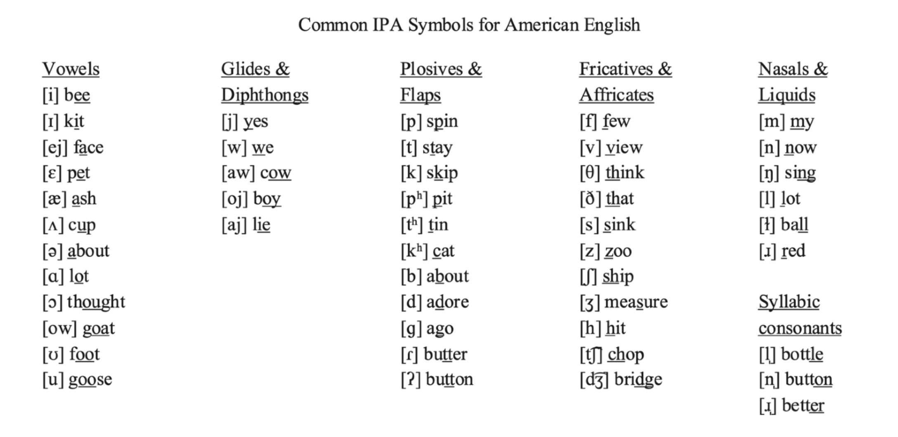
---
## **Get Familiar with English Sounds**
 
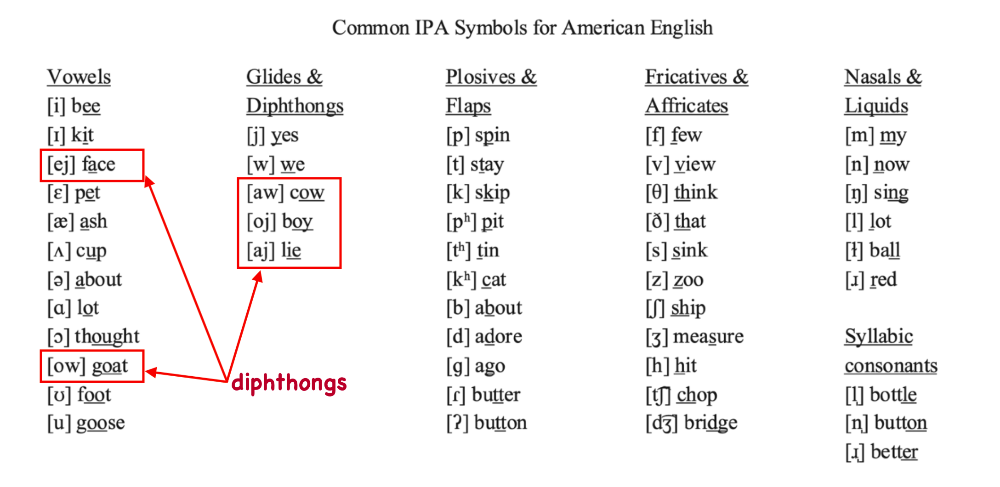
---
## **Get Familiar with English Sounds**
 
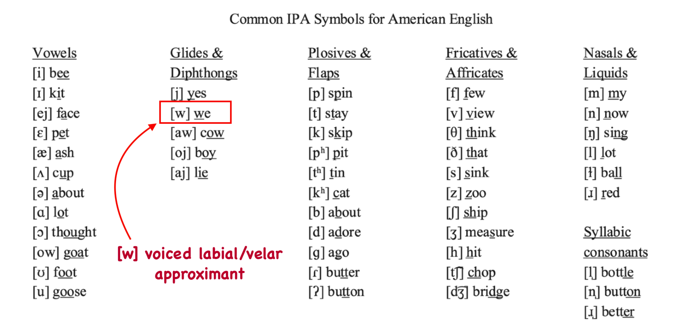
---
## **Get Familiar with English Sounds**
 
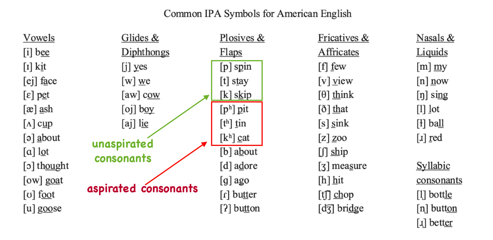
---
## **Get Familiar with English Sounds**
 
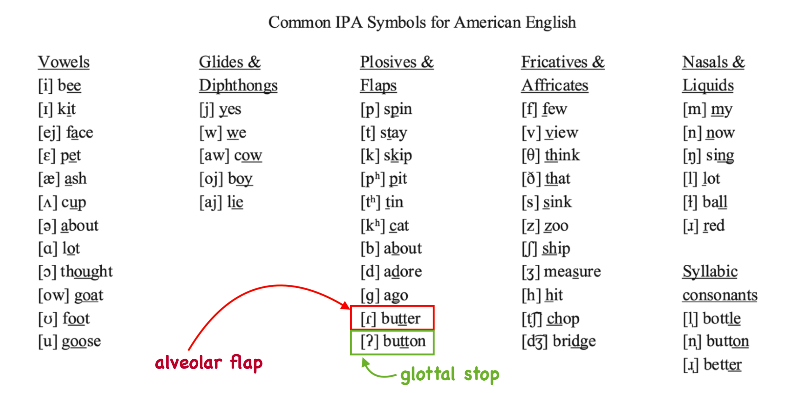
---
## **Get Familiar with English Sounds**
 
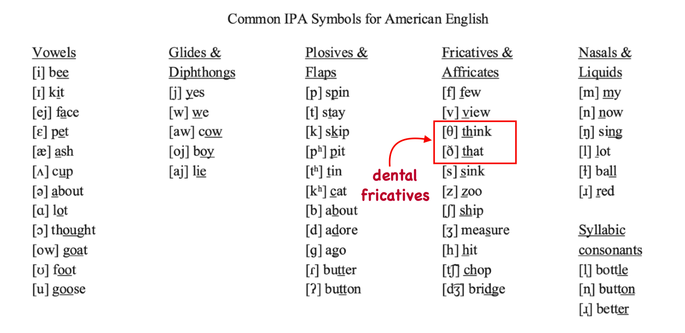
---
## **Get Familiar with English Sounds**
 
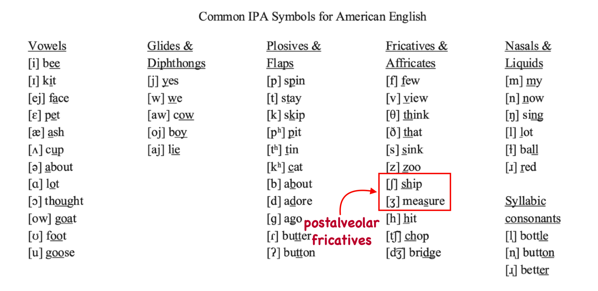
---
## **Get Familiar with English Sounds**
 
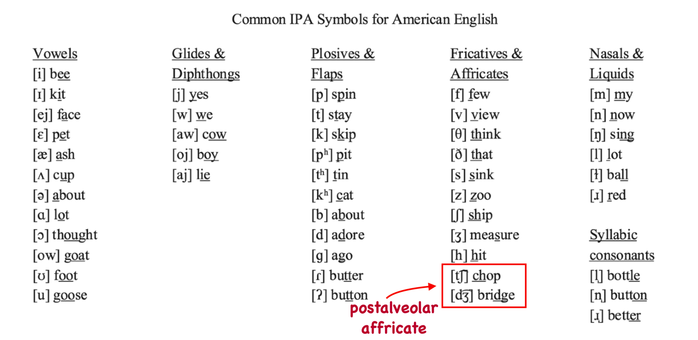
---
## **Get Familiar with English Sounds**
 
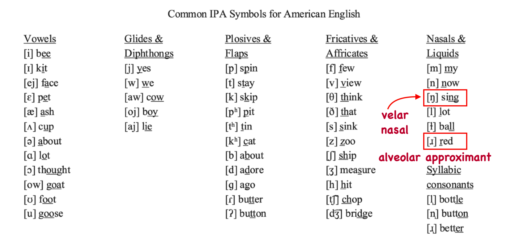

---
## **Exercise I: Identifying Consonants**
 
give a full description for <b>voicing</b>, <b>place</b>, and <b>manner</b> of **each consonant** in the following words and give the corresponding **IPA** symbol   
.pull-left[
move  
cloth  
gosh 
]
.pull-right[
hide  
stove  
bank 
]

---
## **Exercise I: Identifying Consonants**
 
give a full description for <b>voicing</b>, <b>place</b>, and <b>manner</b> of **each consonant** in the following words and give the corresponding **IPA** symbol   
.pull-left[
move-----<b>[m]</b>: <b>voiced</b> <b>bilabial</b> <b>nasal</b> 
move-----<b>[v]</b>: <b>voiced</b> <b>labio-dental</b> <b>fricative</b>  
cloth------<b>[k]</b>: <b>voiceless</b> <b>velar</b> <b>stop</b> 
cloth------<b>[l]</b>: <b>voiced</b> <b>alveolar</b> <b>lateral approximant</b> 
cloth------<b>[θ]</b>: <b>voiceless</b> <b>dental</b> <b>fricative</b>  
gosh------<b>[g]</b>: <b>voiced</b> <b>velar</b> <b>stop</b> 
gosh------<b>[ʃ]</b>: <b>voiceless</b> <b>post-alveolar</b> <b>fricative</b>  
]
.pull-right[
hide------<b>[h]</b>: <b>voiceless</b> <b>glottal</b> <b>fricative</b> 
hide------<b>[d]</b>: <b>voiced</b> <b>bilabial</b> <b>stop</b>  
stove-----<b>[s]</b>: <b>voiceless</b> <b>alveolar</b> <b>fricative</b> 
stove-----<b>[t]</b>: <b>voiceless</b> <b>alveolar</b> <b>stop</b> 
stove-----<b>[v]</b>: <b>voiced</b> <b>labio-dental</b> <b>fricative</b>  
bank------<b>[b]</b>: <b>voiced</b> <b>bilabial</b> <b>stop</b> 
bank------<b>[ŋ]</b>: <b>voiced</b> <b>velar</b> <b>nasal</b> 
bank------<b>[k]</b>: <b>voiceless</b> <b>velar</b> <b>stop</b>  
]

---
.pull-left[
## **Exercise II: Identify Vowels**
 
in this **MRI** (Magnetic Resonance Imaging), the speaker is saying **5** vowels:   
  - **[i]** as in *bee* 
  - **[e]** as in *bay* 
  - **[a]** as in *baa* 
  - **[o]** as in *bow* 
  - **[u]** as in *boo*  

1. What is the tongue **height** in each image? 
2. What is the tongue **backness** in each image? 
3. How are lips (**roundness**) acting in each image? 
4. What **vowel** is being said in each image?
]
.pull-right[
 

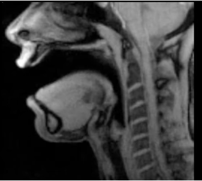 
<b>[a]</b>  
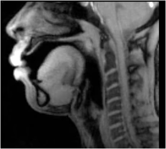
_____
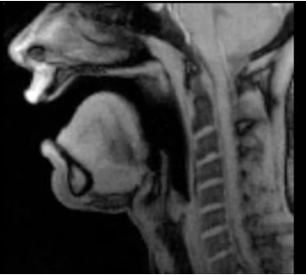 
<b>[u]</b>
_____________________
<b>[e]</b>  
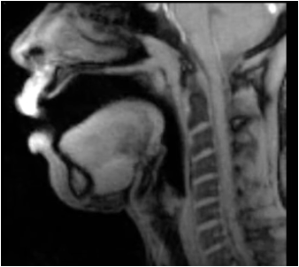
_____
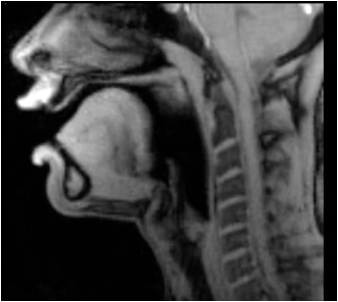 
<b>[o]</b>
_____________________
<b>[i]</b>

]

---
.pull-left[
## **Exercise II: Identify Vowels**
 
in this **MRI** (Magnetic Resonance Imaging), the speaker is saying **5** vowels:   
  - **[i]** as in *bee* 
  - **[e]** as in *bay* 
  - **[a]** as in *baa* 
  - **[o]** as in *bow* 
  - **[u]** as in *boo*  

1. What is the tongue **height** in each image? 
2. What is the tongue **backness** in each image? 
3. How are lips (**roundness**) acting in each image? 
4. What **vowel** is being said in each image?
]
.pull-right[
 

 
<b>[a]</b>  

_____
 
<b>[u]</b>
_____________________
<b>[e]</b>  

_____
 
<b>[o]</b>
_____________________
<b>[i]</b>

]

---
## **Exercise III: Identify Vowels**
 
.pull-left[
(1) identify which **vowels** are in the following words 
(2) give the **IPA** symbol for them 
(3) define them using the big three **features**
  

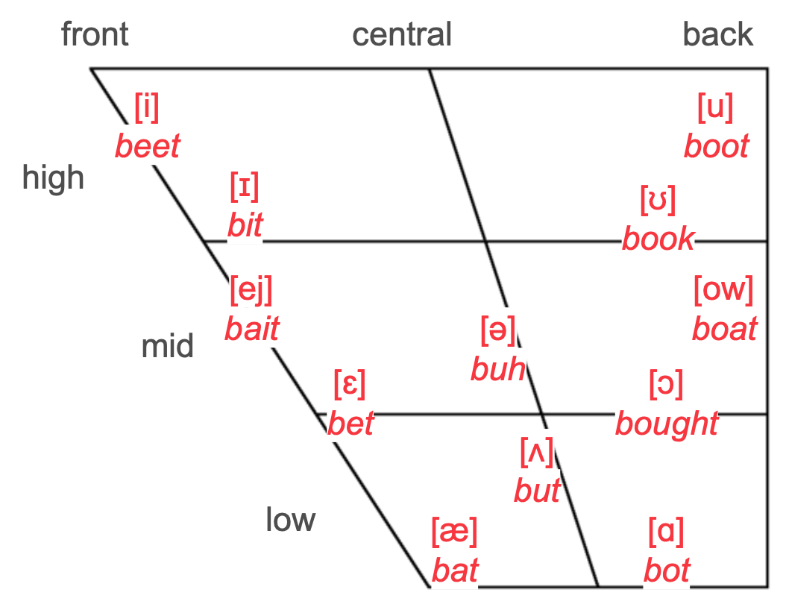

]
.pull-right[
1. cat  
2. kit  
3. red  
4. reed  
5. pot  
6. boot  
7. cut  
8. should  
9. fork
]

---
## **Exercise III: Identify Vowels**
 
.pull-left[
(1) identify which **vowels** are in the following words 
(2) give the **IPA** symbol for them 
(3) define them using the big three **features**
  

]
.pull-right[
1. cat **æ**--------[-high, +low, -back, -round]  
2. kit **ɪ**----------[+high, -low, -back, -round]  
3. red **ɛ**---------[-high, -low, -back, -round]  
4. reed **i**--------[+high, -low, -back, -round]  
5. pot **ɑ**---------[-high, +low, +back, -round]  
6. boot **u**--------[+high, -low, +back, +round]  
7. cut **ʌ**----------[-high, +low, +back, -round]  
8. should **ʊ**------[+high, -low, +back, +round]  
9. fork **ɔ**---------[-high, -low, +back, +round]
]

---
## **Exercise IV: IPA to English**
 
.pull-left[
what **English words** do the following **phonetic transcriptions** represent?  

.pull-left[
1. [ˈkæ.lən.dɹ]  
2. [ˈbɹɪŋ.ɪŋ]  
3. [ˈtɛ.lə.ˌvɪ.ʒn]  
4. [ˈðiz]  
5. [ˈθɪŋk]  
6. [ˈʃæk]  
7. [ˈnʌ.θɪŋ]
]
]
.pull-right[
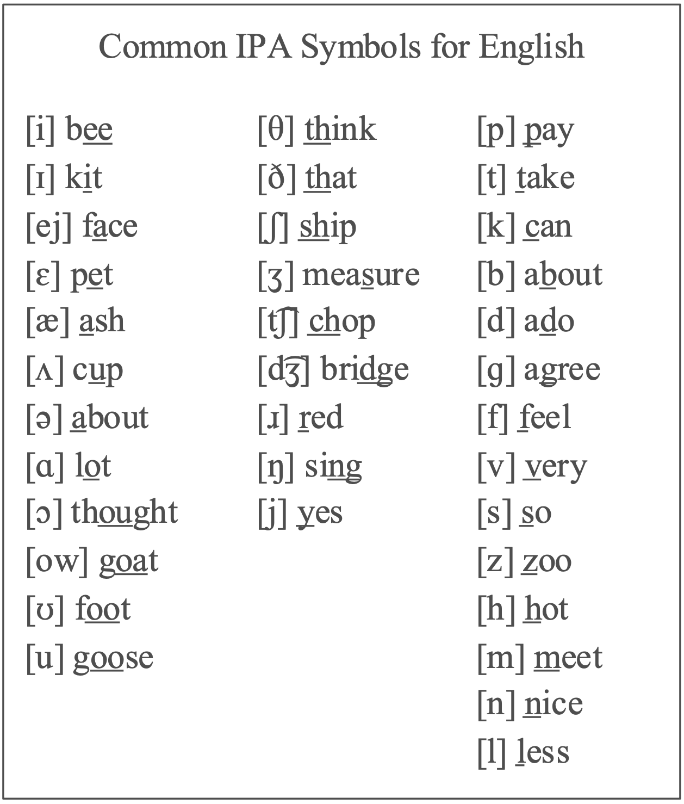
]
---
## **Exercise IV: IPA to English**
 
.pull-left[
what **English words** do the following **phonetic transcriptions** represent?  

.pull-left[
1. [ˈkæ.lən.dɹ]  
2. [ˈbɹɪŋ.ɪŋ]  
3. [ˈtɛ.lə.ˌvɪ.ʒn]  
4. [ˈðiz]  
5. [ˈθɪŋk]  
6. [ˈʃæk]  
7. [ˈnʌ.θɪŋ]
]
.pull-right[
<b>calendar</b>  
<b>bringing</b>  
<b>television</b>  
<b>these</b>  
<b>think</b>  
<b>shack</b>  
<b>nothing</b>  
]
]
.pull-right[

]

---
## **Exercise V: IPA to English (Complex)**
 
what **English words** do these **phonetic transcriptions** correspond to?  
.pull-left[
.pull-left[
1. [ˈel.bow]  
2. [vaj.əˈlɪn]  
3. [ˈaɪ.lənd]  
4. [ˈpi.pl]  
5. [jɪ.ər]  
6. [ˈdejn.dʒə.rəs]  
7. [jʌŋ]  
8. [ɡrejps]  
]
]
.pull-right[

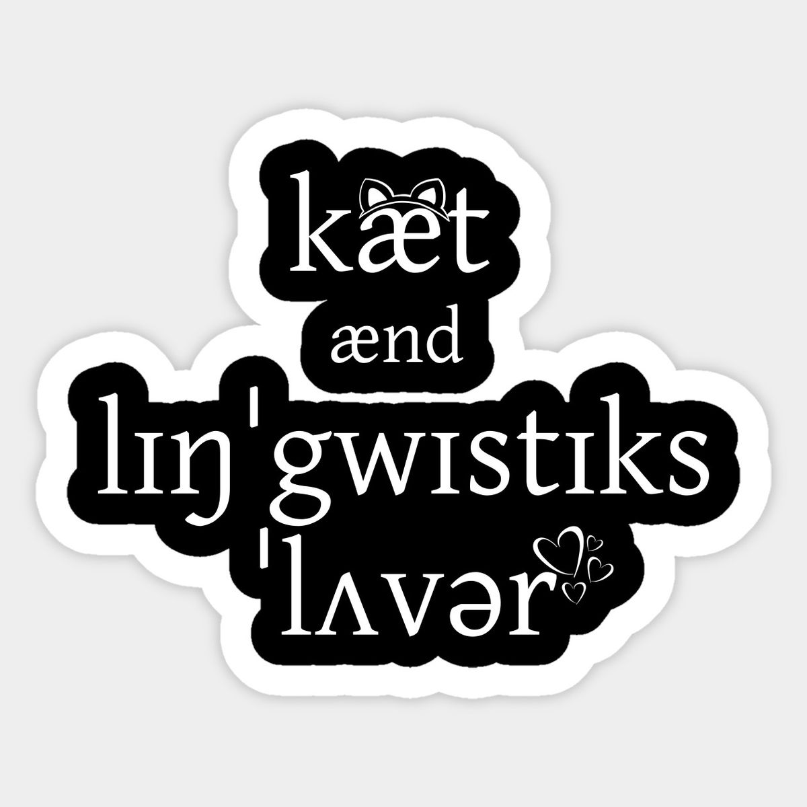

]

---
## **Exercise V: IPA to English (Complex)**
 
what **English words** do these **phonetic transcriptions** correspond to?  
.pull-left[
.pull-left[
1. [ˈel.bow]  
2. [vaj.əˈlɪn]  
3. [ˈaɪ.lənd]  
4. [ˈpi.pl]  
5. [jɪ.ər]  
6. [ˈdejn.dʒə.rəs]  
7. [jʌŋ]  
8. [ɡrejps]
]
.pull-right[
<b>elbow</b>  
<b>violin</b>  
<b>island</b>  
<b>people</b>  
<b>year</b>  
<b>dangerous</b>  
<b>young</b>  
<b>grapes</b>
]
]
.pull-right[

  
<b><i>cat and linguistics lover</i></b>

]

---
## **Exercise V: IPA to English (Complex)**
 
what **English words** do these **phonetic transcriptions** correspond to?  
.pull-left[
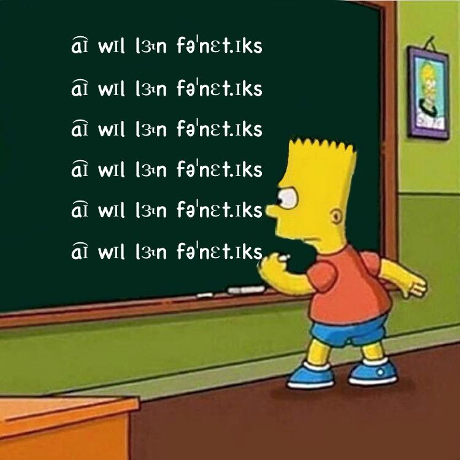
]
.pull-right[
.pull-left[
1. [ˈbʌ.tər.flaj]  
2. [ˈʌŋ.kl]  
3. [ˈrʌ.bər]  
4. [rajt]  
5. [ˈeə.pɔːt]  
6. [ˈɔ.ɡəst]  
7. [ɡə.ˈrɪ.lə]  
8. [məs.ˈki.tow]
]
]

---
## **Exercise V: IPA to English (Complex)**
 
what **English words** do these **phonetic transcriptions** correspond to?  
.pull-left[
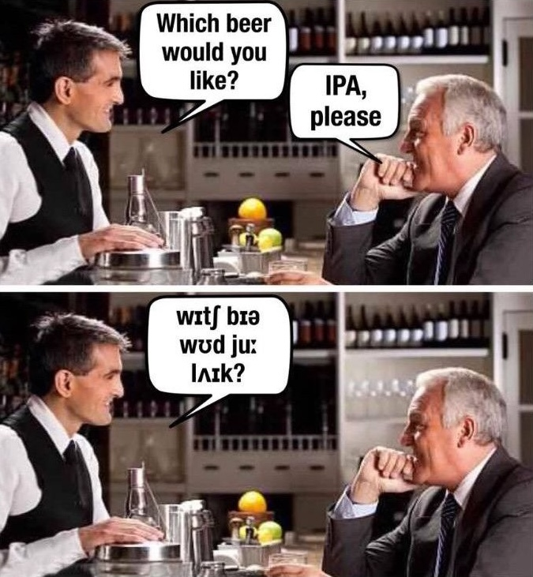
]
.pull-right[
.pull-left[
1. [ˈbʌ.tər.flaj]  
2. [ˈʌŋ.kl]  
3. [ˈrʌ.bər]  
4. [rajt]  
5. [ˈeə.pɔːt]  
6. [ˈɔ.ɡəst]  
7. [ɡə.ˈrɪ.lə]  
8. [məs.ˈki.tow]
]
.pull-right[
<b>butterfly</b>  
<b>uncle</b>  
<b>rubber</b>  
<b>right</b>  
<b>airport</b>  
<b>August</b>  
<b>gorilla</b>  
<b>mosquito</b>
]
]

---
## **Review: Convention of IPA Transcription**
 
.pull-left[
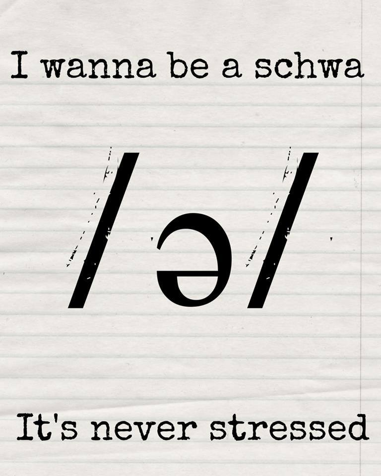
]
.pull-right[
1. spelling (orthography) is written in *<b>italics</b>* or <b>angle brackets</b>: *banana*, <b><</b>banana<b>></b>  
2. <b>all</b> sounds and <b>only</b> sounds are written:
  
  - no silent letters 
  <b>ph</b>on<b>e</b> [ˈfown]; throu<b>gh</b> [ˈθɹu]
  - write out actually pronounced sounds 
  ne<b>x</b>t [ˈnɛkst], e<b>x</b>am [əɡ.ˈzæm]
  
3. phonetic transcriptions are put between **square brackets [</b>**bə.ˈnæ.nə**]**  
4. a dot (.) indicates <b>syllable divisions</b>: pronunciation [prə<b>.</b>ˌnʌn<b>.</b>si<b>.</b>ˈej<b>.</b>ʃən]  
5. <b>primary</b> and <b>secondary</b> stress are indicated with <b>ˈ</b> and <b>ˌ</b> <b>before</b> the stressed syllable
]

---
## **Review: Convention of IPA Transcription**

<h3><b><i>Edinburgh</i></b></h3>

 

--

.pull-left[
- spelling (orthography) is written in *<b>italics</b>* or <b>angle brackets</b>: *banana*, <b><</b>banana<b>></b>
]

--

.pull-right[

<b>< </b>edinburgh<b> ></b>

]  

--

.pull-left[
- <b>all</b> sounds and <b>only</b> sounds are written
  - no silent letters 
  - write out actually pronounced sounds
]

--

.pull-right[

< edinbur<b>gh</b> >

]  

--

.pull-left[
- phonetic transcriptions are put between **square brackets [**bə.ˈnæ.nə**]**
]

--

.pull-right[

<b>[ </b>ɛdɪnbəɹə<b> ]</b>

]  

--

.pull-left[
- a dot (.) indicates <b>syllable divisions</b>: pronunciation [prə<b>.</b>ˌnʌn<b>.</b>si<b>.</b>ˈej<b>.</b>ʃən]
]

--

.pull-right[

[ ɛ<b>.</b>dɪn<b>.</b>bə<b>.</b>ɹə ]

]  

--

.pull-left[
- <b>primary</b> and <b>secondary</b> stress are indicated with <b>ˈ</b> and <b>ˌ</b> <b>before</b> the stressed syllable
]

--

.pull-right[

[ <b>ˈ</b>ɛ.dɪn.bə.ɹə ]

]

---
## **Exercise VI: English to IPA**
 
represent the following **English words** each with a **phonetic transcription**   
.pull-left[
.pull-left[
1. camera  
2. cotton  
3. decision  
4. length  
5. weather  
6. judge  
7. visionary
]
]
.pull-right[

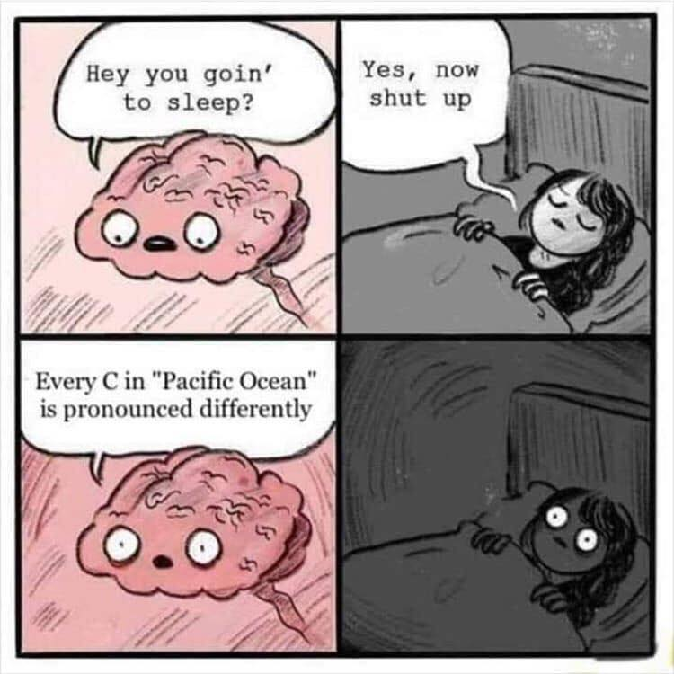  

]

---
## **Exercise VI: English to IPA**
 
represent the following **English words** each with a **phonetic transcription**   
.pull-left[
.pull-left[
1. camera  
2. cotton  
3. decision  
4. length  
5. weather  
6. judge  
7. visionary
]
.pull-right[
<b>[ˈkæ.m(ə).ɹə/]</b>  
<b>[ˈkɑ.ʔn̩]</b>  
<b>[dɪ.ˈsɪ.ʒən]</b>  
<b>[lɛŋθ]</b>  
<b>[ˈwɛ.ðər]</b>  
<b>[d͡ʒʌd͡ʒ]</b>  
<b>[ˈvɪ.ʒəˌnɛ.ɹi]</b>
]
]
.pull-right[

  
<b>[ˌpə.ˈsɪ.fɪk ˈow.ʃən]</b>

]

---
class: center, middle
## **CHALLENGE**
  
write a **phonetic transcription**   
of your name  
how would you describe   
each <b>vowel</b> and <b>consonant</b>?

---
class: center, middle
# **ˈfaɪnəl ɪɡˈzæm ɪz ˈkʌmɪŋ sun**    
# **bʌt aɪ sərˈvaɪvəd fəˈnɛtɪks klas**

---
class: center, middle
**Assignment VII** is due this Friday (**Nov 20th**)  
<b>reading</b> - **Phonology**: The Function and Patterning of Sounds 
in O'Grady et al.'s *Contemporary Linguistics: An Introduction*  
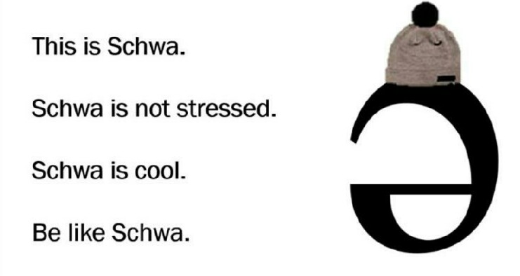&nbsp;&nbsp;&nbsp;&nbsp; 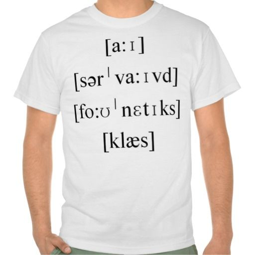
  
Slides created via the R package [**xaringan**](https://github.com/yihui/xaringan).

